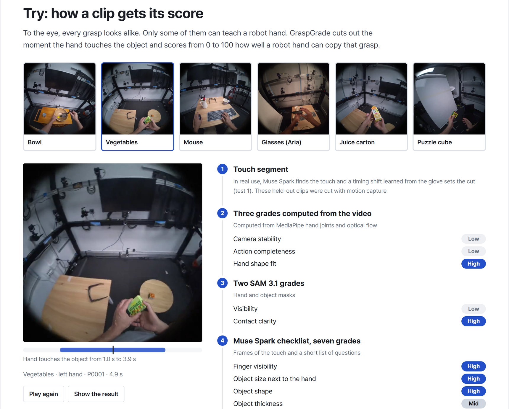

<h1 align="center">GraspGrade</h1>

<p align="center"><b>Find the hand videos a robot can learn from.</b></p>

<p align="center">
GraspGrade cuts human egocentric hand video at the moment a hand touches an
object, and scores each clip from 0 to 100 for how well a robot hand could
copy the grasp. Video is the only input. SAM 3.1 tracks hands and objects,
Muse Spark answers a short checklist, and a logistic regression turns twelve
grades into the score, so every weight is visible. Every step is checked
against sensors: a tactile glove for contact timing, and motion capture moved
onto an Allegro robot hand for the grasp. On 1,426 held-out clips the score
reaches AUC 0.624, where Muse Spark asked directly is at chance (0.501).
</p>

<p align="center">
  
  
  
  
  
  
</p>

<p align="center">
  <a href="https://graspgrade.vercel.app/en">Live site</a> ·
  <a href="https://graspgrade.vercel.app/demo?lang=en">Demo video</a> ·
  <a href="https://graspgrade.vercel.app/try?lang=en">Try it</a> ·
  <a href="https://graspgrade.vercel.app/logs">Experiment log</a> ·
  <a href="benchmark/">Benchmark</a> ·
  <a href="paper/main.pdf">Paper</a> ·
  <a href="docs/MEASUREMENT_PLAN.md">Measurement plan</a>
</p>

<p align="center">
  <a href="https://graspgrade.vercel.app/try?lang=en">
    
  </a>
</p>

## Problem

Human egocentric video is the easiest robot training data to collect and to
grow. To use it, you need to find when a hand touches and leaves an object,
and which grasps a robot hand could copy. Today this is judged by looking at
the video only, with no check against real contact or a real robot.

## What we built

Video is the only input. Muse Spark finds when each touch starts and ends,
with one timing shift learned from the glove. Muse Spark then grades each
clip on a short checklist, and SAM 3.1 masks and three video checks add five
more grades. Two kinds of sensor data are used only to check the work:

1. **When does a touch start and end?** Checked against a touch-sensing
   glove (OpenGraph Ego-Tactile).
2. **Can a robot hand copy this grasp?** Checked against motion capture of
   hands and objects (Meta HOT3D), with each human grasp moved onto an
   Allegro robot hand and tested for collision, reach and grip.

The score is a logistic regression on twelve grades, so every weight is
visible. Every comparison, threshold and pass rule was written in
[docs/MEASUREMENT_PLAN.md](docs/MEASUREMENT_PLAN.md) before the held-out
data was scored. Both sensor label sets and their scorers are packed as a
benchmark in [benchmark/](benchmark/) (EXP-28).

## Built during the hackathon

All of this repository was written by our team between Oct 26 and Nov 4.
The first commit is from Oct 27.

| Built by us | Used as is, not ours |
| --- | --- |
| The pipeline: contact rules, timing shift, checklist prompts (`scripts/prompts/`), grades and the logistic regression score | Meta models through the API: SAM 3.1, Muse Spark |
| The two sensor label sets: cleaned glove contact, and the robot copy label (retargeting onto the Allegro hand, collision, reach and grip) | Datasets: OpenGraph Ego-Tactile, HOT3D |
| The benchmark files and their scorers, the measurement plan and all 42 experiments | Libraries: MediaPipe, dex-retargeting (with its Allegro hand model), scikit-learn, OpenCV, numba, trimesh, meta-sam-parser, MuJoCo |
| The site: report, viewer, Try page, demo page | Robot model in the first demo scene: Apptronik Apollo from MuJoCo Menagerie (Apache 2.0), rendered by us |
| The demo video: script, charts, cards, robot render and editing | English voice: ElevenLabs. Korean voice: Windows built-in voice |

## Results

| Question | Metric | Muse Spark asked directly | Our method | Notes |
| --- | --- | --- | --- | --- |
| Contact timing, 22 held-out episodes | Boundary F1 ±5 frames | 0.074 | **0.195** | Contact IoU 0.850, Muse Spark asked directly 0.821 (EXP-37) |
| Copyable grasps, 1,426 held-out clips | AUC (0.5 is chance) | 0.501 | **0.624** | Unseen objects 0.571, object name baseline 0.771 (EXP-40) |

- Contact timing: video shows a touch before the glove feels pressure. A
  timing shift learned on tuning data makes Muse Spark alone the best method.
  All methods are low at ±5 frames, because video cannot see pressure.
- Copyable grasps: the gain comes from the checklist (+0.117 over Muse Spark
  asked directly). Learning the weights adds +0.005.
- When an object was seen before, its name alone does better (0.771). On
  objects never seen in training our score keeps 0.571.

## Scope and limits

- The score is for rigid objects. Filtering out soft objects automatically
  is not yet reliable: Muse Spark held back 51.7% of soft segments against a
  rule of 70% (EXP-42).
- The score works at the object level. It cannot rank grasps of the same
  object (0.506).
- With a strict 2 mm depth limit in the robot check, the score drops to
  chance (0.521, EXP-41). At the 5 mm limit fixed in advance and at 10 mm it
  holds.
- The robot check is geometric, with one robot hand. Both datasets were
  recorded in a lab, and the held-out set for copyable grasps has three
  people.

## Use on other video

The same steps can run on egocentric video without sensors. They need only
the video and calls to SAM 3.1 and Muse Spark, and they reuse the timing
shift and checklist weights learned here. This has not been measured yet.
Contact timing and the score were tested on two separate datasets, the joined
steps were not scored end to end, and no third dataset was tried. Data with
sensor labels can be measured with the same metrics through the benchmark
scorers.

## Running it

The code runs in WSL2 Ubuntu 24.04 with Python 3.12.

```bash
bash scripts/setup_wsl.sh          # system packages, venv, pinned packages
cp .env.example .env               # then fill in MODEL_API_KEY
.venv/bin/python scripts/verify_env.py
```

Scripts that call the Meta API send requests only with `--send`. Without it
they prepare the inputs and print the cost. Answers are cached in `out/`,
which is not in git. With that cache the final results come from these
commands without new calls. A fresh clone needs the datasets and new calls
first.

```bash
.venv/bin/python scripts/muse_contact.py score --split held_out --segments out/contact/rule_segments_applied.json
.venv/bin/python scripts/number1_final_report.py
.venv/bin/python scripts/number2_score.py --final
.venv/bin/python scripts/number2_depth.py
.venv/bin/python scripts/muse_soft.py score
```

Site data and media:

```bash
.venv/bin/python scripts/viewer_data.py      # viewer/data and viewer/media
.venv/bin/python scripts/try_data.py         # web/assets/try for the Try page
.venv/bin/python web/tools/demo_video.py --voice el   # English demo video, ElevenLabs voice
```

## Layout

| Path | What |
| --- | --- |
| `scripts/` | all code, one script per step, each with a usage note at the top |
| `docs/MEASUREMENT_PLAN.md` | what is compared, on which data, decided before the results |
| `docs/experiments/` | one page per experiment, with figures |
| `splits/` | fixed tuning and held-out splits (seed 20261026), soft object labels |
| `benchmark/` | sensor label files and standalone scorers |
| `viewer/` | static viewer of the final held-out results. Its data and videos are not in git, `scripts/viewer_data.py` makes them |
| `paper/` | the write-up in paper form (`main.tex`, `main.pdf`) |
| `web/` | the hosted site (report, demo, Try, experiment log) and its builders in `web/tools/` |
| `web/api/`, `web/worker/` | password protected labeling and video check pages: their endpoints and the worker that runs the pipeline on an uploaded video |

## Data

- OpenGraph Ego-Tactile Manipulation by OpenGraph Labs (CC BY 4.0): 72
  episodes, both hands with tactile gloves.
- HOT3D by Meta Platforms Technologies (Project Aria): the 136 Aria sequences
  with hand and object poses. Video CC BY-SA 4.0, hand annotations
  CC BY-NC-SA 4.0, object models CC BY-SA 4.0 and not for sale.

The full datasets are not in this repository. Short clips and frames from
both are, in the site folders and the figures, with credit.
[MEDIA_LICENSE.md](MEDIA_LICENSE.md) lists each file, what we changed and its
license.
