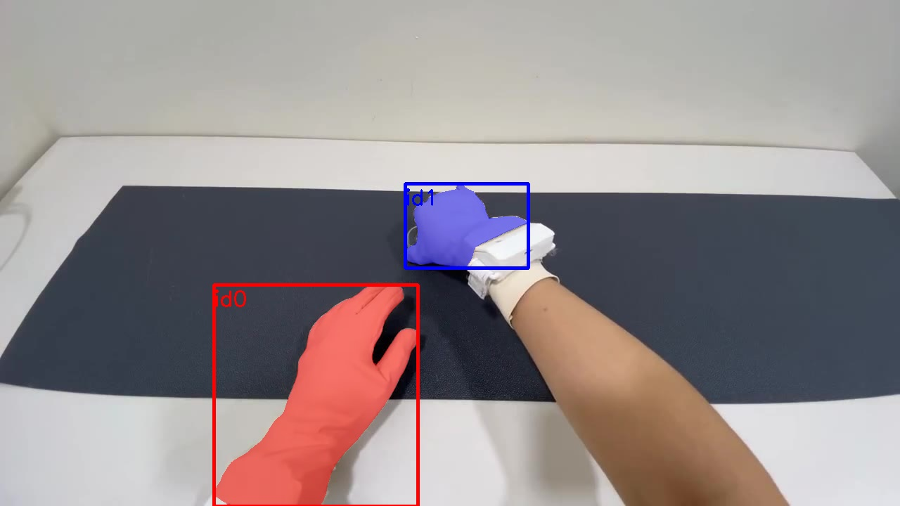

# EXP-01: Meta Model API smoke test

Date: 2026-10-27. Script: `scripts/meta_smoke.py`. Raw output: `out/meta_smoke/`.

## Question

Do Muse Spark and SAM 3.1 work on our data, what do the responses look like,
and what do they cost per call?

## Setup

- Input: OpenGraph episode 1 (tuning split), frames 270 to 419. That is a 5 second
  clip at 1280x720, H.264, 407 KB. The tactile glove says the right hand first
  touches the object at frame 321.
- Muse Spark: `muse-spark-1.3`, chat completions, one JPEG frame (frame 330),
  `reasoning_effort="low"`. The prompt asks which hand is touching, the object,
  and how visible the fingertips are, as JSON.
- SAM 3.1: `sam-3.1`, Responses API, the clip uploaded with the Files API,
  text prompt `hand`, streamed.

## Results

| | Muse Spark | SAM 3.1 |
| --- | --- | --- |
| Time | 6.0 s | 3.2 s upload, first frame after 3.0 s, done after 22.4 s |
| Usage | 1,261 input tokens (the 720p image is about 1,100), 780 output tokens of which 714 are reasoning | 150 frames processed, 0 tokens |
| Cost | $0.0049 | $0.03 ($0.20 per 1,000 frames) |
| Answer | right hand touching, left hand not touching, object "mat" | both hands found in all 150 frames, with stable ids |

The Muse Spark answer matches the tactile label for frame 330.

*SAM 3.1 with the prompt `hand`, frame 330. Red is object id 0 (left hand),
blue is object id 1 (right hand). The right hand mask covers the glove
fingers but not the white sensor box on the wrist.*

## Response format

- SAM 3.1 sends one `response.output_text.delta` event per frame and ends with
  `response.completed`.
- Each line is a frame marker `<Nf>` and then, per object, an id, a box token
  with corners in source pixels, and a mask token. The mask is a raster the
  size of the box, encoded in base85.
- Meta's own Python parser, `meta-sam-parser` 0.1.0, reads the stream and
  decodes the masks. We use it as is.
- Raw output is about 15 KB per frame (2.28 MB for this clip).

## What it means for the budget

At these prices, SAM 3.1 over all 138,629 OpenGraph frames costs about $28
per text prompt. All 480,375 HOT3D frames with ground truth would cost about
$96 per prompt, which does not fit the $150 credit. So HOT3D clips are
selected first from motion capture, and only those clips go to SAM.

## Note

The first call failed with HTTP 401. The key line in `.env` had the variable
name twice (`MODEL_API_KEY=MODEL_API_KEY=...`). Fixing the line fixed the call.
