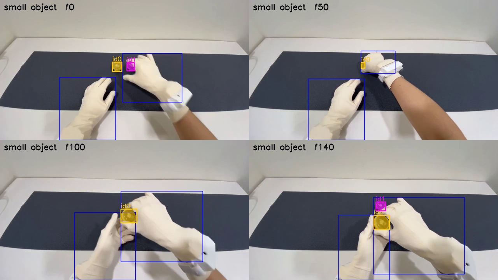

# EXP-02: Which text prompt finds the objects? (small container clip)

Date: 2026-10-27. Scripts: `scripts/meta_smoke.py`, `scripts/sam_prompt_compare.py`.
Raw output: `out/meta_smoke/prompt_compare.json`. Meta API cost: $0.15.

## Question

SAM 3.1 takes one short text prompt per call. Our contact signal needs object
masks for any object, so we need one generic prompt that works across the
dataset. Which prompt is that?

## Setup

- Same 5 second clip as EXP-01: OpenGraph episode 1, frames 270 to 419. Two
  small round containers on a dark mat. The right hand picks one up. The
  tactile glove says contact starts at clip frame 51.
- Four generic prompts: `object`, `held object`, `item`, `small object`.
- One specific prompt as a reference: `round container`.
- Each call is billed for all 150 frames, even when nothing is found.

## Results

| Prompt | Frames with an object | Objects per frame | Ids (frames seen) | Boxes on a hand |
| --- | --- | --- | --- | --- |
| `object` | 0% | 0 | none | |
| `held object` | 0% | 0 | none | |
| `item` | 0% | 0 | none | |
| `small object` | 100% | 1.45 | 0 (150), 1 (56), 2 (11) | 0% |
| `round container` | 100% | 1.37 | 0 (150), 1 (56) | 0% |

*Prompt `small object`. Blue boxes are the hands from the `hand` prompt.
Coloured masks are the objects SAM found.*

*Prompt `round container`, the specific name, for reference.*

- `small object` gives almost the same result as the specific name. Its one
  extra id (id 2, frames 7 to 17) is a small false box near the right wrist.
- Very generic words (`object`, `item`, `held object`) find nothing.
- Hand masks and object masks are within 3 pixels of each other in 100% of
  frames before the tactile contact (98% for `round container`) and in 100%
  after it. Seen from the head, the hand covers the object long before it
  touches it.

## Conclusion

- `small object` is the first candidate for a generic object prompt.
- 2D overlap alone cannot tell touch from occlusion. The contact signal also
  needs co-movement: after a real grasp, the object moves with the hand.
