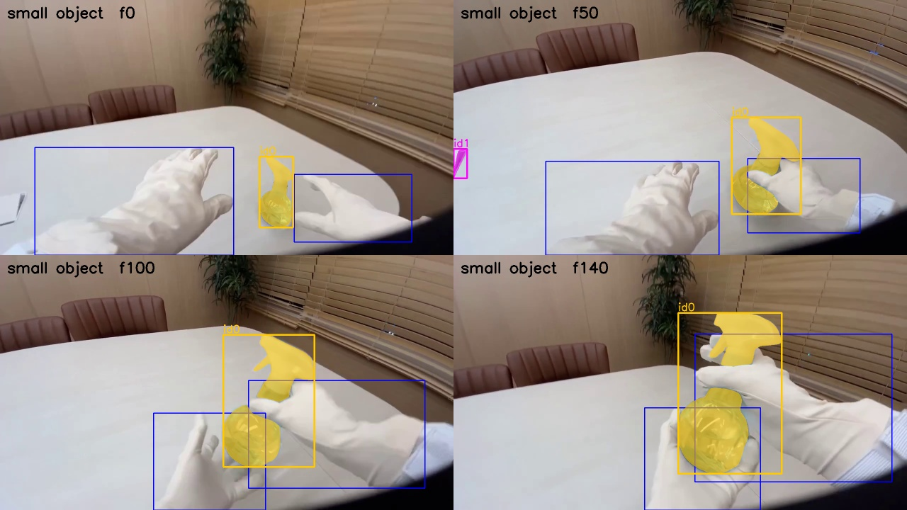
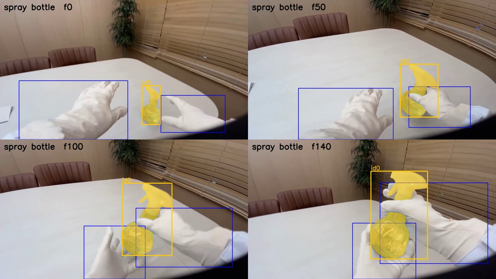

# EXP-03: Does the generic prompt hold on a large object? (spray bottle clip)

Date: 2026-10-27. Scripts: `scripts/meta_smoke.py`, `scripts/sam_prompt_compare.py`.
Raw output: `out/meta_smoke/ep53/`. Meta API cost: $0.15 (5 calls of 150 frames).

## Question

EXP-02 picked `small object` on a clip with small containers. Spray bottle
tasks are about 20% of all frames, the bottle is large, and the background is
a beige table close to the glove colour. Does `small object` still work there?

## Setup

- OpenGraph episode 53 (tuning split), frames 136 to 285, 5 seconds at 720p.
  The right hand reaches for a spray bottle on the table. The tactile glove
  says contact starts at clip frame 50. The head moves in this episode
  (see EXP-04).
- Prompts: `hand` (for the hand masks), `small object`, `handheld object`,
  `bottle`, and the specific name `spray bottle` as a reference.

## Results

| Prompt | Frames with an object | Objects per frame | Ids (frames seen) | Boxes on a hand | Time |
| --- | --- | --- | --- | --- | --- |
| `handheld object` | 0% | 0 | none | | 6.9 s |
| `small object` | 100% | 1.44 | 0 (150), 1 (66) | 0% | 16.9 s |
| `bottle` | 100% | 1.00 | 0 (150) | 0% | 14.9 s |
| `spray bottle` | 100% | 1.00 | 0 (150) | 0% | 17.2 s |

`hand` found both gloved hands in all 150 frames (22.2 s).

*Prompt `small object`. Id 0 (yellow) is the spray bottle in every frame. Id 1
(pink, left edge) is another object at the edge of the table.*

*Prompt `spray bottle`, the specific name, for reference. The bottle mask is
the same as with `small object`.*

- `small object` finds the large bottle in every frame, with the same mask as
  the specific name. It also picks up one background object (id 1, 66 frames).
- `handheld object` finds nothing, like the other very generic words in EXP-02.
- No prompt put a box on a glove, even on the beige table.
- Right hand and object masks are within 3 pixels in 76% to 80% of frames
  before contact and 100% after. Better than the container clip, but still
  far from a usable contact signal on its own.

## Conclusion

- `small object` works on both a small and a large object. We use it as the
  single object prompt for OpenGraph.
- Extra background objects are expected. The contact step keeps only the
  object that moves with a hand.
- Cost check: one prompt over all OpenGraph frames is about $28 at 30 fps.
  With `hand` and `small object`, the full run is about $55, or about $18 at
  10 fps if the 10 fps test in EXP-04 holds.
