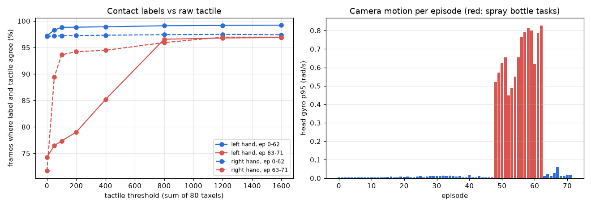

# EXP-04: Cleaning OpenGraph without any API call

Date: 2026-10-27. Scripts: `scripts/refine_check.py`, `scripts/refine_plots.py`.
Output: `out/refine_check/summary.json`, `out/refine_check/per_episode.csv`.
Cost: $0. Everything here runs on the local CPU.

## Question

Before we spend credit on SAM 3.1, what can the dataset itself tell us about
label quality, ground truth, and camera motion?

## 1. The contact labels follow a thresholded tactile signal

OpenGraph labels which hand is in contact (`annotation.hand`). We compared
this, frame by frame, with our own rule: a hand is touching when the sum of
its 80 taxels is above a threshold.

*Left: agreement between labels and the tactile rule as the threshold rises.
Right: head gyro p95 per episode.*

- With threshold 0 (any pressure), agreement is 97% for episodes 0 to 62 but
  only 72% to 74% for episodes 63 to 71. In those episodes the gloves read a
  small pressure at rest, so "any pressure" marks a hand as touching when it
  is not.
- With threshold 800, agreement is 98.7% (left) and 97.2% (right) over all
  138,629 frames, and 96.6% to 96.9% for episodes 63 to 71.
- Contact onsets with threshold 800: for the right hand, 93.5% of label
  onsets have a tactile onset within 5 frames (median offset 0). For the left
  hand it is 79.6% (median offset 1 frame, tactile first).

Use for the project: we can build a second, independent ground truth for
number 1 from the raw tactile data, but only with a threshold near 800 or a
resting baseline per episode. Plain "any pressure" is wrong for 9 of 72
episodes.

## 2. No short blips to clean

There are 261 contact segments. None is shorter than 5 frames and no gap
between two contacts is shorter than 5 frames. Segment length is 24 frames
at p10, 246 at the median, and 978 at p90. The labels need no smoothing
before we score boundaries with a 5 frame window.

## 3. Camera motion is known for free

The head IMU gyro splits the data into two groups. In episodes 0 to 47 and 63
to 71 the camera is almost still (p95 at most 0.06 rad/s). In the spray bottle
episodes 48 to 62 the head moves (p95 0.45 to 0.83 rad/s).

Use for the project: the "camera stability" check, which we compute from the
video only, can be tested against the IMU at no cost. It also means camera
stability only varies inside the spray bottle group in OpenGraph.

## 4. Cheaper SAM input, not yet tested

SAM 3.1 is billed per frame. Sending clips at 10 fps instead of 30 fps would cut
the OpenGraph bill from $27.73 to $9.24 per prompt. A 10 fps step is 0.1 s,
which is inside the 0.167 s (5 frame) boundary window, and boundaries can be
refined locally at 30 fps. This needs one paid test to check that tracking
holds at 10 fps.

## Other API free steps for later

- HOT3D: pick contact clips from motion capture (hand to object distance) and
  drop frames that fail the dataset QA flags (434,452 of 480,375 pass). Only
  those clips go to SAM.
- HOT3D: `box2d_hands.csv` has ground truth 2D hand boxes. It checks SAM hand
  boxes at no cost.
