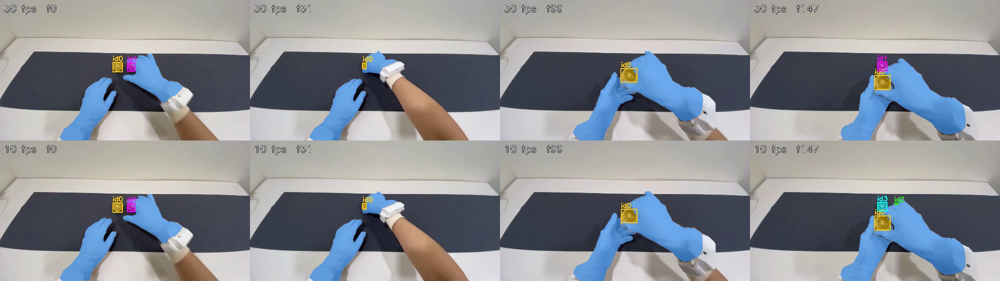
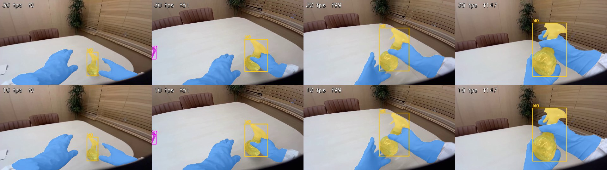
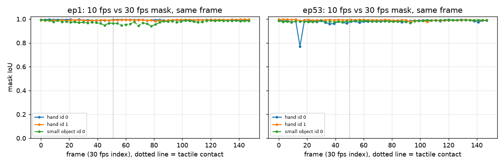

# EXP-05: Can we send SAM 3.1 a 10 fps clip instead of 30 fps?

Date: 2026-10-27. Scripts: `scripts/meta_smoke.py --step 3`, `scripts/sam_fps_compare.py`.
Raw output: `out/meta_smoke/fps10/`. Meta API cost: $0.04 (4 calls of 50 frames).

## Question

SAM 3.1 video is billed per frame. If we keep every third frame, the same
5 seconds cost a third as much. Do the hand and object tracks stay the same?

## Setup

- The same two clips as EXP-02 and EXP-03:
  - ep1: OpenGraph episode 1, frames 270 to 419, two small containers, the
    right hand picks one up. Tactile contact at clip frame 51.
  - ep53: OpenGraph episode 53, frames 136 to 285, spray bottle, the head
    moves. Tactile contact at clip frame 50.
- The 10 fps clip keeps clip frames 0, 3, 6, up to 147 (50 frames). Each
  10 fps frame was checked against its 30 fps twin (pixel MSE 1.6 to 5.4,
  against 78 to 206 for the next frame), so frame k at 10 fps is frame 3k at
  30 fps.
- Prompts `hand` and `small object`. The 30 fps runs are the ones from EXP-02
  and EXP-03, compared on the same 50 frames.
- Mask IoU: for each 10 fps object id we take the 30 fps id that overlaps it
  most. A frame where only one of the two runs has the object counts as 0.

## Results

### Main tracks

| Clip | Track | Frames found, 10 fps / 30 fps | Mask IoU mean | Mask IoU min |
| --- | --- | --- | --- | --- |
| ep1 | left hand | 50 / 50 | 0.992 | 0.987 |
| ep1 | right hand | 50 / 50 | 0.991 | 0.981 |
| ep1 | grasped container | 50 / 50 | 0.974 | 0.940 |
| ep53 | left hand | 50 / 50 | 0.990 | 0.975 |
| ep53 | right hand | 50 / 50 | 0.978 | 0.770 |
| ep53 | spray bottle | 50 / 50 | 0.983 | 0.968 |

All six tracks keep the same id in all 50 frames. The one low value (0.77,
ep53 right hand, clip frame 15) is a single frame where the 10 fps mask
reaches further right (box right edge at x = 1231 against 1111). The next
frame is back at 0.98.

*ep1. Top row 30 fps, bottom row 10 fps, same source frames. Blue: hand masks.
Yellow: the grasped container (id 0). At frame 147 the second container is id 1
at 30 fps but id 3 at 10 fps.*

*ep53. The spray bottle (id 0) and both hands look the same at both frame
rates. Id 1 (pink, left edge) is the background object seen in EXP-03.*

*Mask IoU between the 10 fps and 30 fps results on the same frame, for the
tracks that last the whole clip. Hand id 0 is the left hand in ep1 and the
right hand in ep53. Small object id 0 is the grasped object in both.*

### Side tracks

- ep1, second container: it is hidden under the right hand from about clip
  frame 7 to 101. At 30 fps it comes back with its old id. At 10 fps it comes
  back as a new id (id 2 for one frame, then id 3). In the 14 frames where
  both runs see it, the masks agree (median IoU 0.97).
- ep1, false box near the right wrist (the id 2 from EXP-02): present at both
  frame rates in the same frames (clip frames 9 to 15). At 10 fps the id 2
  label is later reused for the returning container and a tiny box.
- ep1: two tiny extra boxes (about 21 x 6 pixels) in the last two 10 fps
  frames, not in the 30 fps run.
- ep53, background object: 21 frames at 10 fps against 22 at 30 fps, mean
  IoU 0.89.

### Contact cue and speed

| | ep1 10 fps | ep1 30 fps | ep53 10 fps | ep53 30 fps |
| --- | --- | --- | --- | --- |
| Right hand within 3 px of an object, before contact | 94% | 100% | 82% | 82% |
| Same, after contact | 100% | 100% | 100% | 100% |
| `hand` stream time | 9.5 s | 22.4 s | 9.4 s | 22.2 s |
| `small object` stream time | 5.7 s | 9.6 s | 5.9 s | 16.9 s |
| `hand` raw output | 0.71 MB | 2.28 MB | 0.87 MB | 2.57 MB |

The 30 fps columns use the same 50 frames. The one ep1 difference before
contact is a single frame where the 30 fps run still had a thin sliver of the
second container next to the hand.

## Conclusion

- At 10 fps, SAM 3.1 gives the same hand and grasped-object tracks as at
  30 fps: same ids, mask IoU 0.97 to 0.99. We will send 10 fps clips.
- What we lose: an object that stays hidden for about 3 seconds may come back
  with a new id. The contact step only needs the object that moves with the
  hand, so this does not change it. If we need one id per object, we can join
  tracks by position after the gap.
- Contact timing is measured at 30 fps, so a 10 fps signal has a step of
  3 frames (0.1 s). That is inside the ±5 frame target, but it uses up to a
  third of it. Muse Spark boundary checks can still look at the 30 fps frames
  around each boundary.
- Cost: one prompt over all OpenGraph frames drops from about $27.7 to $9.2.
  `hand` plus `small object` drops from about $55 to about $18. It is also
  2 to 3 times faster and gives a third of the raw output.
