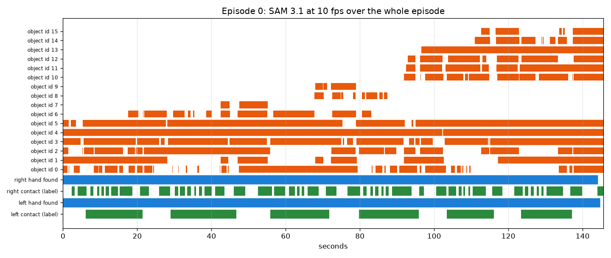
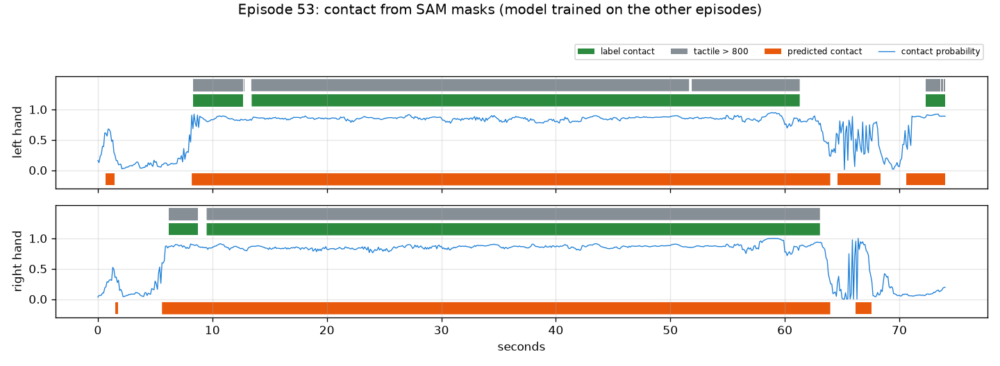
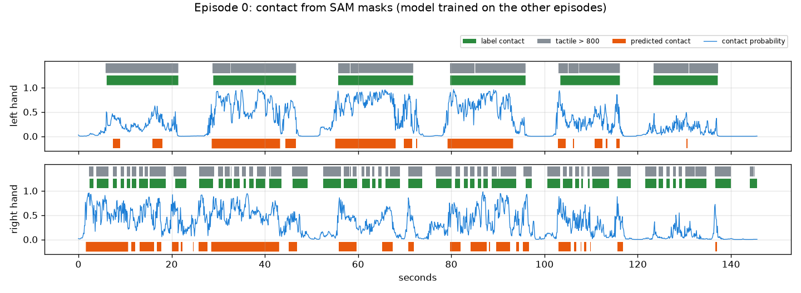
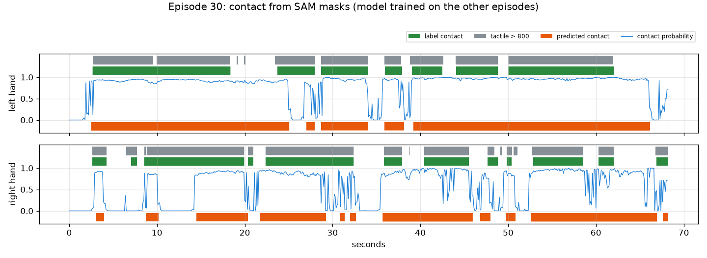

# EXP-06: Contact cutting pilot on three whole episodes

Date: 2026-10-27. Scripts: `scripts/sam_episodes.py`, `scripts/sam_fast.py`,
`scripts/sam_track_check.py`, `scripts/contact_cut.py`.
Raw output: `out/sam10/`, `out/contact/`. Meta API cost: $1.15 (6 calls, 5,762 frames).

## Question

Before we send all 50 tuning episodes, does SAM 3.1 keep its tracks over a
whole episode (1 to 2.5 minutes), and does our contact pipeline run end to
end and give a first signal?

## Setup

- Three tuning episodes with different tasks:
  - ep0: 146 s, moving small black and white discs between clear containers.
    The right hand touches 48 times.
  - ep30: 68 s, orange cardboard box.
  - ep53: 74 s, spray bottle, the head moves.
- Each whole episode goes to SAM 3.1 as one 10 fps clip (EXP-05), once with
  `hand` and once with `small object`. SAM takes up to 15,000 frames per
  request. Our longest episode has 1,457 frames at 10 fps.
- Masks are decoded with `sam_fast.py`. It runs the same decoder as the
  official `meta-sam-parser`, compiled with numba. On 345 masks the result was
  bit for bit the same, at about 3 ms per mask instead of 400 ms.
- Contact model (`contact_cut.py`), per 10 fps frame and hand:
  - 13 features: the gap between the hand mask and the nearest object mask,
    the share of that object next to the hand, object motion with camera
    motion removed, whether object and hand move together, hand motion,
    visible object area, number of objects.
  - The same features from 6 frames before to 6 frames after are added as context.
  - A logistic regression gives a contact probability. Smoothing and two
    thresholds turn it into segments, which go back to 30 fps.
- Baseline rule: contact when the hand mask is within 3 px of an object mask.
- Scoring: leave one episode out (train on two, test on the third). Ground
  truth is the dataset label, with tactile sum above 800 as a check.
  - Boundary F1 at ±5 frames (0.167 s) and ±15 frames (0.5 s). Starts and
    ends are matched one to one, only to the same kind.
  - Contact IoU over all frames.

## Results

### SAM over whole episodes

| | ep0 | ep30 | ep53 |
| --- | --- | --- | --- |
| Request time (`hand` / `small object`) | 77 s / 83 s | 44 s / 44 s | 48 s / 49 s |
| Raw output, both prompts, gzip | 127 MB | 94 MB | 81 MB |
| Frames with a hand | 99.4% | 99.0% | 100% |
| Hand ids | 2 | 2 | 3 (one lives 6 frames) |
| Objects per frame, mean / max | 6.9 / 12 | 2.3 / 4 | 1.6 / 3 |
| Object ids | 16 | 4 | 5 |
| Left hand found in left-contact frames | 100% | 100% | 96.7% |
| Right hand found in right-contact frames | 98.3% | 97.2% | 100% |

All six requests ran in parallel in 93 seconds. The two hand ids last the
whole episode in all three cases.

*Episode 0. Blue: SAM found the hand. Green: the hand is in contact (label).
Orange: object ids from `small object`. The scene has many discs and
containers, so SAM uses 16 object ids, up to 12 in one frame. The limit is 16.*

One thing had to be fixed first. Our first rule called a hand id left or right
from its median position in the image. Hands cross the image centre often. In
ep53 the left hand spends 56% of its frames right of the centre, so it was
called the right hand. We now use frames that show both hands: the id that is
more often the left one of the pair is the left hand. The table above uses
the fixed rule.

### First contact numbers (3 episodes only)

| Method | Ground truth | Boundary F1 ±5 | Boundary F1 ±15 | Contact IoU |
| --- | --- | --- | --- | --- |
| Rule, gap ≤ 3 px | label | 0.00 | 0.07 | 0.74 |
| Logistic regression | label | 0.18 | 0.31 | 0.64 |
| Rule, gap ≤ 3 px | tactile | 0.01 | 0.07 | 0.75 |
| Logistic regression | tactile | 0.16 | 0.30 | 0.64 |

The rule has a higher IoU because it marks long blocks of "contact". The
hand is next to some object most of the time. But it finds almost no
boundaries.

Without any shift, our starts come 6 frames (0.2 s) before the label starts
(median). Ends have no delay (median 0). That means the hand looks like it
touches before the glove feels pressure. The pipeline now moves starts by
the median delay seen in the training episodes.

How well single frames are separated (ROC AUC of the model probability, each
episode left out):

| | ep0 | ep30 | ep53 |
| --- | --- | --- | --- |
| Left hand | 0.93 | 0.70 | 0.91 |
| Right hand | 0.59 | 0.65 | 0.92 |

*Episode 53, model trained on ep0 and ep30. Blue line: contact probability.
Green: label contact. Grey: tactile above 800. Orange: predicted contact.
The long holds are found. The short releases at 9 s and 13 s are missed, and the
ends come 1 to 3 s late, while the hands are still next to the bottle.*

*Episode 0. The left hand holds a container in six long blocks, and the
probability follows them. The right hand picks up small discs 48 times. It
never leaves the area next to the containers, so the probability cannot
separate touch from no touch.*

*Episode 30, cardboard box. Long contacts are found. Short gaps where the
hand rests on the box without pressure are often called contact.*

## Conclusion

- SAM 3.1 handles whole episodes at 10 fps. Hand ids last the whole
  episode, and each hand is found in 97% to 100% of its contact frames. We
  can send one request per episode.
- Cost and time are as planned: $0.20 per 1,000 frames, about 1 minute per
  request, about 100 MB of raw output per episode.
- The pipeline runs end to end. Large held objects are separated well from
  single frames (AUC 0.91 to 0.93). Quick pinches of small objects next to a
  container are not (AUC 0.59).
- Boundary F1 is low (0.18 at ±5 frames). This model was trained on only
  two episodes, so the number is not the final answer. It does show that
  masks alone will not place boundaries within ±5 frames. The Muse Spark
  boundary check in the plan is needed.
- Visible contact starts about 0.2 s before glove pressure. This is the
  delay the plan asked us to measure, but it comes from three episodes only.
- Note: the two thresholds were picked on the same out-of-fold
  probabilities that were scored, so these numbers are slightly optimistic.
