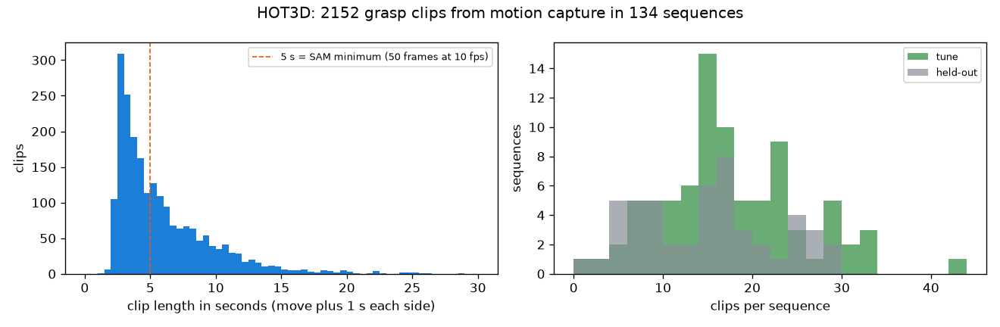

# EXP-07: How many grasp clips does HOT3D give, and what will number 2 cost?

> Note, 2026-10-27: this page counts clips for pricing only. The clip set used for number 2 is the one cut from hand to object distance in [EXP-11](exp11_number2_clips_and_labels.md): 400 tuning clips for the weights and all 1,426 held-out clips for the AUC. See [the measurement plan](../MEASUREMENT_PLAN.md).

Date: 2026-10-27. Script: `scripts/hot3d_clip_count.py`.
Raw output: `out/hot3d_clips/events.csv`, `summary.json`. Meta API cost: $0.

## Question

Number 2 sends HOT3D grasp clips to SAM 3.1 and Muse Spark. Sending every
frame of the 136 sequences that have ground truth would cost about $96 per
SAM prompt, so we only send clips around grasps. How many clips are there,
how long are they, and what do they cost?

## Setup

- All 136 Aria sequences with hand and object pose ground truth (85 tuning,
  51 held-out, 480,375 RGB frames). Motion capture only, no video.
- HOT3D objects move only when a hand moves them. Per object, at the RGB
  frame times (30 fps):
  - speed = position change over 0.2 s. A resting object reads about
    0.0003 m/s, a carried one 0.2 to 1 m/s. Moving means above 0.03 m/s.
  - Moves less than 0.5 s apart are joined. Moves shorter than 0.3 s, or
    that end less than 3 cm from where they began, are dropped.
  - One move is one grasp event. Its clip adds 1 s before (reach) and 1 s
    after (release).
- Two checks per event: a MANO wrist comes within 0.25 m of the object, and
  at least 90% of the clip frames pass the dataset QA mask.
- SAM price: $0.20 per 1,000 frames, at least 50 frames per request, 10 fps
  (EXP-05), two prompts (hand and object).
- This count is for pricing only. The clips for number 2 will be cut on
  Day 5 from the distance between the hand and the object.

## Results

| | Tuning | Held-out | All |
| --- | --- | --- | --- |
| Sequences | 85 | 51 | 136 |
| Grasp events (object moves) | 1,709 | 915 | 2,624 |
| Wrist within 0.25 m | 1,581 | 871 | 2,452 |
| Wrist near and clip passes QA | 1,439 | 713 | 2,152 |
| Move length, median | 2.3 s | 3.5 s | 2.7 s |
| Clip length, median / 90th percentile | 4.3 / 10.3 s | 5.5 / 11.7 s | 4.6 / 10.9 s |

*Left: clip lengths. 53% of clips are shorter than 5 s, so SAM bills them
as 50 frames. Right: clips per sequence. Two sequences have no usable clip.*

93% of moving objects have a wrist within 0.25 m, so object motion is a good
grasp detector. The most moved objects are the white mug (164 events), a
puzzle toy, a coffee pot and a cellphone.

### SAM cost for the 2,152 clips

| Option | Requests | Billed frames | Cost |
| --- | --- | --- | --- |
| Every frame of all 136 sequences, 30 fps, 2 prompts | 272 | 960,750 | $192 |
| One request per clip, 30 fps | 4,304 | 766,080 | $153 |
| One request per clip, 10 fps | 4,304 | 293,156 | $59 |
| Overlapping clips joined, 10 fps | 1,452 | 220,812 | $44 |
| All 713 held-out clips plus 400 random tuning clips, 10 fps | 2,226 | 158,070 | $32 |

## Conclusion

- HOT3D gives about 2,150 usable grasp clips, a median of 4.6 s each.
- Sending all of them to SAM at 10 fps costs about $59, or $44 if
  overlapping clips are joined. Muse Spark on every clip adds about $50
  (estimate, see below). Together that is too much next to the rest of the
  plan.
- We do not need every tuning clip. The score is a logistic regression with
  7 inputs, so a few hundred tuning clips are enough. The held-out clips are
  where the AUC and its confidence interval come from, so we keep all 713.
- Plan: all held-out clips plus 400 random tuning clips (seed 20261026),
  about $32 for SAM.
- Muse Spark estimate: two calls per clip (the two checklist items together,
  then the checklist-free baseline), 6 frames each, frames resized to 720 px
  (about 1,100 tokens each, measured in EXP-01 on OpenGraph frames). That is
  about $0.024 per clip, or about $27 for 1,113 clips. Token counts at
  HOT3D resolution are not measured yet.
