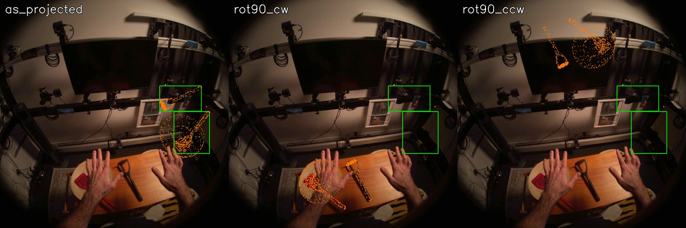
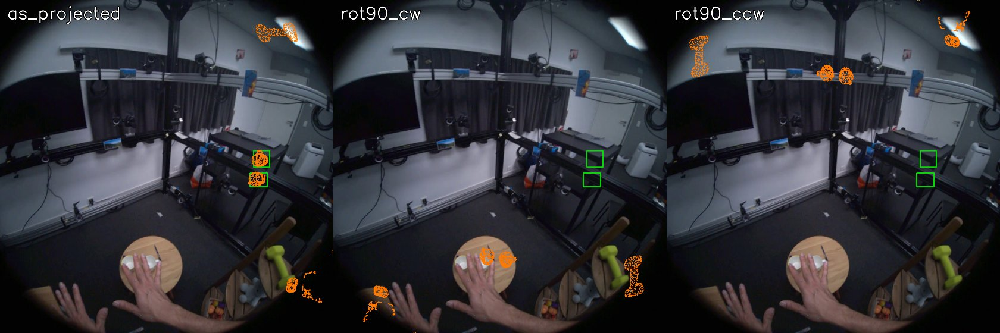

# EXP-08: Which image orientation does the HOT3D calibration use?

Date: 2026-10-27. Script: `scripts/hot3d_calib_check.py`.
Raw output: `out/hot3d_calib/report.json`. Meta API cost: $0.

## Question

Number 2 projects mocap hands and objects into the HOT3D video. We use
`preview_rgb.mp4`, which is upright. Raw Aria images are rotated 90 degrees.
The camera calibration in `ground_truth/camera_models.json` (FISHEYE624) and
the dataset 2D boxes may belong to either orientation. If we guess wrong,
every projection in number 2 lands in the wrong place.

## Setup

- Three sequences from three people: P0001_10a27bf7 (held-out),
  P0002_016222d1 and P0011_72efb935 (tuning).
- Check 1, calibration against the dataset 2D object boxes:
  - For 25 frames per sequence, project each object's 3D model (from
    `assets/*.glb`) with the mocap poses: object to world, world to headset,
    headset to RGB camera, then the FISHEYE624 lens model.
  - Compare the bounding box of the projected points with the box in
    `box2d_objects.csv` (stream 214-1, visibility above 0.6), as projected
    and after a 90 degree turn either way.
- Check 2, against the video itself (independent of the dataset boxes):
  - Run MediaPipe Hands on 150 preview frames per sequence. HOT3D hands are
    bare, so MediaPipe works here.
  - Compare its hand boxes with the dataset hand boxes (`box2d_hands.csv`)
    for each orientation and for frame offsets from -2 to +2. The video has
    one frame fewer than the RGB timestamps, so the time match needs checking too.
- Check 3, by eye: projected models drawn on the video frame.

## Results

### Check 1: projection against dataset object boxes (mean IoU)

| Sequence | Boxes | As projected | Turned 90° clockwise | Turned 90° counter-clockwise |
| --- | --- | --- | --- | --- |
| P0001_10a27bf7 | 68 | 0.86 | 0.00 | 0.00 |
| P0002_016222d1 | 116 | 0.98 | 0.02 | 0.02 |
| P0011_72efb935 | 111 | 0.95 | 0.01 | 0.01 |

The calibration and the dataset boxes agree with each other, so our
projection code (poses and lens model) is right. This check alone does not
say which orientation the video uses.

### Check 2: MediaPipe on the video against dataset hand boxes (mean IoU)

| Sequence | As given, offset 0 | Counter-clockwise, offset 0 | Clockwise, offset -1 | Clockwise, offset 0 | Clockwise, offset +1 |
| --- | --- | --- | --- | --- | --- |
| P0001_10a27bf7 | 0.01 | 0.00 | 0.41 | **0.43** | 0.42 |
| P0002_016222d1 | 0.03 | 0.00 | 0.43 | **0.45** | 0.44 |
| P0011_72efb935 | 0.00 | 0.00 | 0.37 | **0.38** | 0.38 |

The IoU tops out near 0.4 because a MediaPipe box only spans the 21 hand
landmarks, while the dataset box covers the whole visible hand. What matters
is where the peak is: clockwise, offset 0, in all three sequences.

### Check 3: by eye

*P0002_016222d1. Green: dataset object boxes as given. Orange: projected 3D
models. Only the clockwise panel puts the models on the real spatula and
plate on the table. The given boxes sit up near the monitor, in the wrong place.*

*P0001_10a27bf7. Clockwise puts the mug under the right hand and the
dumbbell on the green dumbbell.*

## Conclusion

- The calibration and the dataset 2D boxes (`box2d_objects.csv`,
  `box2d_hands.csv`) are in the raw Aria orientation. The preview video is
  that image turned 90 degrees clockwise.
- To use them with the preview video, map a raw pixel (u, v) to
  (1407 - v, u). The same holds for every projected mocap point.
- Preview frame k matches the k-th RGB timestamp (stream 214-1). The one
  missing video frame is at the end.
- This closes open issue 1 in the plan. Mocap hands and objects can now be
  drawn on the clips we will send to SAM, and SAM boxes can be checked
  against the dataset boxes after the same turn.
