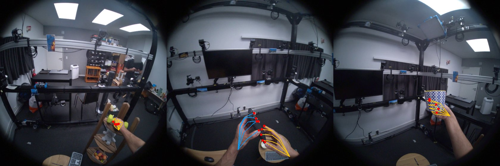
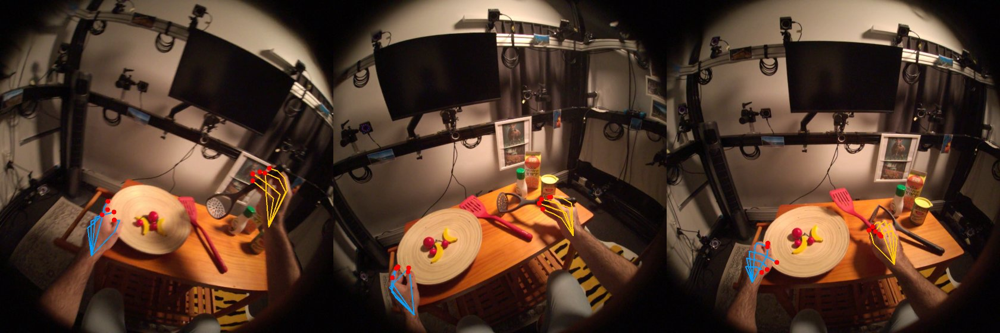

# EXP-09: Fingertip 3D positions from UmeTrack, without MANO

Date: 2026-10-27. Script: `scripts/hot3d_hands.py`.
Raw output: `out/hot3d_hands/report.json`, `tip_distances.csv`. Meta API cost: $0.

## Question

The copyable label in number 2 needs 3D fingertip positions next to the
object. HOT3D gives hands in two formats. MANO needs a separate model file
that requires registration on the MANO website. UmeTrack ships inside HOT3D.
Can we get fingertips from UmeTrack alone?

## Setup

- `hand_data/umetrack_hand_user_profile.json` holds a full kinematic hand
  model per person: 22 joints (rest positions in mm, rotation axes, parents),
  21 landmarks bound to bones, and a 788 vertex skinned mesh.
- `umetrack_hand_pose_trajectory.jsonl` holds, per timestamp and hand, 22
  joint angles and the wrist pose in the world frame.
- We wrote the forward kinematics: each joint turns by its angle about its
  axis through its rest position, on top of its parent, and each landmark
  moves with its bone. Landmarks 0 to 4 are the five fingertips.
- The profile describes one hand. The other hand is its mirror image, and
  we did not know which hand or which axis. We tried all four options per
  hand (no mirror, or mirror along x, y or z).
- Check 1: project the 21 landmarks into the raw image (lens model from
  EXP-08) and count how many fall inside the dataset hand box
  (`box2d_hands.csv`, hands at least 90% visible, box padded by 5%).
  120 frames per sequence.
- Check 2: draw the skeleton on the preview video (turned as in EXP-08).
- Check 3: for each grasp event from EXP-07 in these sequences, the distance
  from the closest fingertip to the object surface (20,000 points sampled on
  the 3D model), in the middle of the move and 1.5 s before it starts.
- Sequences: P0001_10a27bf7, P0002_016222d1, P0011_72efb935.

## Results

### Check 1: landmarks inside the dataset hand box

| Hand index | No mirror | Mirror x | Mirror y | Mirror z |
| --- | --- | --- | --- | --- |
| 0, P0001 / P0002 / P0011 | **1.00 / 1.00 / 1.00** | 0.06 / 0.05 / 0.07 | 0.72 / 0.66 / 0.58 | 0.99 / 0.99 / 0.99 |
| 1, P0001 / P0002 / P0011 | 0.05 / 0.05 / 0.06 | **1.00 / 1.00 / 1.00** | 0.06 / 0.05 / 0.06 | 0.06 / 0.06 / 0.06 |

Hand 1 only fits when mirrored along x. So the profile is hand 0 as it is,
and hand 1 is its x mirror. (For hand 0, mirror z also stays inside the box,
because a box cannot tell a hand from its mirror image. But a real profile
must fit one hand without mirroring, and hand 1 rules that out.)

### Check 2: skeleton on the video

*P0001_10a27bf7. Blue: hand 0. Orange: hand 1. Red dots: fingertips. The
skeletons sit on the real hands, holding the dumbbell, the phone and the mug.
Hand 0 is the left hand and hand 1 is the right hand.*

*P0002_016222d1. The right hand fingertips close around the potato masher handle.*

### Check 3: fingertip to object distance

| | Grasp events | Closest fingertip, median | 90th percentile | Within 15 mm | 2 or more fingertips within 15 mm |
| --- | --- | --- | --- | --- | --- |
| Middle of the move | 65 | 2.3 mm | 6.0 mm | 97% | 95% |
| 1.5 s before the move | 60 | 265 mm | 601 mm | 5% | 5% |

While an object moves, fingertips sit a few millimetres from its surface.
Before the move, the hand is far away. This is the signal the copyable label
is built on.

## Conclusion

- UmeTrack alone gives 21 hand landmarks with fingertips in 3D, in the same
  world frame as the objects. We do not need MANO and nobody needs to
  register for it.
- Hand 0 is the left hand and uses the profile as it is. Hand 1 is the
  right hand and is the profile mirrored along x.
- Fingertip to surface distances are accurate to a few millimetres during
  grasps, which is fine enough for the copyable rule ("thumb and at least
  one other finger near the surface, none deep inside").
- Next: send these landmarks to dex-retargeting (Allegro hand) and measure the
  Allegro fingertips against the object surface. That gives the copyable
  label, and then the label skew check on the tuning set (plan, risk 1).
