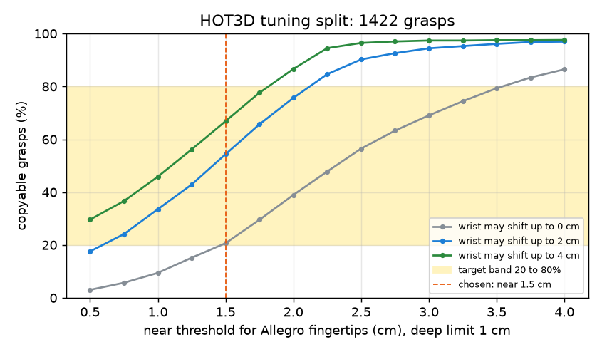
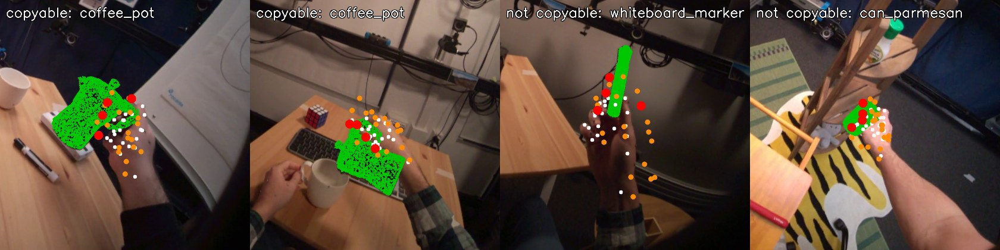

# EXP-10: Copyable labels from Allegro retargeting, and the label skew check

Date: 2026-10-27. Script: `scripts/hot3d_copyable.py`.
Raw output: `out/hot3d_copyable/tune_events.csv`, `tune_sd.npy`, `tune_report.json`.
Meta API cost: $0.

## Question

Number 2 needs a ground truth: can a robot hand copy this human grasp? The
plan defines it with an Allegro hand. The biggest known risk was label skew.
The Allegro hand is larger than a human hand, so a strict rule could call
almost nothing copyable, and a loose rule almost everything. The plan asks
for a copyable share between 20% and 80% on the tuning split. Does our label
land there, and how much does it depend on the thresholds?

## Setup

- Grasps: the EXP-07 events in the 85 tuning sequences (wrist near the
  object, clip passes QA). 1,422 of 1,439 had hand poses at the contact
  frame. Contact frame = the middle of the object move.
- Hand: the one whose fingertips are closest to the object. Landmarks from
  UmeTrack (EXP-09), put in MediaPipe order.
- Retargeting: dex-retargeting 0.4.6, the Allegro vector config for that hand
  (`allegro_hand_right` or `allegro_hand_left`). It matches the four
  wrist-to-fingertip vectors, using the same wrist frame as the
  dex-retargeting MediaPipe example. We turned off the low pass filter and
  reset the solver per grasp, because every grasp is a single frame.
- Size factor: Allegro wrist-to-index-tip length (0.247 m) over the
  person's own (from the UmeTrack profile). Median 1.26. The default 1.6 in
  the config is tuned for MediaPipe input, not metric mocap.
- Placement: the Allegro wrist sits at the human wrist, turned by the same
  wrist frame. Every Allegro link point then goes into the object frame.
- Signed distance to the object surface: nearest of 30,000 points sampled
  on the 3D model, negative when the point is behind the surface normal (inside).
- Rule, per grasp: copyable if, for some wrist shift up to R (1 cm grid):
  - the Allegro thumb tip is within `near` of the surface (and not deeper than `deep`),
  - at least one other Allegro fingertip is too,
  - and no Allegro link point is deeper than `deep` inside the object.
- Sanity check on the same frames: the human rule (thumb and one more human
  fingertip within 15 mm) holds for 89.5% of grasps.

## Results

Retargeting reaches the target vectors with a median error of 4.3%.

### Copyable share over thresholds (tuning split, 1,422 grasps)

| near | deep | Wrist fixed | Shift up to 2 cm | Shift up to 4 cm |
| --- | --- | --- | --- | --- |
| 1.0 cm | 1 cm | 9.4% | 33.5% | 45.9% |
| 1.5 cm | 0.5 cm | 19.7% | 53.3% | 66.8% |
| **1.5 cm** | **1 cm** | 20.7% | **54.4%** | 66.9% |
| 1.5 cm | 2 cm | 21.6% | 55.2% | 67.1% |
| 2.0 cm | 1 cm | 39.0% | 75.7% | 86.6% |
| 3.0 cm | 1 cm | 69.1% | 94.4% | 97.4% |

*Copyable share as the near threshold grows, for three wrist shift limits.
Yellow: the 20% to 80% band from the plan.*

- The `near` threshold and the wrist shift decide the share. The `deep`
  limit barely matters: with the wrist fixed, only 4.1% of grasps have any
  Allegro link more than 1 cm inside the object.
- With the wrist fixed, the median Allegro thumb tip is 11 mm from the
  surface and the closest other fingertip 19 mm.

### Chosen rule

near 1.5 cm (the same distance as the human fingertip check in EXP-09),
deep 1 cm, wrist shift up to 2 cm. Copyable share: **54.4%**. The share stays
inside the band for any near value from 0.75 cm to 2.0 cm at this shift, so
the label is not sitting on an edge. From here on these thresholds are fixed.

### Who and what is copyable (chosen rule)

| Person | P0002 | P0003 | P0009 | P0011 | P0014 | P0015 |
| --- | --- | --- | --- | --- | --- | --- |
| Grasps | 147 | 122 | 427 | 326 | 147 | 253 |
| Copyable | 29% | 38% | 76% | 48% | 35% | 60% |

| Lowest objects (at least 25 grasps) | Copyable | Highest objects | Copyable |
| --- | --- | --- | --- |
| can_tomato_sauce | 26% | flask | 94% |
| can_soup | 27% | bowl | 93% |
| mouse | 28% | vase | 84% |
| bottle_ranch | 31% | plate_bamboo | 82% |
| potato_masher | 34% | mug_patterned | 78% |

Left hand 50%, right hand 57%.

*Four tuning grasps. Green: object model. White: human hand landmarks.
Orange: Allegro link points, red: Allegro fingertips, after the wrist shift.
Left two: copyable (coffee pot). Right two: not copyable (whiteboard marker,
parmesan can).*

## Conclusion

- The label pipeline runs end to end without any paid call: mocap hand,
  UmeTrack landmarks, Allegro retargeting, signed distance to the object
  model.
- Label skew is not a problem with the chosen rule: 54% copyable on the
  tuning split, and a wide range of thresholds stays inside 20% to 80%.
- But the share is set mostly by the near threshold. So the label is a
  graded "how close do the Allegro fingertips come" turned into yes or no.
  This is the definition from the plan. We report it with the threshold
  curve, not as a single number.
- The label varies a lot by object (26% to 94%) and by person (29% to 76%).
  That gives number 2 something to predict. It also means the held-out
  persons may have a different share. AUC does not depend on the share.
- Limits:
  - Allegro points are link frames, not finger surfaces.
  - The inside or outside sign comes from the nearest sampled surface
    normal, which can be wrong at thin edges.
  - Each grasp is judged on one frame.
- Next: compute the same labels for the held-out persons with these fixed
  thresholds, cut the number 2 clips, and run the free checklist items
  (camera stability, MediaPipe retargeting) on them.
