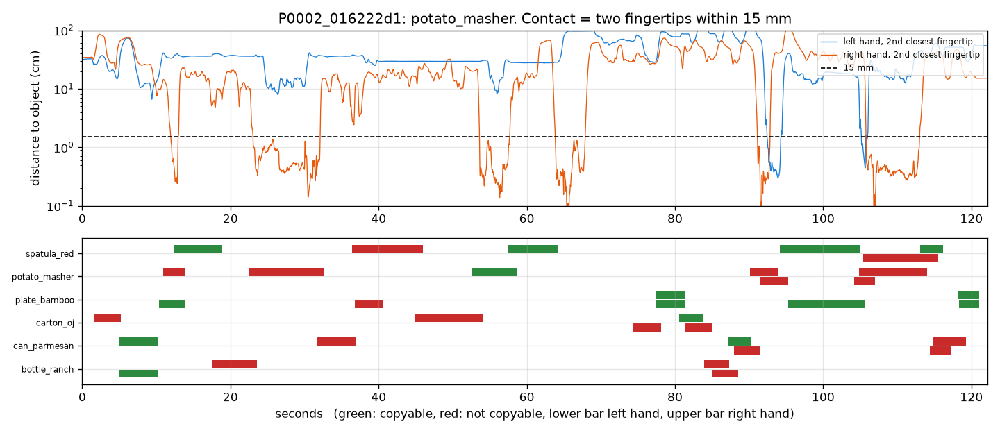

# EXP-11: Number 2 clips cut from hand to object distance, with held-out labels

Date: 2026-10-27. Scripts: `scripts/hot3d_clips.py`, `scripts/hot3d_copyable.py`.
Raw output: `out/hot3d_clips/clips.csv`, `clips_labeled.csv`, `out/hot3d_copyable/`.
Meta API cost: $0.

## Question

1. With the copyable rule fixed on the tuning split (EXP-10), what share of
   held-out grasps is copyable?
2. The plan says number 2 clips must be cut from mocap hand to object
   distance, not from our own video pipeline, so that cutting errors do not
   mix into the score check. What clips does that give, and what labels?

## Setup

- Held-out labels: the EXP-10 pipeline and rule, unchanged (near 1.5 cm,
  deep 1 cm, wrist shift up to 2 cm), on the 713 held-out EXP-07 grasps.
- Clips (all 136 sequences, every 30 fps RGB frame):
  - Per hand and object, a frame is in contact when at least two UmeTrack
    fingertips are within 15 mm of the object surface.
  - Contact frames are joined across gaps up to 0.5 s and kept if they last
    at least 0.3 s.
  - The clip runs from 1 s before the contact (reach) to 1 s after it (release).
  - We keep clips where the object travels at least 3 cm (a real pick, not a
    brush) and at least 90% of the clip frames pass the dataset QA mask.
  - The copyable label is judged at the middle of the contact, for the hand
    of that clip.
- Fingertip distances use forward kinematics on all frames at once. All 136
  sequences take 17 seconds on 12 processes.

## Results

### 1. Held-out labels on the EXP-07 grasps

| Split | Grasps | Copyable | Human rule check | By person |
| --- | --- | --- | --- | --- |
| Tuning | 1,422 | 54.4% | 89.5% | 29% to 76% |
| Held-out | 707 | **52.6%** | 90.0% | P0001 30%, P0010 47%, P0012 73% |

The held-out share is close to the tuning share, and inside 20% to 80%.

### 2. Clips from hand to object distance

| | Tuning | Held-out |
| --- | --- | --- |
| Contacts (per hand) | 2,987 | 1,858 |
| Object moved at least 3 cm | 2,656 | 1,750 |
| Moved and clip passes QA | 2,433 | 1,449 |
| Labelled (hand pose at the contact frame) | 2,385 | 1,426 |
| Contact length, median | 2.2 s | 2.2 s |
| Clip length, median / 90th percentile | 4.2 / 9.7 s | 4.2 / 8.9 s |
| Both hands on the object for most of the contact | 29.5% | 33.5% |
| Copyable | **53.3%** | **51.7%** |

There are more clips than EXP-07 grasps because a clip belongs to one hand.
When both hands hold an object, that gives two clips. A put-down and a
re-grasp also give two.

Lowest and highest objects (at least 40 clips): parmesan can 27%, soup can
29%, potato masher 32%, tomato sauce can 33%, milk carton 34%, against
patterned mug 73%, bowl 75%, white mug 75%, bamboo plate 77%, dino toy 79%.

*P0002_016222d1 (tuning). Top: distance from the potato masher to the second
closest fingertip of each hand. Contact is below the dashed 15 mm line.
Bottom: every clip in the sequence, coloured by its copyable label.*

### SAM cost for these clips (10 fps, 2 prompts)

| Set | One request per clip | Overlapping clips joined |
| --- | --- | --- |
| All 1,426 held-out clips | $34.97 | **$17.76** (198 requests) |
| 400 random tuning clips (seed 20261026) | $10.04 | **$8.82** (315 requests) |

Joining overlapping clips into one request costs half as much. SAM tracks
every hand and object in the window, and each clip takes its own frames out
of the result.

## Conclusion

- Number 2 now has its clip list and its ground truth, made from mocap only:
  2,385 tuning and 1,426 held-out clips, about 52% to 53% copyable in both splits.
- The held-out share (52.6% on EXP-07 grasps, 51.7% on clips) is close to
  tuning, so the fixed rule carries over. The person to person spread stays
  large (30% to 73% in held-out).
- About a third of clips are two-handed. The copyable label is per hand.
- Planned SAM spend for number 2: about $27 (all held-out clips plus 400
  tuning clips, overlapping clips joined). Muse Spark still runs per clip:
  1,826 clips at about $0.024 is about $44. Running Muse on a random half of
  the held-out clips would bring that to about $27. To be decided when the
  credit arrives.
