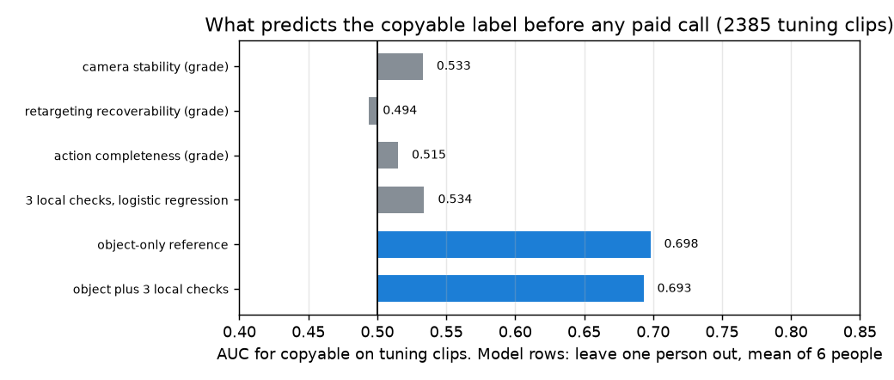

# EXP-12: Do the free checklist items predict copyable? And how far does object identity go?

Date: 2026-10-27. Scripts: `scripts/hot3d_local_checks.py`, `scripts/hot3d_signal_check.py`.
Raw output: `out/hot3d_checks/clip_checks.csv`, `summary.json`, `signal_check.json`.
Meta API cost: $0.

## Question

Number 2 compares our score with Muse Spark asked the same question with no
checklist (see the measurement plan). The copyable share differs a lot by
object (26% to 94%), so a model that only recognises the object may already
do well. Before we spend credit:

1. Do the three checklist items that need no API call carry any signal for copyable?
2. How well does object identity alone predict copyable?

Only tuning clips are used. Held-out clips are not looked at.

## Setup

- Clips: the EXP-11 set, 2,385 tuning clips (53.3% copyable), and the
  held-out clips for the values only.
- Video pass, once per sequence, every 3rd frame (10 fps), on the raw
  fisheye preview:
  - camera motion: corners tracked between frames, a similarity transform
    fitted with RANSAC,
  - MediaPipe Hands, with the left and right labels flipped for a
    non-mirrored view.
- Three checks per clip, video only:
  - camera stability: 90th percentile of camera motion in the clip,
  - retargeting recoverability: MediaPipe world landmarks of the clip's hand
    through dex-retargeting (Allegro) during the contact, as hand found
    share times (1 - vector error),
  - action completeness: the hand is seen and moves in the second before
    contact (reach) and in the second after it (release).
- Grades 1, 0.5, 0. Cut points for camera and retargeting are the tuning
  terciles, now fixed. Completeness has a fixed rule.
- Mocap checks of the checks themselves (not inputs): camera motion against
  headset rotation, and MediaPipe hand labels against the mocap hand nearest
  in the image (EXP-08 projection).
- Models, leave one tuning person out (6 folds):
  - object-only reference: each object's copyable share in the other five
    people, given to the left-out person's clips,
  - the three grades in a logistic regression,
  - object share plus the three grades.

## Results

### The checks measure what they should

| Check of the check | Result |
| --- | --- |
| Camera motion vs headset rotation from mocap, per clip (Spearman) | 0.93 |
| MediaPipe hand label matches the mocap hand | 1,197 of 1,241 (96.5%) |
| Clip hand found by MediaPipe during contact, median | 87% |
| Retargeting vector error, median | 10% |

### But they do not predict copyable

| Signal | AUC on tuning clips |
| --- | --- |
| Camera stability grade | 0.533 |
| Retargeting recoverability grade | 0.494 |
| Action completeness grade | 0.515 |
| Same three, inside each object (weighted mean) | 0.517 / 0.529 / 0.530 |
| Three grades in a logistic regression, leave one person out, mean of 6 people | 0.534 |
| **Object-only reference, leave one person out, mean of 6 people** | **0.698** (0.59 to 0.81 by person) |
| Object share plus the three grades | 0.693 |

*Grey: the three free checks, alone and together. Blue: object identity
alone, and with the three checks. The checks add nothing to object identity.*

### A trap in pooled AUC

When the six left-out people are pooled into one AUC, the numbers drop:
0.616 for the object-only reference, and 0.365 for the three grades, below
chance. The reason is the people, not the checks. Their copyable share runs
from 29% to 74%, and a model trained without a high-share person gives that
person's clips low scores. Pooling then ranks people instead of clips.
Held-out has the same problem (30%, 47% and 73% by person). So the held-out
AUC must be reported per person as well as pooled.

## Conclusion

- The three free checks work as measurements: camera motion agrees with the
  headset (0.93), and MediaPipe finds the right hand 96.5% of the time.
- They carry no information about copyable (AUC 0.49 to 0.53, also inside
  each object). These checks describe how good the video is. The copyable
  label describes whether the Allegro hand fits the grasp. Those are
  different questions.
- Object identity alone reaches AUC 0.70 (mean over people). If Muse Spark
  recognises the object, it should land near there. Our score, as planned,
  would then lose the main comparison of number 2 unless the two Muse Spark
  checks (finger occlusion, object property) carry this signal.
- What to do before spending credit:
  - make retargeting recoverability measure what the proposal says, whether
    the hand shape fits a robot hand. Candidate video-only features: hand
    opening, finger curl and grasp type from MediaPipe, and later object size
    against hand size from SAM masks. They can be tested for free on these
    tuning clips, like here.
  - report the plug-in comparison (Muse Spark alone vs Muse Spark plus our
    checks) next to the main one, as the measurement plan says.
  - keep per-person AUC next to pooled AUC.
- Limits: MediaPipe runs on the raw fisheye image. Grades use tercile cut
  points, which hide small effects but not an AUC this close to 0.5.
