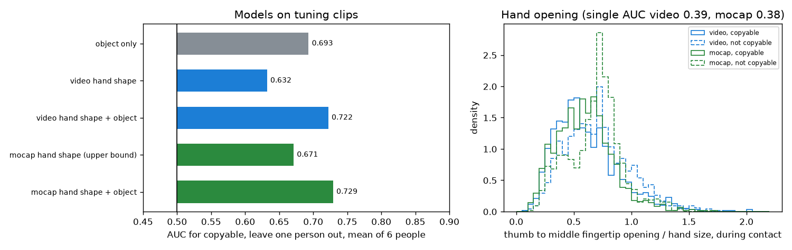

# EXP-13: Hand shape during contact as the retargeting check

Date: 2026-10-27. Script: `scripts/hot3d_hand_shape.py`.
Raw output: `out/hot3d_checks/hand_shape.csv`, `hand_shape.json`. Meta API cost: $0.

## Question

EXP-12 showed that the three free checks measure the video well but do not
predict copyable (AUC about 0.5), while object identity alone reaches 0.70.
The proposal describes the retargeting check as "whether the hand shape fits
a robot hand". Do hand shape features from the video predict copyable, and
do they add anything to object identity?

## Setup

- 2,385 tuning clips (EXP-11). 54 clips where MediaPipe never found the
  clip's hand during contact are left out, so 2,331 remain (53.4% copyable).
  Held-out clips are not used.
- Ten features per clip, the median over the contact frames at 10 fps,
  from 21 hand points:
  - opening: thumb tip to index tip, and thumb tip to middle tip, over hand
    size (wrist to middle finger base),
  - curl of each of the five fingers: 1 - (base to tip) / (length along the joints),
  - spread: angle between the index and little finger directions,
  - closure: mean fingertip distance to the palm centre, over hand size,
  - pinch vs power: index curl minus the mean curl of ring and little finger.
- Two sources for the same features:
  - video: MediaPipe world landmarks, the check we can actually use,
  - mocap: UmeTrack landmarks, an upper bound for what hand shape could tell
    with a perfect hand tracker. It is never an input to our score.
- Models: logistic regression, leave one tuning person out, AUC per person
  and the mean over the six people (EXP-12 explains why pooled AUC misleads).
  "Within object" is the AUC inside each object, weighted by clip count.

## Results

### Single features (tuning clips, AUC for copyable)

| Feature | Video | Mocap |
| --- | --- | --- |
| Opening, thumb to index | 0.37 | 0.37 |
| Opening, thumb to middle | 0.39 | 0.38 |
| Closure | 0.39 | 0.35 |
| Curl, middle / ring | 0.59 / 0.59 | 0.62 / 0.63 |
| Spread | 0.54 | 0.61 |
| Pinch vs power | 0.51 | 0.49 |

An AUC below 0.5 means the relation is reversed: a wider hand opening goes
with not copyable. Video and mocap agree on the direction and size.

### Models, leave one person out

| Model | AUC, mean of 6 people | Range over people | Within object |
| --- | --- | --- | --- |
| Object-only reference | 0.693 | 0.59 to 0.81 | |
| Video hand shape | 0.632 | 0.56 to 0.71 | 0.48 |
| **Video hand shape + object** | **0.722** | 0.62 to 0.84 | 0.42 |
| Mocap hand shape (upper bound) | 0.671 | 0.58 to 0.74 | 0.56 |
| Mocap hand shape + object | 0.729 | 0.63 to 0.82 | 0.51 |

*Left: model AUCs. Right: the thumb to middle fingertip opening during
contact. Not copyable grasps (dashed) are more open, from video and from mocap alike.*

## What this means

- Hand shape from video does predict copyable (0.63), unlike the EXP-12
  checks. The video version gets most of what perfect mocap hand shape gets (0.67).
- It works mainly as a stand-in for object size. A wide opening means a big
  object, and big objects (cans, cartons) are less often copyable. Inside
  one object, video hand shape does not separate copyable from not
  copyable (0.48).
- It is still below object identity (0.63 against 0.69). Combined, the two
  reach 0.72, so hand shape adds about 0.03 on top of knowing the object.
- For number 2 this means:
  - Our score with this check should beat the free checks but may still
    lose to Muse Spark alone, if Muse Spark knows the object well.
  - The plug-in comparison (Muse Spark alone vs Muse Spark plus our checks)
    is where we can show a gain. On tuning, object plus hand shape beats
    object alone by about 0.03 AUC.
- Decision for the checklist: the retargeting recoverability check becomes
  "hand shape fit". It is the logistic regression on the ten video features,
  graded by tuning terciles. It is trained on tuning clips that are not in
  the 400 clips used for the final score weights, so the two models do not
  share training data.
- Limits: MediaPipe runs on the raw fisheye image. The within-object AUC of
  the combined video model is below 0.5 (0.42). Across objects, a closed hand
  means copyable. Inside an object the link is weak and slightly reversed, so
  the model should not be read as "close your hand to be copyable".
