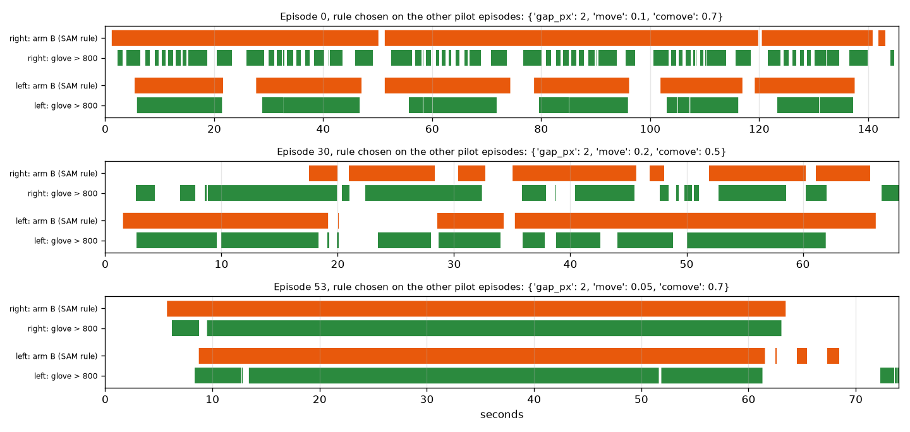

# EXP-14: Arm B (SAM rule) and the reference rows on the three pilot episodes

Date: 2026-10-27. Script: `scripts/contact_cut.py rule`.
Raw output: `out/contact/rule_report.json`. Meta API cost: $0 (uses the EXP-06 SAM output).

## Question

The measurement plan brings number 1 back to three arms. Arm B is the SAM
rule from the proposal: mask overlap plus co-movement. Is it implemented,
does it run end to end against the glove ground truth, and how does it
compare with the reference rows "always in contact" and "never in contact"?
This is a code check on three tuning episodes, not a result.

## Setup

- Episodes 0, 30 and 53 (tuning), SAM 3.1 at 10 fps (EXP-06).
- Arm B, per hand at 10 fps:
  - near: the hand mask is within `gap_px` pixels of an object mask,
  - co-moving: the nearest object moves at least `move` object sizes over
    0.3 s, with camera motion removed, and moves with the hand (`comove`
    at most a limit),
  - a contact is a run of near frames (gaps up to 0.2 s joined) that contains
    at least one co-moving frame, from the start of the run to its end.
    A touch counts once the object has moved with the hand, and it lasts while
    the hand stays at the object.
  - Contacts go back to 30 fps and are shifted by the median start and end
    delay measured on the training episodes.
- Parameters: grid over `gap_px` (2, 4, 8, 12), `move` (0.05, 0.1, 0.2) and
  `comove` (0.5, 0.7). For each episode, the parameters and the shift are
  chosen on the other two episodes (leave one out), by boundary F1 at
  ±15 frames plus IoU.
- Ground truth:
  - glove, cleaned (main since this experiment): tactile sum above 800, with
    pressure dropouts up to 0.1 s joined and pressure blips under 0.1 s dropped,
  - glove, raw: tactile sum above 800 with no cleaning (check),
  - labels: the dataset contact labels (check).

## Results

### The raw glove signal flickers

On these three episodes the glove gives 124 contact segments (both hands together). 21 of
them are shorter than 0.2 s, and 28 gaps between them last 0.1 s or less.
The dataset labels have 78 segments and none of either kind. These flickers
come from pressure crossing the threshold, not from a hand letting go. They
add boundaries that no video method can see: 248 boundaries on the raw glove,
190 after cleaning, 156 in the labels.

### Arm B against the reference rows (leave one episode out)

| Ground truth | Method | Boundary F1 ±5 | Boundary F1 ±15 | Contact IoU | Boundaries found / true |
| --- | --- | --- | --- | --- | --- |
| **Glove, cleaned (main)** | Arm B | 0.07 | 0.15 | 0.747 | 52 / 190 |
| Glove, cleaned (main) | Always in contact | 0.02 | 0.02 | 0.669 | 12 / 190 |
| Glove, cleaned (main) | Never in contact | 0 | 0 | 0 | 0 / 190 |
| Glove, raw | Arm B | 0.04 | 0.12 | 0.745 | 52 / 248 |
| Glove, raw | Always in contact | 0.02 | 0.02 | 0.666 | 12 / 248 |
| Labels | Arm B | 0.02 | 0.14 | 0.744 | 52 / 156 |
| Labels | Always in contact | 0.04 | 0.04 | 0.663 | 12 / 156 |

Per episode (raw glove): ep0 IoU 0.72 and F1 ±15 0.05, ep30 0.60 and 0.23,
ep53 0.94 and 0.27. The leave-one-out runs picked `gap_px` 2 every time.
Against the raw glove, starts come 4 frames early and ends 6 frames late (median).

For context, the appendix model from EXP-06 (logistic regression, raw glove)
reached F1 0.16 / 0.30 and IoU 0.64 on the same episodes. Its thresholds were
picked on the scored predictions, so those numbers are optimistic.

*Green: the cleaned glove (main ground truth). Orange: arm B, with parameters
chosen on the other two episodes against it. Long holds are found (ep53, ep0 left hand). When a hand works
next to objects without pause (ep0 right hand, ep30), arm B joins many
touches into one long block.*

## Conclusion

- Arm B and both reference rows run end to end against the glove and the
  labels, with parameters chosen on other episodes. The code is ready for
  the 50 tuning episodes.
- Arm B beats "always in contact" on IoU (0.75 against 0.67) but finds only
  52 of 190 to 248 boundaries. In a human egocentric view the hand stays within a
  few pixels of some object most of the time, so near-runs rarely break
  between touches. This was already visible in EXP-02 and EXP-03.
- That limits arm C as well. Arm C only moves the boundaries that arm B
  finds, so it cannot add the touches arm B joined together.
- Decisions:
  1. Decided on 2026-10-27: the main ground truth is the cleaned glove (dropouts and blips under 0.1 s
     removed). The raw glove asks video to see pressure flicker. The
     cleaning rule is fixed now and does not use any result.
  2. Still open. Arm B: also break a near-run when the nearest object changes or when
     the hand moves away from the object for a moment. This should split
     touches that follow each other (ep0 right hand). Any new rule is chosen
     on the 50 tuning episodes only.
- Three episodes are too few to choose between rules. The next step for
  number 1 needs SAM on the remaining 47 tuning episodes ($11.89, after the
  credit arrives).
