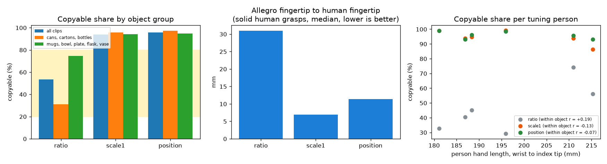
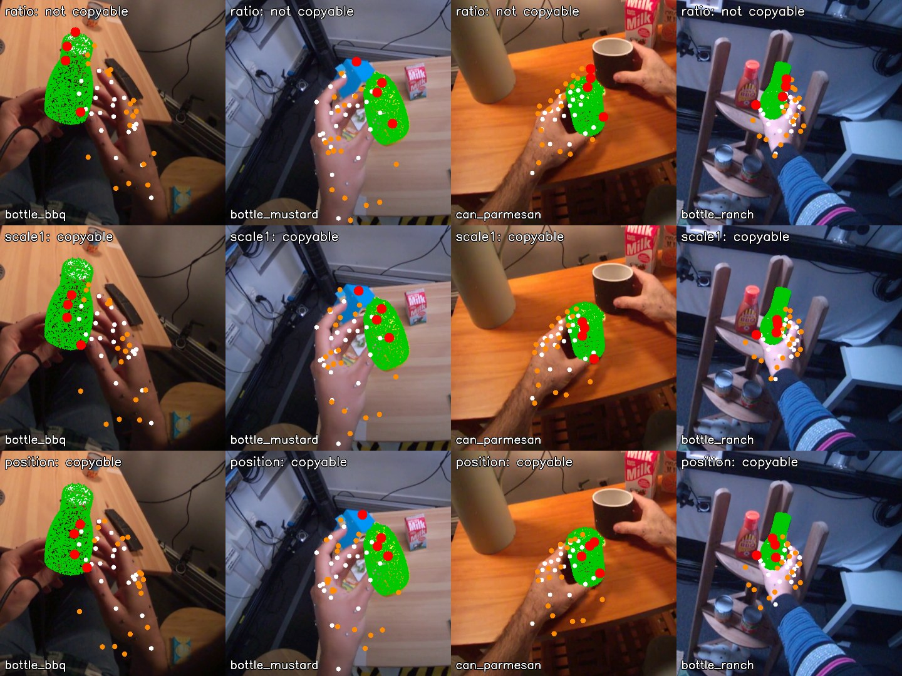

# EXP-15: Is the copyable label measuring the robot, or the retargeting?

Date: 2026-10-27. Scripts: `scripts/hot3d_copyable.py --method`, `scripts/hot3d_label_compare.py`.
Raw output: `out/hot3d_copyable/tune_clips*_events.csv`, `label_compare.json`. Meta API cost: $0.
Tuning clips only. Held-out clips were not used.

## Question

Feedback on EXP-10 pointed out two warning signs:

- Cans, cartons and bottles came out as "not copyable" (26% to 33%), yet
  wrapping a cylinder is one of the easiest grasps for an Allegro hand.
- The copyable share per person fell as the scale factor rose (r = -0.78
  over 9 people). The scale factor is Allegro length over the person's hand
  length.

Is the label measuring the Allegro hand, or a side effect of how we
retarget? We compared three label methods. The choice criteria were written
into the measurement plan before any result.

## Setup

- 2,385 tuning clips (EXP-11). The copyable rule is unchanged: near 1.5 cm,
  deep 1 cm, wrist shift up to 2 cm.
- Three retargeting methods (dex-retargeting 0.4.6, Allegro):
  - `ratio` (EXP-10): wrist-to-fingertip vectors, scaled by Allegro length
    over the person's hand length, wrist at the human wrist.
  - `scale1`: the same vectors with scale 1.0.
  - `position`: Allegro fingertips and finger bases fitted to the human
    positions, with a free hand base (the dex-retargeting offline config).
- Criteria, fixed before the results:
  - fidelity: on solid human grasps (thumb and one more human fingertip
    within 15 mm of the surface), the median distance from each Allegro
    fingertip to the matching human fingertip,
  - hand size: the rank correlation between the person's hand length and
    the label inside each object (weighted mean). It should be near 0.
  - share: inside 20% to 80%.
  - rule: among methods with |hand size correlation| ≤ 0.1 and the share in
    the band, take the best fidelity.

## Results

| | ratio (EXP-10) | scale1 | position |
| --- | --- | --- | --- |
| Copyable share | 53.3% | 93.7% | 95.6% |
| Fidelity: Allegro tip to human tip, median | 31.0 mm | **6.9 mm** | 11.4 mm |
| Hand size correlation inside objects | +0.19 | -0.13 | **-0.07** |
| Copyable among solid human grasps | 55% | 99% | 99% |
| Cans, cartons, bottles: copyable | 31% | 96% | 97% |
| Cans, cartons, bottles: closest non-thumb Allegro tip to surface | 25.5 mm outside | 2.8 mm | 2.2 mm |
| Mugs, bowl, plate, flask, vase: copyable | 75% | 94% | 95% |
| Allegro wrist to human wrist, median | 0 (fixed) | 0 (fixed) | 26 mm |
| Passes the share band | yes | no | no |
| Passes the hand size check | no | no | yes |

Lowest objects with `position`: keyboard 67%, bamboo plate 90%, flask 91%.
With `scale1`: keyboard 58%, birdhouse toy 85%, cellphone 88%. These are
flat or thin objects.

*Left: copyable share by object group. Yellow: the 20% to 80% band. Middle:
fidelity, lower is better. Right: copyable share per tuning person against
hand length.*

*Four can, carton and bottle grasps. Rows: ratio, scale1, position. Green:
object model. White: human hand. Orange: Allegro link points, red: Allegro
fingertips. With `ratio` the Allegro fingertips land beyond the object. With
the other two they sit on its surface.*

**By the rule fixed in advance, no method passes.**

## What this means

- The feedback was right. The EXP-10 label measures mostly a retargeting
  side effect:
  - with `ratio`, Allegro fingertips are 31 mm from where the human put
    them, and 25 mm off the surface of cans the person holds firmly,
  - the label also depends on hand size (+0.19 inside objects).
  - Its 53% share, which passed the skew check in EXP-10, came from this
    distortion.
- When the fingertips are retargeted faithfully (`scale1`, `position`),
  almost every human grasp counts as copyable (94% to 96%). The few failures
  are flat or thin objects (keyboard, plate), which is believable for a
  large four-finger hand.
- So the copyable rule as built cannot tell grasps apart once the retargeting
  is honest. This is risk 1 of the plan, label skew, now showing up for the
  right reason.
- One part of the rule is too weak. "No part of the Allegro hand deep inside
  the object" was checked only at about 20 link origin points, not on the
  finger and palm shapes. A larger hand that puts its fingertips where the
  human did will often push its finger bodies or palm into the object, and
  this check misses it.
- Everything built on the EXP-10 label is on hold until the label is fixed:
  the held-out shares in EXP-11, the object reference in EXP-12, and the
  hand shape check in EXP-13. The clips themselves (EXP-11) are not affected.

## Candidate next definition (to be fixed in the plan before computing)

- Retargeting: `position` (it passes the hand size check, and its fingertips
  land 11 mm from the human ones).
- Collision on the real Allegro link meshes, not on link origins. Copyable
  only if no finger or palm surface goes more than `deep` into the object.
- Reach: the Allegro fingertip for each human finger that touches the
  object must land within a set distance of the human contact point.
- Then the same criteria as here: hand size correlation near 0, share
  between 20% and 80%, chosen on tuning only.
