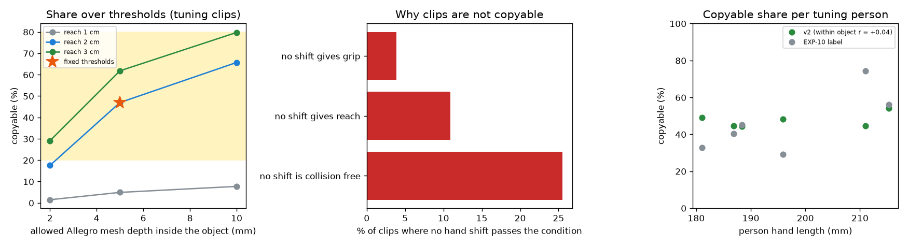
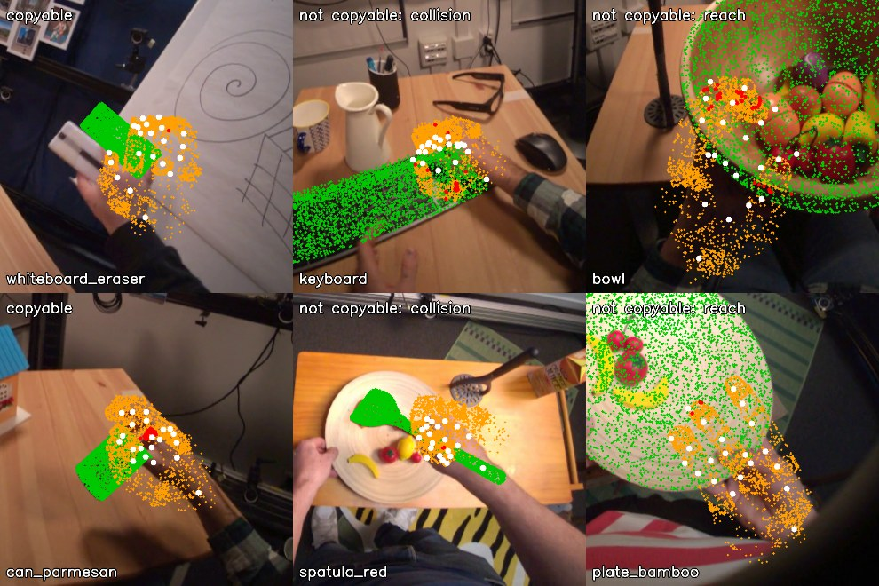

# EXP-16: Copyable label v2, with mesh collision and contact reach

Date: 2026-10-27. Script: `scripts/hot3d_copyable_v2.py`.
Raw output: `out/hot3d_copyable/tune_v2_*`. Meta API cost: $0.
Tuning clips only. Held-out clips were not used.

## Question

EXP-15 showed that the EXP-10 label mostly measured a retargeting side
effect. Faithful retargeting called almost every grasp copyable, because
the old rule checked collisions only at link origin points. Does a stricter,
more physical definition give a label we can use?

The definition, its thresholds and the acceptance rule were written into
the measurement plan before computing ("Copyable definition v2").

## Setup

- 2,385 tuning clips (EXP-11), contact frame of each clip, the clip's hand.
- Position retargeting (dex-retargeting Allegro offline config): Allegro
  fingertips and finger bases fitted to the human ones, free hand base.
- Allegro surface: about 300 points sampled on the visual mesh of each of
  21 links, placed by forward kinematics.
- The hand may shift up to 2 cm (1 cm grid). A clip is copyable if one shift
  passes all three conditions:
  1. Grip: the Allegro thumb tip and one more Allegro fingertip are within
     1.5 cm of the object surface.
  2. Reach: every human finger (thumb, index, middle, ring) that touches the
     object (tip within 15 mm) has its Allegro fingertip within 2.0 cm of it.
  3. No collision: no Allegro mesh point is more than 5 mm inside the object.
- Acceptance, fixed in advance: share between 20% and 80%, and the rank
  correlation of hand length with the label inside objects at most 0.1 in size.

## Results

### Acceptance

| Check | Result | Pass |
| --- | --- | --- |
| Copyable share | 47.0% | yes |
| Hand size correlation inside objects | +0.04 | yes |

**The v2 label passes both checks set in advance.**

### Why clips fail

| Condition that no hand shift can meet | Share of all clips |
| --- | --- |
| No collision | 25.5% |
| Reach | 10.9% |
| Grip | 3.9% |

Without any shift, the deepest Allegro mesh point sits 7.9 mm inside the
object (median). Allegro fingertips land 11.5 mm from the human fingertips
(median), and the free hand base sits 26 mm from the human wrist.

### By person and object

| Person | P0002 | P0003 | P0009 | P0011 | P0014 | P0015 |
| --- | --- | --- | --- | --- | --- | --- |
| Hand length (mm) | 196 | 181 | 211 | 188 | 187 | 215 |
| Copyable, v2 | 48% | 49% | 45% | 44% | 45% | 54% |
| Copyable, EXP-10 label | 29% | 33% | 74% | 45% | 40% | 56% |

| Lowest objects (at least 25 clips) | Copyable | Highest objects | Copyable |
| --- | --- | --- | --- |
| keyboard | 1% | holder_black | 96% |
| carton_oj | 8% | holder_gray | 91% |
| dumbbell_5lb | 10% | bottle_bbq | 81% |
| flask | 14% | mug_white | 78% |
| dino_toy | 16% | whiteboard_marker | 74% |
| carton_milk | 19% | can_tomato_sauce | 68% |

Cans, cartons and bottles together: 49% (EXP-10 label: 31%).

*Left: copyable share for other reach and depth limits. The star is the
fixed choice. Middle: why clips fail. Right: share per tuning person, v2
(green) and the EXP-10 label (grey).*

*Two tuning clips per outcome. Green: object model. White: human hand. Orange:
Allegro mesh points. Red: mesh points more than 5 mm inside the object.
Left: copyable (eraser, parmesan can). Middle: collision, the larger Allegro
fingers go into the keyboard and the spatula. Right: reach, on the wide bowl
and plate the Allegro hand cannot put its fingertips where the human did.*

### Sensitivity

| Reach \ depth | 2 mm | 5 mm | 10 mm |
| --- | --- | --- | --- |
| 1 cm | 2% | 5% | 8% |
| **2 cm** | 18% | **47%** | 66% |
| 3 cm | 29% | 62% | 80% |

## Conclusion

- The v2 label passes the acceptance rule set before computing: 47%
  copyable, and almost no link to hand size (+0.04 inside objects, 44% to 54%
  by person, against 29% to 74% for the EXP-10 label).
- The failures make physical sense: the bigger Allegro fingers collide with
  flat or crowded objects (keyboard, spatula), and the hand cannot span wide
  objects the way the human did (bowl, plate). Cylinders are no longer
  pushed to "not copyable". Some low objects are less obvious (dumbbell 10%,
  flask 14%) and are worth a look.
- Limits, stated plainly:
  - The share depends strongly on the depth limit (18% at 2 mm, 66% at
    10 mm). 5 mm is about the size of the mocap and model error, so the label
    is partly "how much the Allegro hand overlaps the object, within
    measurement error". The choice was fixed before computing, and we report
    the curve.
  - A reach of 1 cm leaves almost nothing copyable, because the fitted
    Allegro fingertips sit about 11 mm from the human ones.
  - One frame per clip. The free base moves the hand 26 mm from the human
    wrist (median).
  - The inside or outside sign comes from the nearest surface sample.
- Next, all free:
  - recompute on the v2 label the object-only reference (EXP-12) and the hand
    shape check (EXP-13), on tuning clips,
  - then compute the held-out v2 labels with these fixed thresholds.
