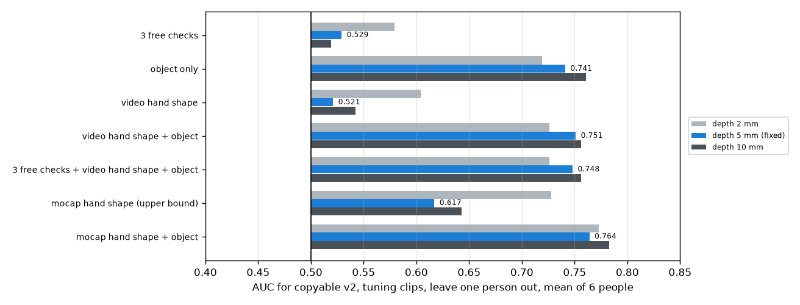

# EXP-17: What predicts the v2 copyable label? (EXP-12 and EXP-13 again)

Date: 2026-10-27. Script: `scripts/hot3d_v2_signal.py`.
Raw output: `out/hot3d_checks/v2_signal.json`. Meta API cost: $0.
Tuning clips only. Held-out clips were not used.

## Question

EXP-12 and EXP-13 were scored against the EXP-10 label, which EXP-15
showed to be mostly a retargeting side effect. With the v2 label (EXP-16),
how well do the free checks, the video hand shape and object identity
predict copyable?

## Setup

- 2,331 tuning clips with a MediaPipe hand during contact (54 of 2,385 left
  out, as in EXP-13). v2 copyable share: 47%.
- Same features and models as EXP-12 and EXP-13, leave one tuning person out,
  AUC per person and the mean over the six people:
  - the three free checks (camera stability, retargeting recoverability,
    action completeness),
  - object-only reference: the copyable share of each object in the other
    five people,
  - video hand shape: 10 MediaPipe features during contact,
  - mocap hand shape: the same 10 features from UmeTrack, as an upper bound,
  - combinations with the object share.
- The v2 label is also scored at depth limits of 2 mm and 10 mm, to see
  whether the picture depends on the depth limit.

## Results

### Main label (depth 5 mm)

| Model | AUC, mean of 6 people | Range over people | Within object |
| --- | --- | --- | --- |
| Camera / retargeting / completeness grade, single | 0.521 / 0.538 / 0.480 | | |
| Three free checks | 0.529 | 0.49 to 0.57 | 0.50 |
| **Object-only reference** | **0.741** | 0.67 to 0.80 | |
| Video hand shape | 0.521 | 0.49 to 0.57 | 0.53 |
| Video hand shape + object | 0.751 | 0.68 to 0.80 | 0.46 |
| Three free checks + video hand shape + object | 0.748 | 0.68 to 0.80 | 0.46 |
| Mocap hand shape (upper bound) | 0.617 | 0.55 to 0.73 | 0.55 |
| Mocap hand shape + object | 0.764 | 0.72 to 0.83 | 0.48 |

### Other depth limits

| Model | Depth 2 mm (18% copyable) | Depth 5 mm (47%) | Depth 10 mm (66%) |
| --- | --- | --- | --- |
| Three free checks | 0.579 | 0.529 | 0.519 |
| Object-only reference | 0.719 | 0.741 | 0.761 |
| Video hand shape | 0.604 | 0.521 | 0.542 |
| Video hand shape + object | 0.726 | 0.751 | 0.756 |
| Mocap hand shape (upper bound) | 0.728 | 0.617 | 0.643 |

*AUC for the v2 label on tuning clips, leave one person out. Blue: the fixed
depth limit of 5 mm. Grey: 2 mm and 10 mm.*

## What this means

- The video hand shape check from EXP-13 lost its signal (0.632 on the old
  label, 0.521 on v2). It had been learning the retargeting side effect:
  with the old label, a wide hand opening meant "not copyable", because wide
  grasps pushed the scaled Allegro fingertips off the object.
- Object identity alone predicts the v2 label well (0.74, and 0.72 to 0.76
  at the other depth limits). Copyability under v2 is mostly a property of
  the object: flat, crowded or wide objects fail, compact ones pass.
- Our video checks add almost nothing on top of the object: +0.01 for hand
  shape, and nothing for the three free checks.
- Hand pose does carry some information, since mocap hand shape reaches
  0.62. MediaPipe on the raw fisheye video does not recover it (0.52). Inside
  an object, even mocap hand shape adds little (0.55).
- For number 2:
  - If Muse Spark recognises the object and has a fair sense of which
    objects a large robot hand struggles with, it may come close to 0.74.
    Our checklist, as it stands, would then lose the main comparison. In the
    plug-in comparison it would add about 0.01.
  - The physically sensible label makes the problem about the object, not
    about the video. The checklist was designed for video quality. That
    mismatch, not the label, is now the main issue for number 2.
- The depth limit changes the numbers by a few hundredths. Among the
  signals we can actually use, object identity is the strongest at every
  limit. At 2 mm the mocap hand shape (the upper bound, not a video method)
  edges past it, 0.728 against 0.719.
