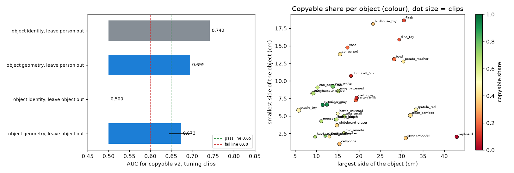

# EXP-18: Can object geometry carry the copyable signal? (option A check)

Date: 2026-10-27. Script: `scripts/hot3d_object_geometry.py`.
Raw output: `out/hot3d_checks/object_geometry.json`. Meta API cost: $0.
Tuning clips only. Held-out clips were not used.

## Question

EXP-17 showed that the v2 copyable label is mostly about the object:
object identity alone reaches AUC 0.741, and our video checks add almost
nothing. Option A keeps the question and the label, and turns "object
property" into concrete object items that Muse Spark would rate from the
video. That only makes sense if a few object properties, not the object's
name, can carry the signal. Do they, and do they still work on an object
the model has never seen?

The features, tests and decision rule were written into the measurement
plan before computing ("Option A check").

## Setup

- 2,385 tuning clips with the v2 label (47.0% copyable), 33 objects.
- Seven features per object, from its 3D model only:
  - the largest, middle and smallest side of its oriented bounding box,
  - flatness (smallest over largest) and elongation (middle over largest),
  - volume and fill (volume over box volume).
  - The HOT3D models are not watertight, so volume is the convex hull volume.
- Logistic regression on these features. Each clip gets its object's values.
- Tests:
  1. leave one person out: AUC per person, mean over the six people,
  2. leave one object out: the model never sees the object it scores.
     Pooled AUC, 95% interval resampling sequences.
- Decision rule (fixed in advance): pass if both AUCs are at least 0.65,
  fail if either is below 0.60, weak in between.

## Results

| Test | Object identity reference | Object geometry |
| --- | --- | --- |
| Leave one person out, mean of 6 people | 0.742 | **0.695** (0.65 to 0.76 by person) |
| Leave one object out, pooled | 0.5 (cannot score an unseen object) | **0.673** (0.645 to 0.698) |

**Verdict by the rule set in advance: pass.**

The strongest single feature is the largest side of the object. On its own
its AUC is 0.32, which means 0.68 the other way round: the longer the
object, the less often it is copyable. Volume works the same way (0.38).

*Left: AUC of object identity and object geometry, leaving out a person or
an object. Right: every object by its largest and smallest side, coloured
by its copyable share. Long or bulky objects (keyboard, flask, dino toy,
bowl) are mostly not copyable. Compact, hand-sized ones (holders, mugs,
cans, bottles) mostly are.*

Objects that geometry explains less well:

- the two cartons (19 cm tall, 8% and 19% copyable),
- the dumbbell (18 cm, 10%),
- the puzzle toy, a small cube that comes out at only 46%.

## What this means

- Seven numbers about an object's size and shape recover most of what the
  object's name tells (0.695 against 0.742). Unlike the name, they still
  work on an object the model has never seen (0.673 against 0.5).
- So option A has a basis. A checklist that asks Muse Spark concrete
  questions about the object (how big it is next to the hand, how long, how
  flat, how wide) can carry the copyable signal. It can also carry it to new
  objects, which is the point of a reusable score.
- What it does not show: whether Muse Spark can read these sizes from the
  video, and whether Muse Spark asked the plain question does just as well.
  Those need the paid run.
- Limits:
  - Only 33 objects. The leave-one-object-out interval resamples sequences,
    not objects, so it is narrower than the uncertainty over objects.
  - Volume and fill use the convex hull because the models are not watertight.
  - Mostly one feature (largest side) drives the result.
- Next:
  - write the Muse Spark object items (size next to the hand, length,
    flatness, width, handle, crowding) and their high, mid, low anchors,
  - check them for free with the 3D model numbers as stand-ins,
  - then compute the held-out v2 labels with the fixed thresholds.
