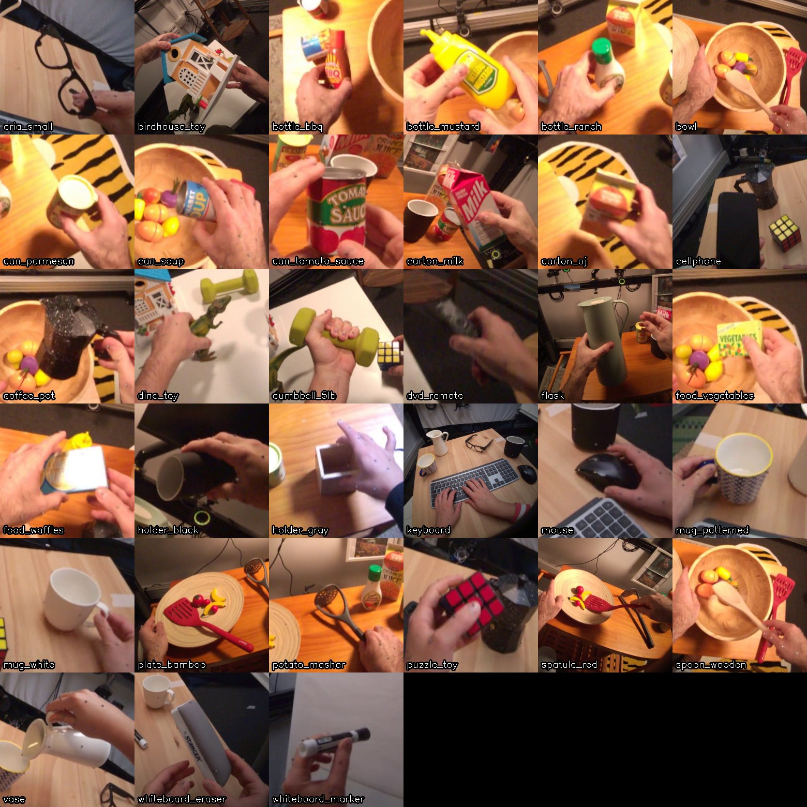
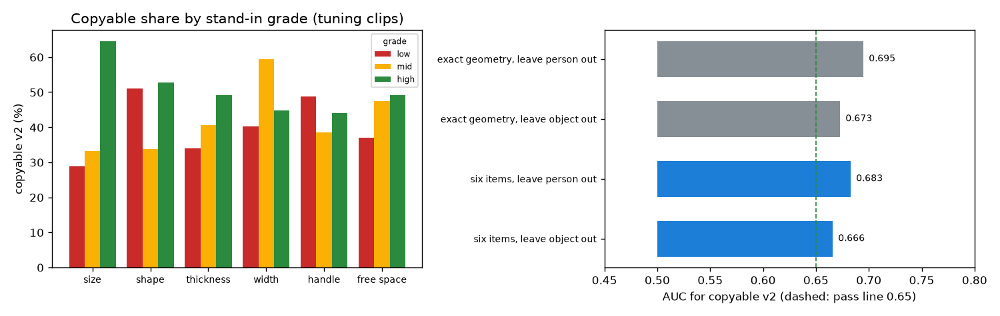

# EXP-19: Six object items for the checklist, checked with stand-in grades

Date: 2026-10-27. Scripts: `scripts/hot3d_object_items.py`, `scripts/hot3d_object_sheet.py`.
Raw output: `out/hot3d_checks/object_items.csv`, `object_items.json`. Meta API cost: $0.
Tuning clips only.

## Question

Option A turns "object property" into concrete items that Muse Spark rates
high, mid or low. EXP-18 showed that exact object sizes carry the copyable
signal. Do six coarse three-level items, with fixed anchors, keep that
signal? Here the grades come from the truth (3D models, mocap, a look at
each object), as stand-ins for what Muse Spark would answer.

Items, anchors and the pass rule were written into the measurement plan
before computing ("Object items for Muse Spark").

## Setup

- 2,385 tuning clips, v2 label (47.0% copyable).
- Six items. High always means "easier for a large four-finger robot hand",
  and the direction was set from the meaning, not the data:

| Item | High | Mid | Low | Stand-in source |
| --- | --- | --- | --- | --- |
| Size next to the hand (longest side) | up to 15 cm | 15 to 25 cm | over 25 cm | 3D model box |
| Shape (middle over longest side) | 0.6 or more | 0.3 to 0.6 | under 0.3 | 3D model box |
| Thickness (shortest side) | 4 cm or more | 2 to 4 cm | under 2 cm | 3D model box |
| Width to wrap (middle side) | up to 8 cm | 8 to 14 cm | over 14 cm | 3D model box |
| Handle | yes | partly | no | by eye, one frame per object |
| Free space (gap to nearest other object) | 10 cm or more | 4 to 10 cm | under 4 cm | mocap poses at the contact frame |

- Handle was judged from the contact sheet below before looking at any
  label: yes for coffee pot, dumbbell, flask, both mugs, potato masher,
  spatula, wooden spoon and vase, partly for the whiteboard eraser, no for
  the rest.
- Logistic regression on the six grades. Leave one person out (mean AUC
  over six people) and leave one object out (pooled AUC). Pass if both are
  0.65 or more.

*One grasp per object, used only to judge the handle item.*

## Results

| Test | Six items | Exact geometry (EXP-18) |
| --- | --- | --- |
| Leave one person out, mean of 6 people | **0.683** (0.60 to 0.73) | 0.695 |
| Leave one object out, pooled | **0.666** (0.639 to 0.693) | 0.673 |

**Verdict by the rule set in advance: pass.**

| Item | AUC alone | Weight in the full model |
| --- | --- | --- |
| Size next to the hand | 0.673 | +2.16 |
| Shape | 0.567 | -0.30 |
| Thickness | 0.536 | -0.24 |
| Width to wrap | 0.518 | -1.10 |
| Handle | 0.478 | -0.18 |
| Free space | 0.534 | +0.09 |

*Left: copyable share for each grade of each item. Right: the six coarse
items keep almost all of the signal of the exact sizes.*

## What this means

- Six coarse items with fixed anchors keep nearly all of the object signal:
  0.683 and 0.666, against 0.695 and 0.673 for exact sizes. If Muse Spark
  grades them about right, the checklist can carry the copyable signal, also
  for objects it has not seen.
- Size next to the hand does almost all of the work (0.673 alone).
- Two items do not behave as their meaning suggested:
  - Handle: objects with a handle are slightly less often copyable (0.478).
    Most handled objects here are long tools (spatula, masher, spoon) or
    large (flask, coffee pot), and size wins.
  - Width to wrap gets a negative weight once size is known. Among objects
    of the same length, narrow ones (spoon, marker, remote) are harder.
  These directions are learned by the regression on tuning clips. The
  anchors stay as they are.
- Free space adds little (0.534). Most grasps have 16 cm or more of room
  (median).
- What this does not test: whether Muse Spark can read these grades from
  fisheye frames. That needs the paid run. A short pilot on a few tuning
  clips should check Muse Spark grades against these stand-ins before the
  full run.
