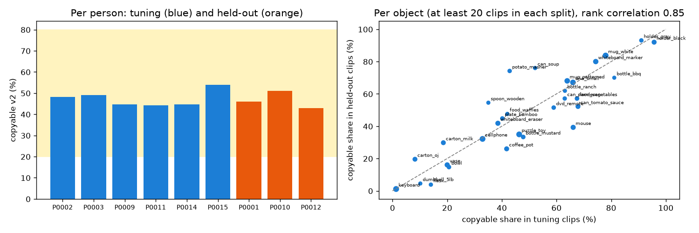

# EXP-20: Held-out copyable v2 labels, with the thresholds fixed on tuning

Date: 2026-10-27. Scripts: `scripts/hot3d_copyable_v2.py run held_out`, `scripts/hot3d_v2_heldout_summary.py`.
Raw output: `out/hot3d_copyable/held_out_v2_*`, `v2_split_summary.json`. Meta API cost: $0.

## Question

The v2 label was defined and accepted on tuning clips (EXP-16). With the
same thresholds, what does it look like on the 1,426 held-out clips? This
page looks at labels only. No model or checklist is scored on held-out data.

## Setup

- Held-out clips: the EXP-11 set, persons P0001, P0010, P0012.
- Same code and thresholds as EXP-16: position retargeting, hand shift up to
  2 cm, grip within 1.5 cm, reach within 2.0 cm, no Allegro mesh point more
  than 5 mm inside the object.

## Results

| | Tuning | Held-out |
| --- | --- | --- |
| Clips | 2,385 | 1,426 |
| Copyable | 47.0% | **46.4%** |
| By person | 44% to 54% | P0001 46%, P0010 51%, P0012 43% |
| Hand size correlation inside objects | +0.04 | -0.08 |
| Fails: collision / reach / grip | 25.5% / 10.9% / 3.9% | 31.1% / 8.6% / 5.6% |
| Allegro tip to human tip, median | 11.5 mm | 11.4 mm |

Sensitivity on held-out (reach 2 cm): depth 2 mm 20%, 5 mm 46%, 10 mm 65%.
The tuning values were 18%, 47% and 66%.

Lowest held-out objects: keyboard 1%, flask 4%, bowl 15%, vase 16%,
orange juice carton 20%. Highest: gray holder 93%, black holder 92%, white
mug 84%, whiteboard marker 80%.

*Left: copyable share per person, tuning in blue, held-out in orange. Right:
copyable share per object in tuning against held-out (30 objects with at
least 20 clips in each). Rank correlation 0.85.*

## Conclusion

- The fixed v2 rule carries over: 46.4% copyable on held-out, close to
  tuning, inside the band, with person shares from 43% to 51%. The person
  spread of the old label (30% to 73%) is gone.
- Object shares agree closely between the splits (rank correlation 0.85).
  So the object-only reference, trained on tuning, will be strong on held-out
  as well. The main comparison has to be read with that in mind.
- These labels are now the number 2 ground truth for the AUC. No score or
  checklist has been run on held-out data.
