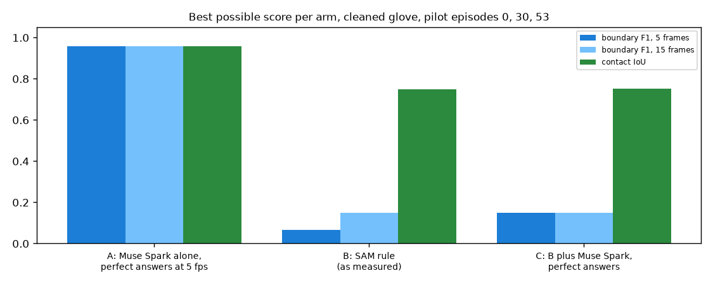

# EXP-21: How well could each number 1 arm do at best?

Date: 2026-10-27. Script: `scripts/muse_contact.py selftest`.
Raw output: `out/number1/selftest.json`. Meta API cost: $0.
Pilot tuning episodes 0, 30 and 53 only.

## Question

The code for the two Muse Spark arms of number 1 is written (arm A, Muse
Spark alone, and arm C, the SAM rule plus a Muse Spark boundary check).
Before paying for them:

1. Does the code turn answers into contacts and scores correctly?
2. What is the best each arm could reach, given how it is built? Feedback
   said arm A cannot reach ±5 frames at 5 fps. Arm C can only adjust the
   boundaries that arm B finds.

## Setup

- Arm A: every 6th frame (5 fps) of the 720p episode, 10 frames per call.
  For each frame and hand, Muse Spark says touching or not. A sample stands
  for its 6 frames.
- Arm C: for each start and end that arm B found (EXP-14, rule chosen on the
  other pilot episodes), 7 frames 5 frames apart, from 15 before to 15 after.
  Muse Spark picks the first or last touching frame, or keeps arm B.
- Both arms then use the arm B rules: gaps up to 0.2 s joined, contacts
  shorter than 0.2 s dropped.
- Self-test: instead of Muse Spark, the answers come from the main ground
  truth itself (cleaned glove). This is a perfect Muse Spark. It checks the
  code and gives each arm its ceiling.

## Results

Cleaned glove (main ground truth), 3 pilot episodes, both hands:

| Arm | Boundary F1 ±5 | Boundary F1 ±15 | Contact IoU | Boundaries found / true |
| --- | --- | --- | --- | --- |
| A, perfect answers at 5 fps | **0.956** | 0.956 | 0.957 | 174 / 190 |
| B, SAM rule as measured (EXP-14) | 0.066 | 0.149 | 0.747 | 52 / 190 |
| C, B plus perfect boundary picks | **0.149** | 0.149 | 0.752 | 52 / 190 |

With the raw glove, the A ceiling is 0.825 at ±5 frames. With the labels it
is 0.830, and 0.939 at ±15. Arm C stays at 0.12 to 0.15.

*Best possible scores. Arm A with perfect answers at 5 fps, arm B as
measured, arm C with perfect boundary picks on top of arm B.*

## What this means

- The code works: perfect answers give near-perfect scores where the design
  allows it.
- 5 fps does not stop arm A from reaching ±5 frames. A perfect Muse Spark at
  5 fps scores 0.96. The feedback point was too strong. A real Muse Spark will
  fall short because of its answers, not because of the frame rate.
- Arm C cannot beat arm B by much. It can only move the 52 boundaries arm B
  finds, out of 190, so even perfect picks give 0.15. As built, the planned
  "SAM plus Muse Spark" arm is limited by how many touches arm B separates,
  and arm B joins touches that follow each other (EXP-14).
- So the comparison A against C, as planned, favours A, for a structural
  reason. Two ways to make arm C a fair test, to decide before paying:
  1. raise arm B recall first: break contacts when the nearest object changes
     or the hand leaves for a moment, chosen on the 50 tuning episodes (needs
     SAM on the remaining tuning episodes, $11.89),
  2. let arm C also look inside long arm B contacts for missed releases and
     touches, by sampling a few frames per second there (more Muse Spark calls).
- Cost estimates without sending: arm A on the 22 held-out episodes about
  $11.86 (6,817 frames). Arm C about $0.013 per boundary.
