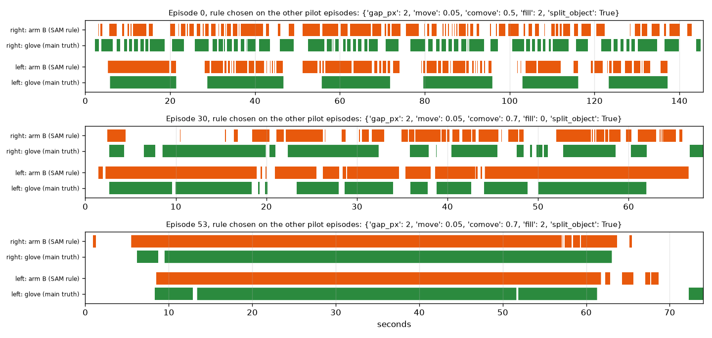
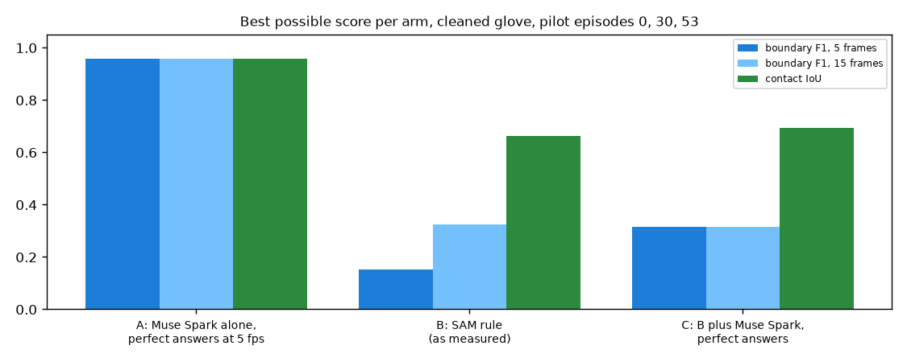

# EXP-22: Arm B that splits contacts when the nearest object changes

Date: 2026-10-27. Scripts: `scripts/contact_cut.py rule`, `scripts/muse_contact.py selftest`.
Raw output: `out/contact/rule_report.json`, `rule_segments.json`, `out/number1/selftest.json`
(these files now hold the EXP-22 run, the EXP-14 numbers are in its page).
Meta API cost: $0. Pilot tuning episodes 0, 30 and 53.

## Question

EXP-14 showed that arm B joins touches that follow each other: it found 52
of 190 boundaries. EXP-21 showed that this also caps arm C at 0.15, because
arm C can only move the boundaries arm B finds. Does arm B find more
touches if it may break a contact when the nearest object changes, or keep
short gaps instead of joining them?

## Setup

- Same features and leave-one-episode-out search as EXP-14, with two more
  options in the grid:
  - split on object change: inside a run of near frames, start a new
    contact when the nearest object id changes, and never join two contacts
    on different objects,
  - fill: join gaps of 0, 1 or 2 frames at 10 fps (EXP-14 always joined 2).
- Main ground truth: the cleaned glove. The grid includes the EXP-14 rule, so
  the search can still pick it.
- Then the arm C ceiling again: perfect boundary picks on top of the new arm B.

## Results

Cleaned glove, leave one episode out:

| | EXP-14 arm B | EXP-22 arm B | Always in contact |
| --- | --- | --- | --- |
| Boundary F1 ±5 | 0.066 | **0.151** | 0.02 |
| Boundary F1 ±15 | 0.149 | **0.323** | 0.02 |
| Contact IoU | 0.747 | 0.663 | 0.669 |
| Boundaries found / true | 52 / 190 | 392 / 190 | 12 / 190 |
| Arm C ceiling, boundary F1 ±5 | 0.149 | **0.315** | |

All three left-out episodes chose "split on object change". The raw glove
gives the same picture (F1 0.132 and 0.275, IoU 0.692).

*Green: cleaned glove. Orange: arm B with the new options, chosen on the
other two episodes. The right hand in episode 0 now gets separate contacts,
close to the glove. The left hand in episode 0, which holds one container for
long stretches, is now cut into many pieces.*

*Best possible scores with the new arm B. Arm C, with perfect picks, can
now reach 0.315.*

## Conclusion

- Splitting on object change doubles arm B boundary F1 (0.15 at ±5 frames,
  0.32 at ±15) and doubles the arm C ceiling (0.32).
- It overshoots: 392 boundaries against 190 true ones, and contact IoU
  drops below "always in contact" (0.663 against 0.669). While a hand holds
  one object, the nearest object can flicker between it and its neighbours,
  which cuts long holds into pieces.
- Three episodes cannot settle the trade-off. The grid is ready for the 50
  tuning episodes once their SAM output exists ($11.89). A rule that also asks
  the new object to stay nearest for a few frames before splitting would be
  the next option to add to the grid.
