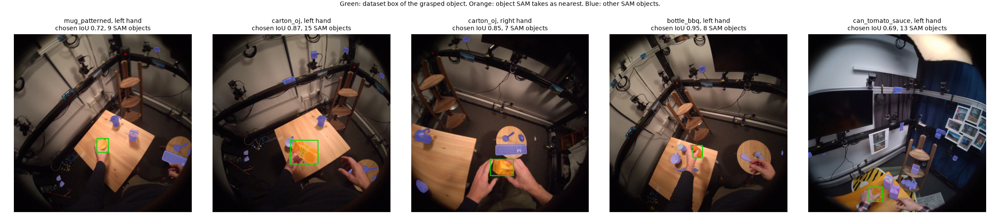
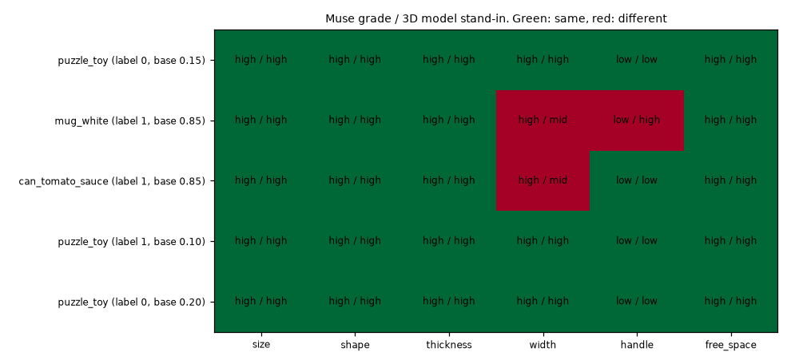

# EXP-23: Number 2 paid pilot (P1)

Date: 2026-10-28. Scripts: `scripts/sam_hot3d.py`, `scripts/muse_hot3d.py`,
`scripts/number2_sam_checks.py`, `scripts/number2_pilot.py`.
Raw output: `out/number2/sam/<window_id>/`, `out/number2/muse/{checklist,baseline}/`,
`out/number2/sam_checks.csv`, `out/number2/pilot.json`.
Meta API cost: **$0.20** (SAM $0.10, Muse checklist $0.05, Muse baseline $0.05).
Data: score_train clips only (tuning persons). Nothing on held-out was sent or scored.

## Question

Before the large number 2 runs (P6 SAM $26.58, P7 Muse about $44), do the
calls work on HOT3D and do the answers make sense?

1. Does SAM 3.1 with the prompts `hand` and `small object` find the grasped
   object on HOT3D tables, and does our code pick that object as the one
   nearest to the hand?
2. Do the Muse Spark object grades match the 3D model stand-ins from EXP-19?
3. What does one call really cost?

## Setup

- SAM: 3 score_train windows drawn with seed 20261026 (500 frames at 10 fps,
  5 clips inside them). Prompts `hand` and `small object`.
- Muse: 5 score_train clips drawn with seed 20261026, the checklist prompt
  and the baseline prompt (`scripts/prompts/number2_{checklist,baseline}.txt`),
  6 frames of 720 px each, reasoning effort low.
- SAM check: per contact frame (mocap), the dataset 2D box of the grasped
  object (`box2d_objects.csv`, turned from the raw orientation to the preview
  with (1407 - v, u), EXP-08) against (a) any SAM object box and (b) the SAM
  object that the number 2 code takes as nearest to the clip's hand. A match
  is box IoU of 0.5 or more.
- Muse check: the six object items against the EXP-19 stand-in grades of the
  same clip. The finger occlusion item has no stand-in.

## Bug found and fixed

`number2_sam_checks.py` crashed on the first HOT3D window. The shared code in
`contact_cut.py` placed masks in a 1280 x 720 frame (OpenGraph), but HOT3D
windows are 1408 x 1408. `frame_table` now takes the frame size, and
`number2_sam_checks.py` passes 1408 x 1408. The OpenGraph path is unchanged
(self test gives the same value as before).

## Results

SAM, 169 contact frames in 5 clips:

| Clip | Object | Contact frames | SAM objects per frame | Grasped object found | Nearest object is the grasped one |
| --- | --- | --- | --- | --- | --- |
| P0009_927973d7_left_02183 | mug_patterned | 23 | 8.2 | 100% | 100% |
| P0009_927973d7_left_02268 | carton_oj | 87 | 13.3 | 100% | 100% |
| P0009_927973d7_right_02490 | carton_oj | 27 | 8.7 | 100% | 63% |
| P0009_cf323827_left_02016 | bottle_bbq | 23 | 7.9 | 100% | 100% |
| P0011_e5cb6a80_left_03430 | can_tomato_sauce | 9 | 11.9 | 78% | 67% |
| All | | 169 | | **98.8%** | **92.3%** |

- `hand` finds two hands in every frame with two stable ids.
- `small object` finds 8 to 13 objects per frame, because HOT3D tables are
  full. The grasped object is among them in 98.8% of contact frames.
- Visibility is 1.0 for all 5 clips. On these clips it does not separate
  anything. Contact clarity ranges from 0.0 to 0.57.

*One contact frame per clip. Green: dataset box of the grasped object.
Orange: the object our code takes as nearest to the hand. Blue: the other
SAM objects.*

Muse, 5 clips:

| Item | Muse grade equals stand-in |
| --- | --- |
| size | 5 / 5 |
| shape | 5 / 5 |
| thickness | 5 / 5 |
| width | 3 / 5 |
| handle | 4 / 5 |
| free space | 5 / 5 |
| All | **27 / 30** |

*Muse grade / stand-in grade per clip and item.*

- Width: Muse said "up to 8 cm" for the white mug and the tomato can. The 3D
  models put their middle side just over 8 cm. This is a cut point problem
  more than a wrong answer.
- Handle: Muse missed the mug handle. In that clip the person turns the head
  away while grasping, and frames 2 to 5 do not show the mug at all. Muse
  graded finger occlusion low for this clip, which is right.
- Object names were right (puzzle toy as "rubik's cube", mug as "cup", can).
- Baseline: copyable probability 0.85 for the mug and the can (both copyable),
  0.10 to 0.20 for the three puzzle toy clips (one copyable, two not). The
  baseline reasons are about object size against the robot fingers, so the
  baseline also reads the object.
- 3 of the 5 Muse clips are the same object (puzzle toy). The sample is small
  and narrow.

Cost per call:

| | Input tokens | Output tokens | Cost per call | Estimate used in plan |
| --- | --- | --- | --- | --- |
| Checklist | 4,384 | 980 | $0.0096 | $0.0123 |
| Baseline | 3,942 | 1,126 | $0.0097 | $0.0119 |

A 720 px frame costs about 700 input tokens, not 1,100. Output is longer than
the 800 assumed. P7 (1,826 clips, both prompts) rescales from $44.17 to about
**$35.4**. SAM was billed exactly as estimated (500 frames, $0.10), so P6
stays $26.58 minus the $0.10 already spent.

## Conclusion

- SAM works on HOT3D. The grasped object is found in 99% of contact frames,
  and the nearest object rule picks it in 92%. Errors come from a neighbour
  that is closer in the image for a few frames.
- Muse object grades match the 3D model stand-ins in 27 of 30 cases. The
  misses are a cut point near 8 cm and a clip where the object is out of
  view. EXP-19 used the stand-ins to show that the items carry the object
  signal, and this pilot supports using Muse to grade them.
- The visibility check was 1.0 on all 5 SAM clips. It may not vary enough to
  matter. The full run will show this.
- Nothing here changes the plan. P6 and P7 can run as planned, and P7 is
  about $9 cheaper than planned.
- Limits: 5 clips per check, 3 of them one object. This is a check that the
  calls work, not a measurement.
