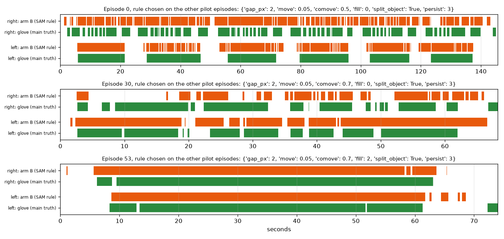

# EXP-24: Arm B splits only when the new object stays nearest

Date: 2026-10-28. Scripts: `scripts/contact_cut.py rule`, `scripts/muse_contact.py selftest`.
Raw output: `out/contact/rule_report.json`, `rule_segments.json`, `out/number1/selftest.json`
(the EXP-22 run is kept as `rule_report_exp22.json`, `rule_segments_exp22.json`,
`selftest_exp22.json`).
Meta API cost: $0. Pilot tuning episodes 0, 30 and 53.

## Question

EXP-22 let arm B start a new contact when the nearest object changes. This
doubled boundary F1, but arm B found 392 boundaries for 190 true ones,
because the nearest object flickers between the held object and its
neighbours. Does it help to count a change only when the new object stays
nearest for a few frames?

This is a code check before the 50 tuning episodes (decision D1). Three
episodes cannot settle which option is best.

## Setup

- New option `persist` in the arm B grid: 1, 3 or 5 frames at 10 fps. A
  switch of the nearest object that lasts fewer frames is read as the object
  held before. 1 is the EXP-22 rule. It only matters with "split on object
  change".
- Unit check on a made-up id sequence: short switches are removed, switches
  of at least `persist` frames are kept, frames with no id stay unknown.
- Same leave-one-episode-out search as EXP-14 and EXP-22. The grid now has
  432 settings. Main ground truth: the cleaned glove.
- Ablation: the EXP-22 rule chosen for each left-out episode, with only
  `persist` changed (1, 2, 3, 5, 8).

## Results

Leave one episode out, cleaned glove:

| | EXP-22 arm B | EXP-24 arm B | Always in contact |
| --- | --- | --- | --- |
| Boundary F1 ±5 | **0.151** | 0.145 | 0.02 |
| Boundary F1 ±15 | **0.323** | 0.291 | 0.02 |
| Contact IoU | 0.663 | **0.718** | 0.669 |
| Boundaries found / true | 392 / 190 | 360 / 190 | 12 / 190 |
| Arm C ceiling, boundary F1 ±5 | **0.315** | 0.297 | |

All three left-out episodes chose `persist` 3. The raw glove gives the same
picture (F1 0.164 and 0.299, IoU 0.717).

Only `persist` changed, everything else as chosen in EXP-22:

| persist | F1 ±5 | F1 ±15 | IoU | Boundaries found / true |
| --- | --- | --- | --- | --- |
| 1 (EXP-22) | 0.151 | 0.323 | 0.663 | 392 / 190 |
| 2 | 0.145 | 0.287 | 0.691 | 388 / 190 |
| 3 | 0.124 | 0.288 | 0.702 | 344 / 190 |
| 5 | 0.109 | 0.243 | 0.717 | 270 / 190 |
| 8 | 0.087 | 0.214 | 0.730 | 202 / 190 |

*Green: cleaned glove. Orange: arm B chosen on the other two episodes, now
with persist 3. The left hand in episode 0 is still cut into pieces during
long holds, but fewer than in EXP-22.*

## Conclusion

- Waiting for the new object to stay nearest is a trade-off, not a fix. It
  removes false splits (IoU 0.66 to 0.72, now above "always in contact") and
  also removes true ones (F1 at ±5 0.151 to 0.145, arm C ceiling 0.315 to
  0.297).
- Even at 8 frames, when arm B finds about as many boundaries as there are
  (202 for 190), F1 at ±5 is only 0.087. Most of the found boundaries are in
  the wrong place, not just too many. The weak part of arm B is where the
  near-runs start and end, not only the object flicker.
- The option stays in the grid. The 50 tuning episodes (P2, $11.89) will pick
  between 1, 3 and 5 with the same search, as decided in D1.
- Runtime: the grid is three times larger. On 50 episodes the leave-one-out
  search is estimated at about 1.5 hours on the CPU, which is fine to run in
  the background.
- Limits: 3 episodes, and the search score (F1 at ±15 plus IoU) favours IoU,
  so it picked persist 3 over 1.
