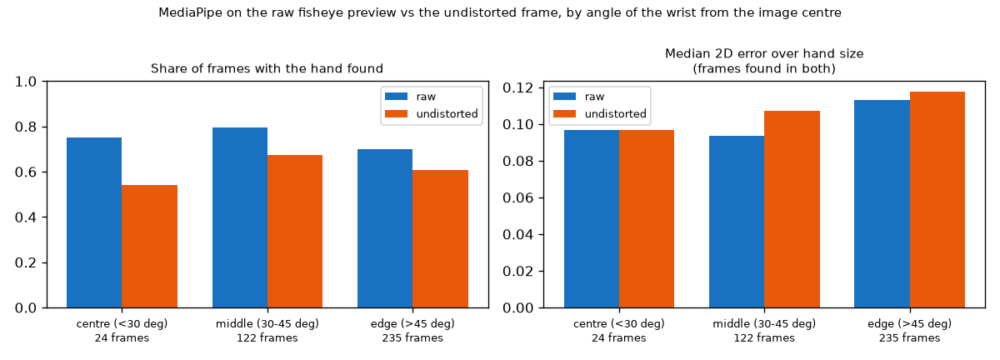
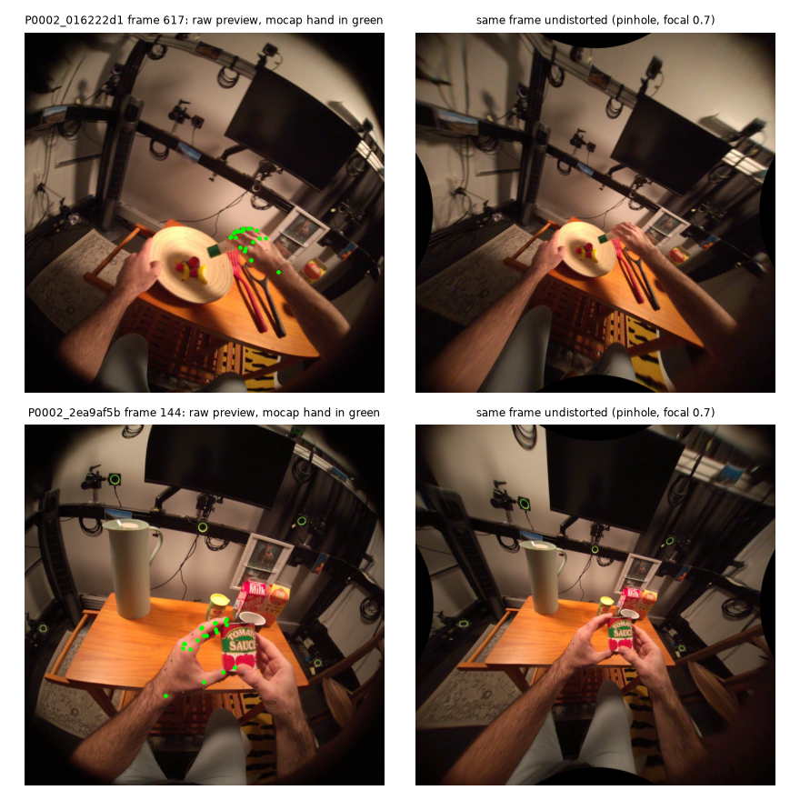

# EXP-25: Does undistorting the fisheye frames help MediaPipe?

Date: 2026-10-28. Script: `scripts/hot3d_fisheye_check.py`.
Raw output: `out/hot3d_checks/fisheye.json`, `fisheye.csv`, `fisheye_rows.json`
(side check: the same files with `_f1.0`).
Meta API cost: $0. Data: tuning persons only (score_train and item_train clips).

## Question

The original plan said to undistort the HOT3D Aria fisheye frames before
MediaPipe. So far MediaPipe runs on the raw fisheye preview. Should we
undistort, or report fisheye as a limit?

## Decision rule (written in the measurement plan before computing)

Undistort only if undistortion raises the share of frames with the hand
found by 5 points or more, or lowers the median 2D point error by 20% or
more, or lowers the median hand shape feature error by 20% or more.
Otherwise keep the raw preview and report fisheye as a limit.

## Setup

- 400 clips of tuning persons, drawn with seed 20261026, the middle contact
  frame of each. 395 frames had a mocap hand pose.
- MediaPipe Hands, static image mode, on two versions of each frame:
  - raw: the preview frame as it is,
  - undistorted: the same frame turned into a pinhole image with the dataset
    lens model (FISHEYE624), focal length 0.7 of the fisheye focal length, so
    that most of the view stays inside the image.
- Truth: the mocap hand (UmeTrack landmarks, EXP-09) projected to the preview
  with the lens model. MediaPipe points from the undistorted frame are mapped
  back to the preview, so both are measured in the same pixels.
- Measures per frame:
  - found: a MediaPipe hand whose median point error is under 0.5 hand size
    (wrist to middle finger base in pixels),
  - 2D error: median point error over hand size,
  - hand shape error: the ten hand shape features of EXP-13 from MediaPipe 3D
    points against the same features from mocap, each over its spread across
    frames, mean over the ten features.
- Side check: the same with focal length 1.0, which keeps the image centre at
  full size but cuts off more of the edge.

## Results

| | Raw preview | Undistorted (focal 0.7) | Change | Needed to undistort |
| --- | --- | --- | --- | --- |
| Hand found | **70.6%** | 60.3% | -10.3 points | +5 points |
| Hand found, hand fully inside the undistorted image (372 frames) | **74.5%** | 63.7% | -10.8 points | |
| 2D error over hand size (212 frames found in both) | **0.102** | 0.113 | 10.8% worse | 20% better |
| Hand shape error (same frames) | 0.832 | 0.775 | 6.9% better | 20% better |

Side check, focal 1.0: hand found 70.6% raw against 62.0% undistorted, 2D
error 0.106 against 0.107, hand shape error 0.827 against 0.805. Only 80% of
the hands are fully inside this image, and on those 77.0% against 71.6%.

Where the hands are: the median wrist is 49 degrees from the image centre,
and 90% of wrists are within 65 degrees. Most grasps happen in the outer part
of the fisheye image, where distortion is strongest.

*Raw (blue) against undistorted (orange), by the angle of the wrist from the
image centre. Undistortion finds fewer hands in every zone. 14 frames beyond
90 degrees by the angle estimate are not shown.*

*Left: raw preview with the mocap hand in green. Right: the same frame
undistorted. Straight edges come out straight, so the lens model is applied
correctly.*

## Conclusion

- Undistortion does not pass the rule. It finds 10 points fewer hands, makes
  the 2D points slightly worse, and improves hand shape by only 7%. The focal
  1.0 side check gives the same answer, so this is not a choice of focal
  length.
- The loss is not only hands cut off at the edge: on hands fully inside the
  undistorted image, MediaPipe still finds 11 points fewer. A likely cause is
  that the pinhole image stretches the outer part, where most hands are, and
  shrinks the centre.
- Decision: keep the raw preview and report fisheye as a limit.
- Side finding: the hand shape error is about 0.8 of the mocap spread in both
  versions. MediaPipe 3D hand shape follows the mocap hand only loosely on
  this footage, with or without undistortion. This fits EXP-17, where video
  hand shape had no signal for the v2 label.
- Muse frames stay raw. Whether Muse judges object size better on undistorted
  frames is not tested, because that costs credit.
- Limits: one frame per clip, MediaPipe only, and the mocap hand as truth
  (about 2 mm from the object surface during grasps, EXP-09).
