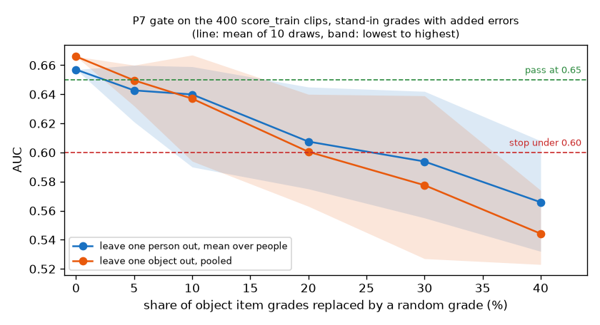

# EXP-26: Code check of the P7 gate and the unseen object report

Date: 2026-10-28. Scripts: `scripts/number2_score.py` (`--gate`, `--check`),
`scripts/number2_gate_noise.py`.
Raw output: `out/number2/gate_standin.json`, `gate_fake_muse_selftest.json`,
`number2_check.json`, `gate_noise.json`.
Meta API cost: $0. Data: tuning persons only. Stand-in grades (EXP-19) take
the place of Muse Spark. Nothing on held-out was used.

## Question

The measurement plan now splits the number 2 Muse Spark run into P7a (400
score_train clips) and P7b (held-out), with a gate in between, and adds a
report on objects the score has never seen (comparison 4). Both were written
before computing. Does the code do what the plan says, and how hard is the
gate to pass?

## Setup

- `number2_score.py --gate`: logistic regression on the six object item
  grades of the 400 score_train clips, v2 label. Leave one person out (mean
  AUC over the six people) and leave one object out (pooled AUC, 95%
  interval resampling sequences). Pass if both are 0.65 or more, stop if
  either is below 0.60, weak in between. It refuses to run until every one
  of the 400 clips has a Muse Spark grade. `--standin` runs it on the
  stand-in grades.
- Unseen object report, now in the output of `--check` and `--final`: for
  each test object, the hand shape fit model, its cut points and the score
  weights are fit again without that object. The object-only reference gives
  every clip the training base rate.
- Checks:
  1. `--check` before and after the change: the earlier outputs must not move.
  2. `--gate` with only the 5 P1 clips graded: it must refuse.
  3. `--gate` on fake Muse grades (stand-ins with 10% of grades replaced at
     random), to run the full real-grade path, including the extra rows.
  4. The hand shape fit refit really changes when an object is left out.
  5. How the gate result falls as grading errors grow: stand-in grades with
     0% to 40% of grades replaced at random, 10 draws each.

## Results

Code checks:

| Check | Result |
| --- | --- |
| `--check` weights, our score, object reference | unchanged |
| `--gate` with 5 of 400 clips graded | refuses: 395 clips have no Muse grade yet |
| `--gate` on fake Muse grades | runs, reports the extra rows; item agreement 91% to 96%, as expected for 10% random replacement |
| Hand shape fit without `mug_white` | 592 of 3,811 clip grades change, so the refit happens |

Gate on stand-in grades (perfect grading, 400 clips):

| Test | AUC | Needed to pass |
| --- | --- | --- |
| Leave one person out, mean over people | 0.657 (0.484 to 0.794 by person) | 0.65 |
| Leave one object out, pooled | 0.666 (0.608 to 0.723) | 0.65 |
| Verdict | pass | |

EXP-19 had 0.683 and 0.666 on all 2,385 tuning clips. On 400 clips the person
test drops to 0.657, just over the bar.

Gate against grading errors:

| Grades replaced at random | About the same as the stand-in | Person out | Object out | Verdicts in 10 draws |
| --- | --- | --- | --- | --- |
| 0% | 100% | 0.657 | 0.666 | pass |
| 5% | 97% | 0.643 | 0.650 | 2 pass, 8 weak |
| 10% | 93% | 0.640 | 0.637 | 1 pass, 8 weak, 1 stop |
| 20% | 87% | 0.608 | 0.600 | 4 weak, 6 stop |
| 30% | 80% | 0.594 | 0.578 | 2 weak, 8 stop |
| 40% | 73% | 0.566 | 0.544 | 10 stop |

A random grade equals the old one a third of the time, so replacing a share r
leaves about 1 - 2r/3 of the grades the same as the stand-in.

*Both gate tests against the share of grades replaced at random. Line: mean of
10 draws. Band: lowest to highest draw.*

Unseen objects in the `--check` run (train item_train, test score_train,
stand-in grades):

| | Main comparison | Unseen objects |
| --- | --- | --- |
| Our score | 0.721 (0.668 to 0.775) | 0.675 (0.618 to 0.731) |
| Object-only reference | **0.776** (0.731 to 0.819) | 0.5 by construction |

## Conclusion

- The code does what the plan says. The earlier outputs did not change, and
  the gate refuses to run on partial Muse grades.
- The gate is tight. With perfect grades it passes by 0.007. At the
  agreement seen in the P1 pilot (27 of 30, 90%, about 15% replaced), the
  expected verdict is "weak", which means a decision with the user before
  P7b. Below about 87% agreement it is most likely "stop".
- Part of this is the sample: 400 clips over six people, about 67 per person,
  and two people (P0003, P0014) are near 0.5 even with perfect grades.
- On tuning clips the object-only reference beats our score in the main
  comparison (0.776 against 0.721). On unseen objects our score keeps 0.675
  while the reference falls to 0.5. This is the reason the unseen object
  report was added, and it is likely to show the same pattern on held-out.
- The gate and its rule are not changed here. They were fixed before any
  Muse grade on the 400 clips exists. Changing them is a decision for the
  user, made before P7a.
- Limits: random replacement is a simple error model. Real Muse errors are
  likely to cluster (for example width near 8 cm in EXP-23), which can hurt
  less or more than random errors.
