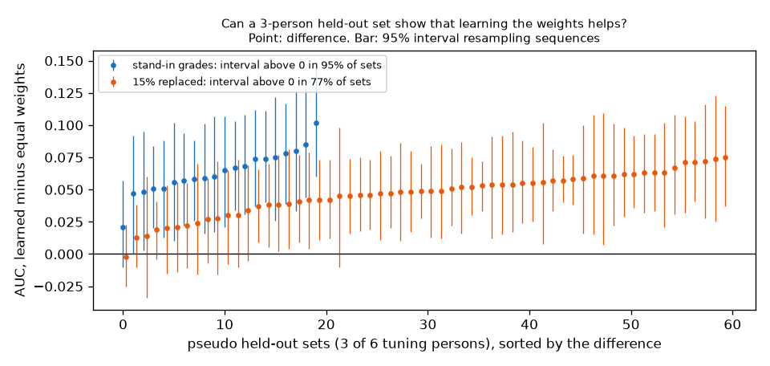

# EXP-27: Code checks for the timing shift and the checklist against learning rows, and a power check

Date: 2026-10-28. Scripts: `scripts/muse_contact.py` (`selftest --lag`, `score`, `c --sample`),
`scripts/number2_score.py --check`, `scripts/number2_power.py`.
Raw output: `out/number1/selftest_lag6.json`, `out/number2/number2_check.json`, `out/number2/power.json`.
Meta API cost: $0. Data: tuning only. No Muse Spark answer is used: number 1
uses answers taken from the glove, number 2 uses the EXP-19 stand-in grades.

## Question

The measurement plan gained two sets of rows, both written before any data:

- Number 1: arms A and C get their own timing shift learned on tuning
  (until now only arm B had one), with a paired bootstrap over episodes.
- Number 2, comparison 5: Muse Spark alone (R1), the checklist grades with
  equal weights (R2), the same grades with learned weights (R3), with paired
  bootstrap differences over sequences.

Does the code do this? And can a held-out set of 3 persons detect "R3 better
than R2" at all?

## Setup

- Number 1: `selftest --lag 6` makes the perfect answers see every change 6
  frames early, like visible contact that comes before glove pressure
  (EXP-06). The arm A and C shifts are then learned on the same 3 pilot
  episodes. A working shift should bring the scores back to the no-lag
  ceilings. The plain `selftest` must give the same file as before.
- Number 2: `number2_score.py --check` (train item_train, test score_train,
  stand-in grades) now also writes comparison 5. The earlier outputs must not
  change.
- Power: for each of the 20 ways to pick 3 of the 6 tuning persons as a
  pseudo held-out set, R3 is trained on 400 clips of the other 3 persons, and
  R3 minus R2 is tested with the paired sequence bootstrap. Once with the
  stand-in grades as they are, once with 15% of grades replaced at random
  (3 draws, about the P1 agreement of EXP-23).

## Results

Number 1, oracle answers 6 frames early, cleaned glove, pilot episodes:

| Row | Boundary F1 ±5 | IoU | Ceiling without lag (EXP-24) |
| --- | --- | --- | --- |
| A | 0.863 | 0.948 | 0.956 |
| A + shift (learned: +3, +3 frames) | **0.956** | 0.975 | |
| C | 0.149 | 0.728 | 0.297 |
| C + shift (learned: +5, +6 frames, moved boundaries only) | **0.307** | 0.750 | |

- The shifts undo the lag. Arm A is quantised at 6 frames (5 fps), so its
  learned shift is 3, half a sample.
- Without a shift, a 6 frame lag halves arm C (0.297 to 0.149). Muse Spark
  picks the visible touch and so removes the arm B shift. This is the case
  the new rows are for.
- The plain selftest output is byte for byte the same as before.
- Paired bootstrap code runs (A + shift minus A: +0.093, C + shift minus C:
  +0.158). With 3 episodes the interval means nothing, it only checks the code.

Number 2, `--check` on tuning, stand-in grades (finger occlusion has no
stand-in, so R2 and R3 use the six object items):

| Row | AUC | 95% interval |
| --- | --- | --- |
| R2 equal weights | 0.647 | 0.592 to 0.699 |
| R3 learned weights | 0.714 | 0.657 to 0.769 |
| Our full score | 0.721 | 0.668 to 0.775 |

| Difference | Value | 95% interval (sequences) |
| --- | --- | --- |
| R3 minus R2 | **+0.067** | 0.014 to 0.120 |
| Our score minus R3 | +0.007 | -0.012 to 0.030 |

- Learned weights: size +2.13, width -1.04, handle -0.21. Equal weights count
  width and handle in the direction of their meaning, which the labels say is
  wrong (EXP-19). That is where learning gains.
- The local and SAM checks add nothing on top of R3 (+0.007), as expected
  from EXP-17.
- The earlier `--check` outputs did not change. The R1 rows ran on the 5 P1
  clips only, as a code path.

Power, pseudo held-out sets of 3 persons (median 1,192 clips, 41 sequences,
held-out has 1,426 clips, 51 sequences):

| Grades | Sets | R3 minus R2, median (range) | Interval above 0 |
| --- | --- | --- | --- |
| Stand-ins as they are | 20 | +0.062 (+0.021 to +0.102) | **95%** of sets |
| 15% replaced at random | 60 | +0.049 (-0.002 to +0.075) | **77%** of sets |

*Each point is one pseudo held-out set, with its 95% interval. Blue: stand-in
grades. Orange: 15% of grades replaced at random.*

## Conclusion

- The timing shift code works: on answers that come 6 frames early it
  recovers the ceilings of arms A and C. Without it, arm C would lose half of
  its ceiling to the lag.
- Comparison 5 works and, on tuning, learning the weights beats equal
  weights by about 0.07 AUC, mainly by turning width and handle around.
- A held-out set of 3 persons is large enough: the gain is detected in 95%
  of sets with perfect grades and 77% with P1-level grade errors.
- Cost found on the way: arm C now has about 120 boundaries per episode
  (EXP-24 arm B), so held-out arm C is about $34, not $5 to $10, and the 200
  tuning boundaries for the arm C shift are about $2.61 (dry run). Both
  depend on the arm B chosen on 50 episodes.
- Limits: the stand-ins are not Muse Spark grades, random errors are a simple
  model of Muse Spark mistakes, and the pseudo held-out persons share objects
  with the training persons, as the real held-out does.
