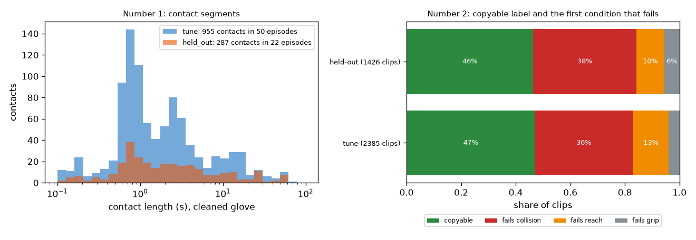

# EXP-28: The ground truth as a reusable benchmark

Date: 2026-10-28. Scripts: `scripts/benchmark_export.py`, `benchmark/score_number1.py`,
`benchmark/score_number2.py`.
Output: `benchmark/` (README, two label files, two license notes, two example
prediction files).
Meta API cost: $0.

## Question

The proposal says teams filter human video with their own rules and do not
publish a score others can reuse. Our heaviest and most checked work is the
ground truth (cleaned glove for number 1, copyable v2 for number 2). Can it be
released as a benchmark that scores any video filter, whatever our own
checklist scores, and do the release scorers give the same numbers as the
project code?

## Setup

- License texts that come with the data: `data/ego-tactile/README.md`
  (OpenGraph: CC BY 4.0) and `data/hot3d/assets/license.txt` (HOT3D: sequence
  data CC BY-SA 4.0, hand data CC BY-NC-SA 4.0, object models CC BY-SA 4.0
  and not for sale). The copyable label uses the hand data, so number 2 is
  shared under CC BY-NC-SA 4.0. This is our reading of the texts, not legal
  advice.
- `benchmark_export.py` writes only labels we made, no video, sensor or
  motion capture values:
  - `number1/ground_truth.json`: per episode and hand, contact segments from
    the cleaned glove (main) and the raw glove, frame ranges at 30 fps,
  - `number2/clips.csv`: per clip, where it is, the copyable label, the first
    condition that fails (grip, reach, collision), and the label at 2 mm and
    10 mm depth limits.
- Two scorers that need only numpy, pandas and scikit-learn, written apart
  from the project code. Checked against numbers the project code already
  gave, on tuning episodes and clips.

## Results

What is in the files:

| | Tuning | Held-out |
| --- | --- | --- |
| Number 1 episodes / clean contacts | 50 / 955 | 22 / 287 |
| Number 2 clips / persons / objects | 2,385 / 6 / 33 | 1,426 / 3 / 33 (all seen in tuning) |
| Number 2 copyable (5 mm) | 47.0% | 46.4% |
| Number 2 copyable at 2 mm / 10 mm | 17.5% / 65.7% | |

The labels written to `clips.csv` equal the labels in the project clip table
for all 3,811 clips (checked in the export).

*Left: length of the cleaned glove contacts. Right: share of clips that are
copyable and, for the others, the first condition that fails.*

Scorer checks, release scorer against project code:

| Input | Release scorer | Project code |
| --- | --- | --- |
| Arm B segments (EXP-24), pilot episodes, cleaned glove: F1 ±5, F1 ±15, IoU | 0.145, 0.291, 0.718 | 0.145, 0.291, 0.718 (EXP-24) |
| Same segments, raw glove | 0.155, 0.293, 0.717 | 0.155, 0.293, 0.717 (selftest) |
| Always in contact, pilot episodes: F1 ±5, IoU | 0.02, 0.669 | 0.02, 0.669 (EXP-14) |
| Object share reference (item_train shares) on score_train clips: AUC, interval | 0.776, 0.731 to 0.819 | 0.776, 0.731 to 0.819 (EXP-26) |
| Same, AUC per person | P0002 0.735 to P0015 0.785, all six equal | equal |

EXP-24 reported 0.164 on the raw glove because there the rule was chosen
again for the raw glove. The exported segments were chosen on the cleaned
glove, and the project selftest gives the same 0.155 for them.

A smoke run of the number 1 scorer on held-out with "always in contact"
gives F1 ±5 0.042 and IoU 0.600 (a reference row, no method involved).

## Conclusion

- The ground truth is now a self-contained benchmark in `benchmark/`, with a
  README, license notes and example inputs. It stays useful whatever our
  checklist scores in the final run.
- The release scorers reproduce the project numbers exactly, so results
  scored with them can be compared with ours.
- Licenses: number 1 can be shared under CC BY 4.0. Number 2 must be shared
  under CC BY-NC-SA 4.0 and not sold, because it uses HOT3D hand data.
- All 33 objects appear in both splits, so the object share lookup is a
  strong reference on held-out. The README says so and asks for a check on
  unseen objects.
- Limits: the benchmark covers 72 episodes of one glove setup and 9 persons
  of HOT3D. The copyable label depends on the collision depth limit, which is
  why the 2 mm and 10 mm labels are included.
