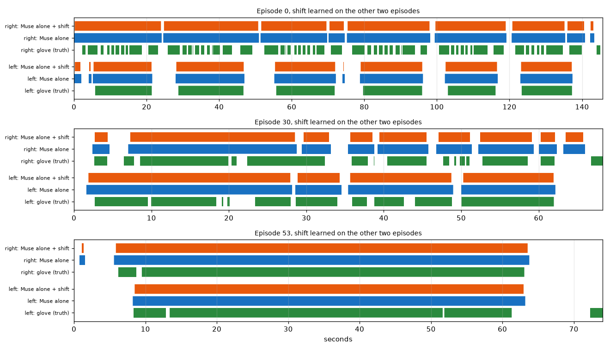
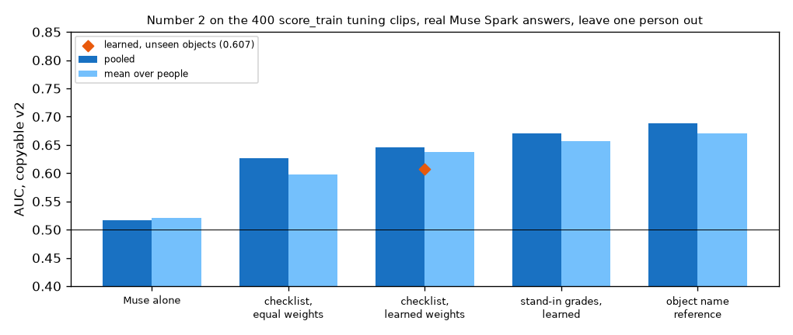

# EXP-29: First real Muse Spark answers on tuning data (arm A on 3 episodes, P7a)

Date: 2026-10-28. Scripts: `scripts/muse_contact.py a`, `scripts/muse_hot3d.py`,
`scripts/tuning_muse_check.py`, `scripts/number2_score.py --gate`.
Raw output: `out/number1/muse_a/`, `out/number2/muse/{checklist,baseline}/`,
`out/tuning_muse_check.json`, `out/number2/gate.json`.
Meta API cost: **$10.62** (arm A $2.64, checklist $4.15, Muse alone $3.83).
Total spent so far: $12.35. Data: tuning only. Nothing on held-out was sent or scored.

## Question

Three claims rested on stand-in grades or simulated answers (EXP-26,
EXP-27). Do they hold with real Muse Spark answers?

1. Timing shift: Muse Spark sees a touch before the glove does, and a shift
   learned from the glove fixes that.
2. Learning: weights learned from the labels beat the plain mean of the
   checklist grades.
3. Unseen objects: our score still works on objects it has not seen, where
   the object name reference cannot.

## Setup

- Number 1: arm A (Muse Spark alone, 10 frames per call at 5 fps) on tuning
  episodes 0, 30 and 53, 146 calls, every frame answered. The shift is
  learned on two episodes and applied to the third, for each episode in turn.
  Main truth: the cleaned glove.
- Number 2: the checklist call and the Muse alone call on the 400 score_train
  clips, every reply parsed. Rows, all scored leave one person out (trained
  on the other five people):
  - R1 Muse alone (its copyable probability),
  - R2 the mean of the seven checklist grades (equal weights, no learning),
  - R3 a logistic regression on the same seven grades,
  - for reference: R3 on the stand-in grades, and the object name reference
    (copyable share of the object in the other people's clips).
  Paired differences with a 95% interval resampling sequences. Leave one
  object out for R3. The P7 gate on the six object items.

## Results

### Number 1: timing shift

| Row | Boundary F1 ±5 | Boundary F1 ±15 | IoU | Start / end error (frames) |
| --- | --- | --- | --- | --- |
| Arm A | 0.062 | 0.171 | 0.804 | -7 / +7 |
| Arm A + shift (learned on the other two episodes) | **0.132** | **0.240** | **0.824** | -5 / +2 |
| Arm B (EXP-24, for reference) | 0.145 | 0.291 | 0.718 | |
| Always in contact | 0.02 | 0.02 | 0.669 | |

- Muse Spark marks a touch about 7 frames (0.23 s) before the glove and its
  end about 7 frames after. The learned shift is the same on every fold:
  +6 to +8 frames at the start, -6 to -7 at the end. For held-out it is
  +7 and -7 (learned on all three).
- The shift doubles boundary F1 at ±5 frames. Over 3 episodes the paired
  interval is 0.000 to 0.132 (difference +0.070), so it is only at the edge.
- Arm A finds 68 boundaries for 190 true ones. It joins short touches into
  one long contact (episode 0, right hand, in the figure), so its IoU is the
  best of all arms (0.80 to 0.82) but its F1 stays low. The perfect-answer
  ceiling at 5 fps was 0.956 (EXP-21), so the limit is what Muse Spark sees,
  not the frame rate.

*Green: cleaned glove. Blue: Muse Spark alone. Orange: the same with the
shift learned on the other two episodes.*

### Number 2: checklist against learning

Leave one person out, 400 clips, 43.5% copyable:

| Row | AUC pooled | Mean over people |
| --- | --- | --- |
| R1 Muse alone | 0.516 | 0.521 |
| R2 checklist, equal weights | 0.627 | 0.597 |
| R3 checklist, learned weights | **0.646** | **0.638** |
| R3 on stand-in grades (perfect grading) | 0.671 | 0.657 |
| Object name reference | 0.688 | 0.670 |

| Difference | Value | 95% interval | Gain |
| --- | --- | --- | --- |
| R2 minus R1 (asking through the checklist) | +0.111 | 0.034 to 0.184 | yes |
| R3 minus R1 | +0.130 | 0.043 to 0.206 | yes |
| R3 minus R2 (learning the weights) | +0.019 | -0.023 to 0.058 | no |
| Object reference minus R3 | +0.042 | 0.002 to 0.083 | reference better |

Unseen objects (leave one object out):

| Row | AUC pooled |
| --- | --- |
| R3 learned, object left out | **0.607** |
| R1 Muse alone (learns nothing) | 0.516 |
| Object name reference | 0.5 by construction |
| R3 minus R1 | +0.091 (0.003 to 0.171) |

Gate (six object items): leave one person out 0.636, leave one object out
0.601 (0.548 to 0.650). Verdict: weak. As decided before P7a, P7b goes ahead.

How often Muse Spark grades equal the stand-ins: size 75%, shape 83%,
thickness 78%, width 49%, handle 90%, free space 62%. The P1 pilot (27 of 30)
was too optimistic. Width is close to a guess.

Weights learned on all 400 clips with real grades: shape +1.30, width +0.99,
finger occlusion +0.45, size +0.37, handle +0.26, thickness -0.30, free
space -0.13. The stand-in weights turned width around (EXP-19, EXP-27). The
real grades do not.

*Leave one person out AUC per row. Diamond: learned weights scored on
objects left out of training.*

## Conclusion

- Claim 1, timing shift: holds on tuning. Muse Spark is about 7 frames early
  at the start and 7 late at the end, the shift is stable across episodes,
  and it doubles boundary F1. Three episodes are too few to be sure. The
  held-out arm A run will settle it.
- Claim 2, learning: does not hold on tuning. Learned weights beat equal
  weights by only 0.019, inside the noise. With real grades the main gain
  comes from the checklist itself: asking Muse Spark item by item beats
  asking it directly by 0.11 AUC. Muse Spark asked directly is close to a
  coin flip (0.52).
- Claim 3, unseen objects: holds on tuning. On objects left out of training
  the checklist score keeps 0.607, against 0.516 for Muse alone and 0.5 for
  the object name reference.
- The object name reference still beats our score on known objects (0.688
  against 0.646), as expected from EXP-26.
- Muse Spark grades the object items less well than the P1 pilot suggested.
  Width (49% equal to the stand-in) is the weakest item.
- These are tuning numbers. The held-out runs (P4 rest, P7b) decide what is
  reported. The comparisons are already fixed in the measurement plan.
