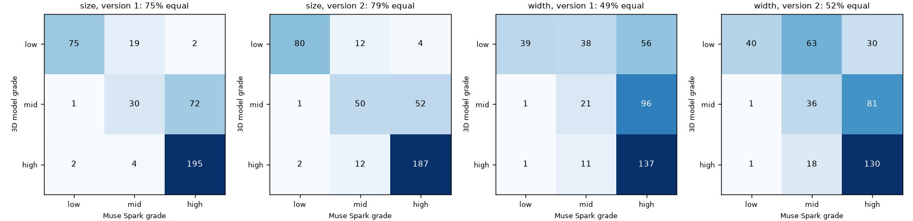
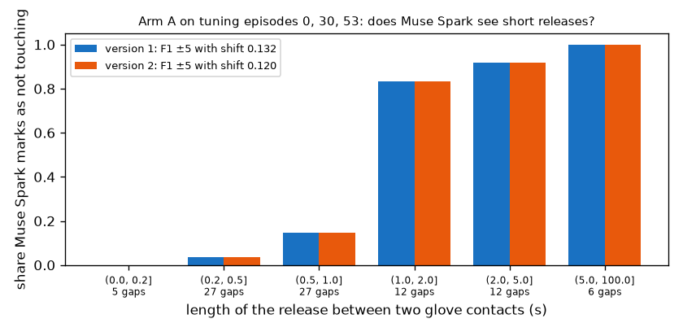

# EXP-30: Where Muse Spark goes wrong on tuning, and one prompt revision

Date: 2026-10-28. Scripts: `scripts/prompt_revision_check.py`, `scripts/muse_contact.py a --a-version 2`,
`scripts/muse_hot3d.py --task checklist_v2`.
Prompts: `scripts/prompts/number1_arm_a_v2.txt`, `scripts/prompts/number2_checklist_v2.txt`.
Raw output: `out/number1/muse_a_v2/`, `out/number2/muse/checklist_v2/`, `out/prompt_revision.json`.
Meta API cost: **$6.71** (arm A version 2 $2.64, checklist version 2 $4.07).
Total spent so far: $19.06. Data: tuning only. Nothing on held-out was sent or scored.

## Question

EXP-29 gave the first real Muse Spark answers. Before any held-out call the
prompts can still change. Where does Muse Spark go wrong, and does one
revision of each prompt fix it? The rule that picks the version for held-out
was written in the measurement plan before the revised prompts were sent
("One prompt revision on tuning").

## Error analysis of version 1 (free)

Number 2 checklist, 400 score_train clips, Muse grade against the 3D model
grade (EXP-19 stand-ins):

- Size: 72 of 103 mid-size objects (15 to 25 cm) are called small.
- Width: 56 of 133 objects wider than 14 cm are called "up to 8 cm". Muse
  Spark seems to judge the part in the hand, not the whole object.
- Thickness: 54 of 323 objects of 4 cm or more are called thin.
- Handle is good (90% equal). Free space is noisy (62%).
- Muse Spark alone: 72% of its answers are 0.85 or more and 27% are 0.25 or
  less. Its mean answer per object has a rank correlation of 0.09 with the
  copyable share of that object. It rates keyboard, bowl and juice carton
  (0% to 8% copyable) as likely. It does not know which objects fail.

Number 1 arm A, tuning episodes 0, 30, 53: Muse Spark covers the glove
contacts well (77% to 100% of contact frames), but it rarely marks a short
release between two contacts as "not touching":

| Release length | Releases | Marked "not touching" at least once |
| --- | --- | --- |
| up to 0.2 s (below the 5 fps sampling) | 5 | 0% |
| 0.2 to 0.5 s | 27 | 4% |
| 0.5 to 1 s | 27 | 15% |
| 1 to 2 s | 12 | 83% |
| over 2 s | 18 | 94% |

So arm A joins touches that are less than 1 s apart, which is why it finds
68 of 190 boundaries.

## The revisions

- Checklist version 2: Muse Spark gives the three sides of the whole object
  in cm, with the hand as a ruler (hand length 19 cm, palm width 8.5 cm,
  finger thickness 2 cm, no object examples). Our code turns the numbers into
  the size, shape, thickness and width grades with the EXP-19 anchors.
  Handle, free space and finger occlusion are asked as before.
- Arm A version 2: the prompt says that a hand which lets go for a moment
  between two grasps is not touching, and asks to look for a visible gap in
  every frame.
- Muse Spark alone keeps its prompt (it is the comparison the proposal
  defines). This is a limit of the comparison: the checklist got one
  revision on tuning, Muse alone none.

## Results

Number 2, 400 score_train clips, leave one person out:

| | Version 1 | Version 2 |
| --- | --- | --- |
| Size equal to 3D model grade | 75% | 79% |
| Shape | 83% | 85% |
| Thickness | 78% | 84% |
| Width | 49% | 52% |
| Handle / free space | 90% / 62% | 90% / 61% |
| R2 equal weights, pooled / mean over people | 0.627 / 0.597 | 0.632 / 0.623 |
| **R3 learned, pooled / mean over people** | 0.646 / **0.638** | 0.611 / **0.625** |
| R3, objects left out | 0.607 | 0.596 |

Version 2 cm estimates against the 3D model box (median ratio, middle half):
longest side 0.97 (0.86 to 1.04), middle side 0.86 (0.72 to 1.03), shortest
side 0.85 (0.65 to 0.99). The longest side is read well. The other two are
underestimated, so width stays the weakest item.

*Muse Spark grade against the 3D model grade for size and width, versions 1
and 2. Version 2 moves some mid-size objects out of "small", but many wide
objects are still called narrow.*

Number 1, arm A, tuning episodes 0, 30, 53, shift learned on the other two:

| | Version 1 | Version 2 |
| --- | --- | --- |
| Boundary F1 ±5, with shift | **0.132** | 0.120 |
| Boundary F1 ±15, with shift | 0.240 | 0.248 |
| IoU, with shift | 0.824 | 0.826 |
| Boundaries found (of 190) | 68 | 76 |
| Learned shift (start, end) | +7, -7 | +7, -6 |

Version 2 changed only 29 of 1,442 frame answers (2%). The releases it newly
caught and newly missed cancel out, so the release table is the same.

*Share of glove releases that Muse Spark marks as "not touching", by release
length, for both versions.*

## Decision (by the rule fixed before sending)

- Checklist: version 2 R3 (0.625) is not higher than version 1 (0.638), so
  **version 1 stays** for P7b.
- Arm A: version 2 F1 (0.120) is not higher than version 1 (0.132), so
  **version 1 stays** for held-out. The held-out shift is +7, -7.
- No further revision, as written in the plan.

## Conclusion

- Muse Spark's object errors are systematic: it sees objects as smaller and
  narrower than they are. Asking for centimetres makes the grades more
  accurate (size, shape and thickness up by 2 to 6 points), but the learned
  score does not get better. With 400 clips the difference (0.013) is within
  noise either way.
- Muse Spark alone does not know which objects a robot hand fails on. This is
  knowledge only the sensor-based label has, and it is the gap the checklist
  closes (EXP-29: 0.52 to 0.63 or more).
- Arm A cannot see releases shorter than about 1 s, and a prompt does not
  change that. At 5 fps a 0.5 s release is 2 to 3 frames in which the hand
  is still very close to the object. This limits arm A boundary F1, not
  the frame rate (the perfect-answer ceiling is 0.956).
- Both held-out runs use version 1 prompts, as before.
