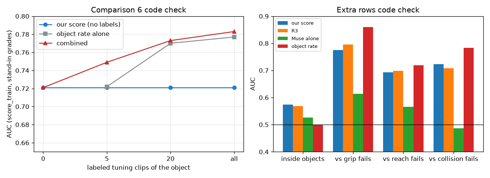

# EXP-31: Code check for comparison 6 and the extra rows

Date: 2026-10-28. Script: `scripts/number2_score.py --check` (new functions
`object_rate_add_on`, `extra_rows`, `pair_auc`, `draw_rates`), fake-data checks
in `scripts/check_paid_cache.py`.
Raw output: `out/number2/number2_check.json` (keys `object_rate_add_on`, `extra`).
Meta API cost: $0. Data: tuning only. Train item_train (1,985 clips), test
score_train (400 clips). The six object items are the EXP-19 stand-in grades,
not Muse Spark. Muse alone is the real P7a answer.

## Question

The October 28 proposal added comparison 6 (the object rate as an add-on) and
two extra rows (AUC inside each object, AUC per failure reason). Their rules
were written in the measurement plan before computing. Does the code follow
them, and does it leave the earlier outputs unchanged?

## Setup

- Comparison 6, as in the plan. For k = 5, 20 and all labeled clips of the
  object, the object rate is (copyable + 1) / (k + 2). A logistic regression
  on logit(our score) and logit(object rate) is trained on the training
  clips, with our score left one person out and rates drawn from other
  persons. It is applied to the test clips. 20 draws for k = 5 and 20. Paired
  bootstrap over sequences (1,000 draws).
- In check mode the labeled pool is item_train (1,985 clips), so the
  score_train test clips are never in it. In the final run it is all 2,385
  tuning clips.
- Extra rows. AUC inside each object is the share of correctly ordered pairs
  from the same object, ties counting half. The failure reason is
  `failed_condition` from `benchmark/number2/clips.csv`. The code stops if its
  copyable label differs from `clips_final.csv` (it matches on all 3,811 clips).
- Fake-data checks: the AUC inside groups equals the sklearn AUC per group,
  weighted by pairs, also with many ties. Rates leave out the clip's own
  person and give 1/2 for an unseen object.

## Results

The fake-data checks pass (30 of 30 in `check_paid_cache.py`). Every earlier
key of `number2_check.json` is byte for byte the same. The run takes about
70 seconds.

Comparison 6 (score_train, stand-in grades):

| Labeled clips | Object rate alone | Combined | Combined minus rate | Combined minus our score |
| --- | --- | --- | --- | --- |
| 0 | | 0.721 (our score) | | |
| 5 | 0.722 | 0.749 | +0.027 (-0.002 to 0.060) | +0.028 (-0.013 to 0.061) |
| 20 | 0.770 | 0.773 | +0.003 (-0.010 to 0.017) | +0.052 (0.014 to 0.091) |
| all | 0.777 | 0.783 | +0.005 (-0.006 to 0.019) | +0.061 (0.028 to 0.095) |

The weight on our score falls from 0.63 (k = 5) to 0.22 (all) as the object
rate gets more reliable.

Extra rows (score_train):

| Score | Inside objects | Inside object and person | vs grip fails (22) | vs reach fails (50) | vs collision fails (154) |
| --- | --- | --- | --- | --- | --- |
| Our score | 0.574 (0.495 to 0.652) | 0.520 | 0.775 | 0.693 | 0.723 |
| R3 (learned grades) | 0.568 (0.505 to 0.636) | 0.550 | 0.795 | 0.698 | 0.708 |
| Muse alone | 0.526 (0.450 to 0.613) | 0.532 | 0.614 | 0.566 | 0.486 |
| Object rate | 0.500 (by construction) | 0.500 | 0.860 | 0.719 | 0.783 |

Pairs from the same object are 1,074, or 2.7% of all pairs. Only 10 objects
have 5 or more clips of each kind in these 400 clips (27 on held-out).

## Conclusion

The code for comparison 6 and the extra rows works and follows the plan. The
earlier outputs do not change. These numbers use stand-in grades on tuning
clips. They test the code, and they are not results. They suggest what the
held-out run may show: with 5 labeled clips our score still adds to the
object rate, from 20 clips on the object rate alone is as good as the
combination, and inside an object the score is near chance. The final
numbers come only from `--final` on held-out.
