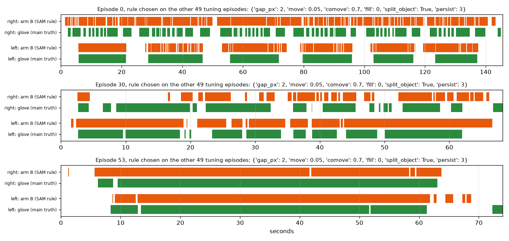

# EXP-32: Arm B (SAM rule) fixed on all 50 tuning episodes (P2)

Date: 2026-10-28. Scripts: `scripts/sam_episodes.py --split tune --send`,
`scripts/contact_cut.py features --split tune`, `contact_cut.py rule`,
`contact_cut.py rule-apply --train tune --apply tune`.
Raw output: `out/sam10/episode_*/`, `out/contact/rule_report.json`,
`out/contact/rule_segments.json` (leave one episode out, the input for the arm C
shift sample), `out/contact/rule_chosen_tune50.json` (the rule chosen on all 50).
Meta API cost: $11.89 (SAM 3.1). Data: tuning only (50 episodes).

## Question

Until now arm B was chosen on 3 pilot episodes (EXP-14, EXP-22, EXP-24). The
plan says to fix its parameters and timing shift on all 50 tuning episodes
before any held-out run. What does arm B score on 50 episodes, leaving one
episode out, and which rule goes to held-out?

## Setup

- SAM 3.1 on the 47 remaining tuning episodes at 10 fps, prompts `hand` and
  `small object`, one request per episode and prompt: 94 requests, 59,444
  billed frames, $11.89. All 100 requests of the 50 episodes have status
  "completed". None failed.
- Arm B grid as before (432 points: gap, object move, co-move, fill, split
  on a change of nearest object, persist). The choice rule is unchanged: best
  boundary F1 at ±15 frames plus contact IoU, then the median start and end
  error as the shift.
- Leave one episode out: the rule and shift for each episode are chosen on
  the other 49. Scores are pooled over episodes and hands.
- Speed-up, no change in result: each grid point is now scored once per
  episode and hand, in parallel, and the folds sum these parts. On the 3 pilot
  episodes the report, the segments and the printout are byte for byte the
  same as before. The 50-episode run takes 16 seconds.

## Results

Leave one episode out, 50 tuning episodes, 100 episode-hands:

| Ground truth | F1 ±5 | F1 ±15 | Precision ±15 | Recall ±15 | IoU | Boundaries (arm B / truth) | Always in contact IoU |
| --- | --- | --- | --- | --- | --- | --- | --- |
| Cleaned glove (main) | 0.153 | 0.294 | 0.204 | 0.522 | 0.683 | 4,880 / 1,910 | 0.623 |
| Raw glove | 0.159 | 0.303 | 0.232 | 0.439 | 0.683 | 4,872 / 2,570 | 0.621 |
| Dataset labels | 0.108 | 0.265 | 0.189 | 0.445 | 0.682 | 3,372 / 1,430 | 0.620 |

- F1 at ±5 per episode ranges from 0.00 to 0.30 (median 0.12).
- The choice is stable: on the cleaned glove 46 of 50 folds pick the same
  rule, the other 4 differ only in the object move threshold.
- The rule for held-out, chosen on all 50 episodes: gap 2 px, object move
  0.05, co-move 0.7, no fill, split on a change of nearest object after 3
  frames, shift +4 frames at the start and -1 at the end.
- Arm C ceiling (oracle answers on pilot episodes 0, 30, 53, cleaned glove)
  with this arm B: boundary F1 at ±5 0.302, the same as with the pilot arm B
  (0.297). Arm A stays at 0.956.
- Arm C cost: arm B makes about 98 boundaries per episode. The tuning shift
  sample (100 starts, 100 ends) costs $2.61. Held-out (22 episodes, about
  2,150 boundaries) would cost about $28.

## Conclusion

On 50 episodes arm B keeps the pilot picture: it beats always in contact on
IoU (0.683 against 0.623) and finds half the glove boundaries within ±15
frames, but it makes 2.5 times too many boundaries, so precision is low and
F1 at ±5 is 0.153. The chosen values sit at the edge of the grid (smallest
gap, smallest move, no fill). The grid stays as written. This rule and shift
are now fixed for held-out. Next paid step: P3, SAM on the 22 held-out
episodes ($5.45).
