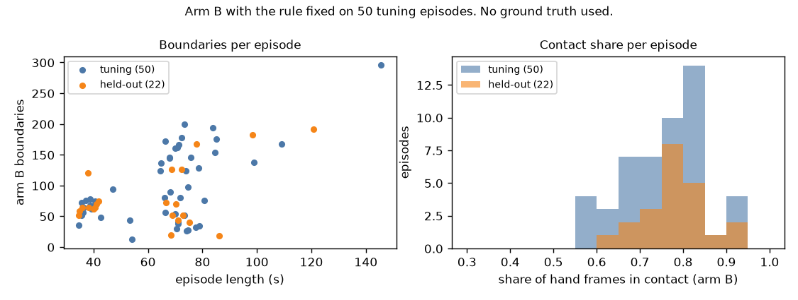

# EXP-33: SAM on the 22 held-out episodes and the fixed arm B applied (P3)

Date: 2026-10-28. Scripts: `scripts/sam_episodes.py --split held_out --allow-held-out --send`,
`scripts/contact_cut.py features --split held_out`,
`contact_cut.py rule-apply --train tune --apply held_out`.
Raw output: `out/sam10/episode_*/` (held-out episodes), `out/contact/features/`,
`out/contact/rule_segments_applied.json` (the final arm B, the input of arm C).
Meta API cost: $5.45 (SAM 3.1). Data: held-out (22 episodes), not scored.

## Question

The plan fixes arm B on the 50 tuning episodes (EXP-32) and then applies it
once to held-out. This step makes the held-out arm B segments, which arm C
needs, without looking at the held-out ground truth.

## Setup

- SAM 3.1 on the 22 held-out episodes at 10 fps, prompts `hand` and
  `small object`, one request per episode and prompt: 44 requests, 27,250
  billed frames, $5.45, the same as the cost shown before sending. All 44
  requests have status "completed". None failed. A rerun of the cost preview
  finds nothing left to send.
- Features: the same code as on tuning. It reads the held-out ground truth
  only for the number of video frames, not for any contact value.
- Arm B: `rule-apply` chooses the rule on the 50 tuning episodes again and
  applies it to held-out. The rule and shift are the same as in EXP-32 (gap
  2 px, object move 0.05, co-move 0.7, no fill, split on a change of nearest
  object after 3 frames, shift +4 frames at the start and -1 at the end).
- No held-out score was computed. Boundary F1 and IoU on held-out wait for
  the final run with arms A and C.

## Results

Arm B segments, without ground truth:

| Split | Episodes | Minutes | Boundaries | Boundaries per minute | Median per episode | Share of hand frames in contact |
| --- | --- | --- | --- | --- | --- | --- |
| Tuning (rule on all 50) | 50 | 54.3 | 4,888 | 90.0 | 77 | 0.764 |
| Held-out | 22 | 22.7 | 1,790 | 78.9 | 64 | 0.789 |

- Held-out boundaries per episode range from 18 to 192. Left hand 454
  segments, right hand 441.
- Arm C cost for held-out from these segments, shown with the cost-only mode
  (nothing sent): 1,790 boundaries, about $23.31. The earlier estimate was
  about $28 (EXP-32, from the tuning rate of about 98 boundaries per episode).
  The tuning sample for the arm C shift stays at 200 boundaries, $2.61.
- Arm A held-out cost, cost-only mode: 693 calls, 6,817 frames, about $11.86.

## Conclusion

The held-out SAM output is complete and arm B is applied with the rule fixed
on tuning. Held-out episodes are a little shorter, so arm B makes fewer
boundaries per episode, and the rate per minute is close to tuning. The
expected total spend drops to about $142. Next paid steps: P4 (arm A,
$11.86) and P5 (arm C, $2.61 for the tuning shift, then about $23.31).
