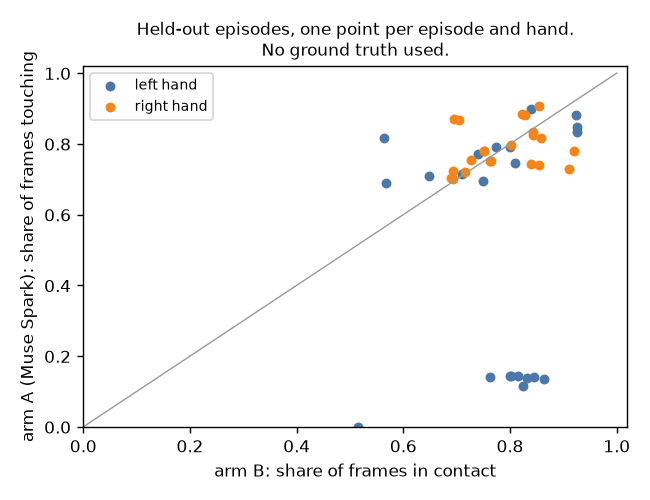

# EXP-34: Arm A (Muse Spark alone) on the 22 held-out episodes (P4)

Date: 2026-10-29. Script: `scripts/muse_contact.py a --split held_out --send`.
Raw output: `out/number1/muse_a/episode_*/` (one file per call),
`out/number1/logs/a_held_out_send.log`.
Meta API cost: $12.44 (Muse Spark). Data: held-out (22 episodes), not scored.

## Question

Arm A asks Muse Spark, 10 frames per call at 5 fps, whether each hand
touches an object. The prompt is version 1, kept by the rule in EXP-30. The
timing shift (+7 frames at the start, -7 at the end) was fixed on tuning
(EXP-29). This step collects the held-out answers. Scoring waits for the
final run with arm C.

## Setup

- 693 calls, 6,817 frames. The code reads the held-out ground truth only
  for the number of video frames, not for any contact value.
- Replies that never parse (plan section "Replies that never parse"): after
  the full run the same command was run once more, then a third time without
  `--send` to count what is left.

## Results

| Pass | Calls sent | Without an answer for every frame | Cost |
| --- | --- | --- | --- |
| First | 693 | 1 | $12.42 |
| Second (resend) | 1 | 0 | $0.02 |
| Third (count only, nothing sent) | 0 | 0 | $0 |

- The one reply that needed the second pass (episode 57, frames 1740 to
  1794) answered 9 of 10 frames. The resend answered all 10. No call gets the
  fallback ("not touching").
- Cost: $12.44 against the $11.86 shown before sending (+4.9%). A call used
  11,946 input tokens and 701 output tokens on average. The input side was
  higher than the 1,100 tokens per frame in the estimate. Arm C uses the same
  estimate, so its real cost may also be about 5% higher than $23.31.
- Answers, without ground truth: Muse Spark marks the left hand touching in
  61.8% of frames and the right hand in 79.6% (tuning episodes 0, 30, 53:
  74.4% and 86.5%).
- In 9 of the 22 episodes (18, 24, 27, 39, 40, 41, 42, 43, 45, all about
  35 to 40 s long) the left hand is touching in at most 14% of frames. In
  these episodes Muse Spark marks the left hand touching once, as one run of
  about 2.5 s, or not at all (episode 39). The replies are well formed. In
  the same episodes arm B puts the left hand in contact in 51% to 86% of frames.
- Over episodes and hands, the share of touching frames from arm A and the
  share from arm B correlate at 0.09.

## Conclusion

All 693 held-out arm A calls have a parsed answer after the one resend, so
the 5% limit is not reached and no fallback is used. The answers are
complete for the final scoring. Arms A and B disagree most on the left hand
in the nine short episodes. Which one is right is decided only by the glove
in the final run. Next paid step: P5 (arm C, $2.61 for the tuning shift,
then about $23.31 to $24.50 for held-out).
