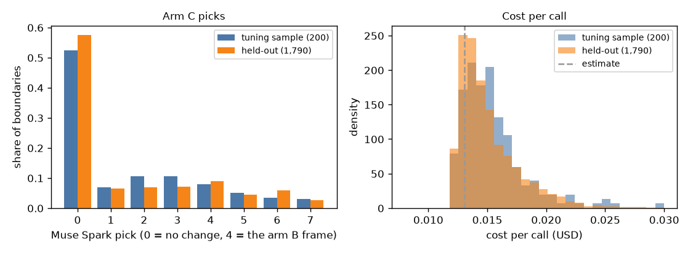

# EXP-35: Arm C (SAM rule + Muse Spark boundary check), tuning shift sample and held-out (P5)

Date: 2026-10-29. Scripts:
`scripts/muse_contact.py c --segments out/contact/rule_segments.json --sample 100 --send` (tuning sample),
`scripts/muse_contact.py c --segments out/contact/rule_segments_applied.json --send` (held-out).
Raw output: `out/number1/muse_c/episode_*/` (one file per boundary),
`out/number1/logs/c_tune_sample_send.log`, `c_held_out_send.log`, `c_held_out_resend.log`.
Meta API cost: $30.28 (Muse Spark): tuning sample $3.09, held-out $27.19.
Data: 200 tuning boundaries and the 1,790 held-out boundaries. Held-out not scored.

## Question

Arm C shows Muse Spark 7 frames around each arm B boundary and asks which
frame is the real start or end (0 means no change). The arm C timing shift is
learned on tuning, from the boundaries Muse Spark moved. This step sends the
tuning sample for that shift (100 starts and 100 ends drawn at random, seed
20261026, from the leave-one-episode-out arm B segments of EXP-32) and then
every boundary of the held-out arm B (EXP-33).

## Setup

- One call per boundary, 7 frames each, at -15, -10, -5, 0, +5, +10 and +15
  frames from the arm B boundary. Frame 4 is the arm B frame itself.
- Replies that never parse (plan section "Replies that never parse"): after
  each full run the same command was run once more, then without `--send` to
  count what is left.
- The held-out part was sent after the user approved its cost at the price
  measured on the tuning sample ($27.63). The first estimate ($23.31) was too
  low.

## Results

| Set | Pass | Calls sent | Without a frame number | API errors | Cost |
| --- | --- | --- | --- | --- | --- |
| Tuning sample | First | 200 | 0 | 0 | $3.09 |
| Tuning sample | Second (resend) | 0 | 0 | 0 | $0 |
| Held-out | First | 1,790 | 0 | 0 | $27.19 |
| Held-out | Second (resend) | 0 | 0 | 0 | $0 |

The count without `--send` finds nothing left in either set. No boundary gets
the fallback (keep the arm B boundary).

Cost per call:

| Set | Input tokens (mean) | Output tokens (mean, 95th percentile) | Cost per call |
| --- | --- | --- | --- |
| Estimate | 7,700 | 800 | $0.0130 |
| Tuning sample | 8,559 | 1,114, 2,337 | $0.0154 |
| Held-out | 8,559 | 1,056, 2,318 | $0.0152 |

Picks, without ground truth:

| Set | Kept (0) | Moved | Moved starts | Moved ends |
| --- | --- | --- | --- | --- |
| Tuning sample | 105 of 200 (52.5%) | 95 | | |
| Held-out | 1,031 of 1,790 (57.6%) | 759 | 342 of 895 | 417 of 895 |

## Conclusion

Every arm C call, tuning and held-out, has a parsed pick after the first
pass, so the 5% limit is not reached and no fallback is used. On held-out
Muse Spark moves 42% of the arm B boundaries, a little fewer than on the
tuning sample (48%). The held-out answers of arms A, B and C are now
complete for number 1. Scoring waits for the final run.
