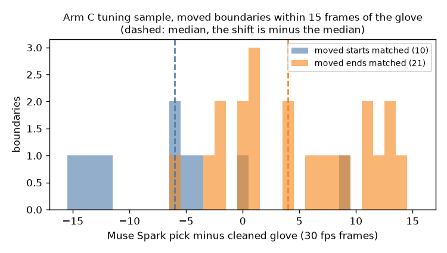

# EXP-36: Separate tuning episodes for the arm A and arm C timing shifts

Date: 2026-10-29. Scripts: `scripts/muse_contact.py score` (new options
`--a-shift-episodes`, `--c-shift-episodes`, `--c-cache`),
`scripts/regression_check.py`, `scripts/check_paid_cache.py`.
Meta API cost: $0. Data: tuning only. Nothing on held-out was scored.

## Question

The plan learns the arm C timing shift from the boundaries Muse Spark moved
in the tuning sample of 200 boundaries (EXP-35). After the paid calls we
found that `muse_contact.py score` used one list of shift episodes for both
arms (default 0, 30, 53). The arm C shift would then have used only the
sample boundaries in those three episodes. The rule for the fix was written
in the plan (section "Timing shift for every arm") before the code changed
and before any held-out score.

## Setup

- `--a-shift-episodes` (default 0, 30, 53): the arm A shift, on the only
  tuning episodes with arm A answers. The score stops if one of them has no
  arm A answers.
- `--c-shift-episodes` (default `tune`, all 50 tuning episodes): the arm C
  shift, with the arm B segments the sample was sent for
  (`out/contact/rule_segments.json`).
- Both lists stop the score if they hold a held-out episode.
- `--c-cache`: the folder of arm C answers. The regression entry
  `score_tune` (pilot arm B segments) now reads an empty folder. The real
  tuning answers were sent for the 50-episode arm B, and their segment
  numbers do not fit the pilot segments, so the cache guard had stopped it.
  A new entry `score_tune50` scores tuning episodes 0, 30, 53 with the real
  answers and the shifts as in the final run.

## Results

Shifts in 30 fps frames, (start, end), added to the arm output:

| Shift | Old code | New code |
| --- | --- | --- |
| Arm A (episodes 0, 30, 53) | +7, -7 | +7, -7 |
| Arm C | 0, -1 (from 1 moved boundary in episode 0) | +6, -4 (from 31 moved boundaries in 20 episodes) |

- Of the 95 moved sample boundaries (41 starts, 54 ends), 10 starts and 21
  ends lie within 15 frames of a glove boundary and enter the shift. Median
  error: starts -6, ends +4. The others are more than 15 frames from any
  glove boundary.
- The arm A shift is the same as the one fixed in EXP-30.
- Regression check: all 12 entries identical after the baselines were saved
  again for `score_tune` and the new `score_tune50`. For `score_tune` only
  the list of shift episodes in the output changed (now one list per arm).
  Every score and interval is byte for byte the same.
- Fake-client checks: 52 of 52 pass. The 6 new ones cover a held-out episode
  in either list, missing arm A answers, the arm C shift using the arm C
  list only, and the `--c-cache` folder.
- The 1,790 held-out arm C answers load against the held-out arm B segments
  without a stop.

## Conclusion

The final score now learns the arm C shift from the whole tuning sample, as
the plan says: +6 frames at the start and -4 at the end, from 31 boundaries.
The old code would have used one boundary. The shift rests on few boundaries,
because two thirds of the moved boundaries are far from any glove boundary.
The paired bootstrap on held-out shows whether the shift adds value. Next:
the number 1 final score on held-out, run once.
