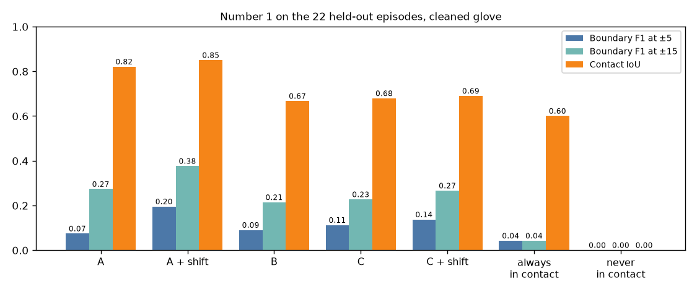

# EXP-37: Number 1 final result on the 22 held-out episodes

Date: 2026-10-29. Scripts:
`scripts/muse_contact.py score --split held_out --segments out/contact/rule_segments_applied.json`
(run once), then `scripts/number1_final_report.py` (the same rows rebuilt with the same shifts, plus
the plan rows the score does not print).
Raw output: `out/number1/final/arms_score_held_out.json`, `score_held_out_stdout.txt`,
`number1_final_report.json`.
Meta API cost: $0 (cached answers from EXP-33, EXP-34, EXP-35). Data: held-out, 22 episodes,
44 episode-hands, 574 glove boundaries (cleaned glove).

## Question

From video alone, when does a touch start and end? Three arms are compared
against the touch glove: A (Muse Spark alone), B (SAM rule), C (SAM rule plus
a Muse Spark boundary check). A and C also get a timing shift learned on
tuning (A: +7 frames at the start, -7 at the end, EXP-30. C: +6 and -4,
EXP-36). Every threshold, prompt and shift was fixed on tuning before this
run.

## Results

Main ground truth, cleaned glove, pooled over episodes and hands:

| Row | F1 ±5 | Precision ±5 | Recall ±5 | F1 ±15 | Contact IoU | Boundaries (row / glove) |
| --- | --- | --- | --- | --- | --- | --- |
| A. Muse Spark alone | 0.074 | 0.090 | 0.063 | 0.273 | 0.821 | 400 / 574 |
| A + shift | **0.195** | 0.254 | 0.159 | **0.376** | **0.850** | 358 / 574 |
| B. SAM rule | 0.090 | 0.059 | 0.185 | 0.214 | 0.667 | 1,790 / 574 |
| C. SAM rule + Muse Spark check | 0.112 | 0.075 | 0.216 | 0.227 | 0.679 | 1,646 / 574 |
| C + shift | 0.137 | 0.094 | 0.253 | 0.266 | 0.690 | 1,546 / 574 |
| Always in contact | 0.042 | 0.159 | 0.024 | 0.042 | 0.600 | 88 / 574 |
| Never in contact | 0 | 0 | 0 | 0 | 0 | 0 / 574 |

Paired bootstrap over the 22 held-out episodes (1,000 draws, F1 at ±5 frames,
cleaned glove), written in the plan before the run:

| Difference | Value | 95% interval | Adds value (interval above 0) |
| --- | --- | --- | --- |
| A + shift minus A | +0.121 | 0.062 to 0.172 | Yes |
| C + shift minus C | +0.025 | 0.019 to 0.032 | Yes |

Added after the run, to read the comparison between arms (descriptive, not
in the plan):

| Difference | Tolerance | Value | 95% interval |
| --- | --- | --- | --- |
| C minus B | ±5 | +0.022 | 0.004 to 0.037 |
| C minus B | ±15 | +0.013 | 0.002 to 0.023 |
| A + shift minus C + shift | ±5 | +0.058 | -0.017 to 0.119 |
| A + shift minus C + shift | ±15 | +0.109 | 0.020 to 0.221 |

Per hand, cleaned glove (F1 ±5, F1 ±15, IoU):

| Row | Left | Right |
| --- | --- | --- |
| A + shift | 0.246, 0.467, 0.875 | 0.159, 0.310, 0.832 |
| B | 0.064, 0.184, 0.614 | 0.113, 0.242, 0.718 |
| C + shift | 0.104, 0.221, 0.632 | 0.167, 0.306, 0.746 |
| Always in contact | 0.016, 0.016, 0.536 | 0.059, 0.059, 0.664 |

Other ground truths (F1 ±5, F1 ±15, IoU):

| Row | Raw glove | Dataset labels |
| --- | --- | --- |
| A | 0.066, 0.239, 0.819 | 0.082, 0.280, 0.818 |
| A + shift | 0.175, 0.320, 0.849 | 0.198, 0.384, 0.847 |
| B | 0.102, 0.236, 0.666 | 0.082, 0.197, 0.665 |
| C | 0.124, 0.249, 0.678 | 0.106, 0.206, 0.676 |
| C + shift | 0.148, 0.281, 0.689 | 0.126, 0.242, 0.687 |
| Always in contact | 0.032, 0.032, 0.599 | 0.026, 0.030, 0.594 |

- Arm B delay against the cleaned glove, median, after its shift: start
  -2 frames, end +2.5 frames on held-out (tuning, leaving one episode out:
  -3 and +1).
- Arm B drops from tuning to held-out: F1 at ±5 0.153 to 0.090, IoU 0.683 to
  0.667. Arm C + shift reaches 0.137 of its 0.302 ceiling (EXP-32).
- Added after, descriptive: the left hand in the 9 short episodes where arms
  A and B disagreed (EXP-34). The glove puts the left hand in contact in
  9.4% of frames there (0% to 11.6%). Muse Spark was right: A + shift IoU
  0.835 and F1 at ±15 0.722 on 20 glove boundaries. Arm B makes 402
  boundaries for those 20 and reaches IoU 0.104.

## Conclusion

On held-out, Muse Spark alone with the timing shift learned from the glove
is the best row on all three metrics: F1 0.195 at ±5 frames, 0.376 at ±15,
IoU 0.850. The glove shift adds value to both Muse Spark arms, by the rule
fixed before the run. The Muse Spark boundary check improves the SAM rule
(C over B, +0.022 at ±5), but C stays below A + shift because the SAM rule
makes about three times too many boundaries and C can only move them. A +
shift over C + shift is clear at ±15 frames and not clear at ±5. All rows
are low at ±5 frames (0.167 s), as the plan expected, because the glove
measures pressure that video cannot see.
