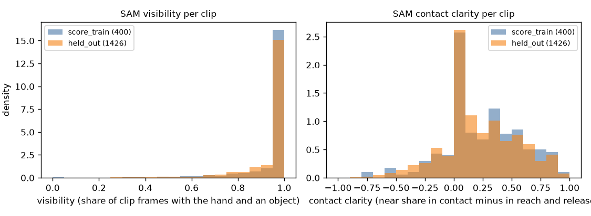

# EXP-38: SAM on the number 2 windows, score_train and held-out (P6)

Date: 2026-10-29. Scripts: `scripts/sam_hot3d.py --role score_train --send`,
`scripts/sam_hot3d.py --role held_out --send`, `scripts/number2_sam_checks.py`.
Raw output: `out/number2/sam/<window_id>/`, `out/number2/sam_checks.csv`,
`out/number2/logs/sam_score_train_send.log`, `sam_held_out_send.log`.
Meta API cost: $26.48 (SAM 3.1). Data: the 400 score_train clips and the
1,426 held-out clips of number 2. Nothing was scored against the copyable label.

## Question

Two of the number 2 checks come from SAM 3.1 masks: visibility and contact
clarity. This step sends every number 2 window to SAM and computes the two
grades for every score_train and held-out clip.

## Setup

- Windows from `hot3d_number2_inputs.py windows`: overlapping clips of one
  sequence share one window, at 10 fps. Prompts `hand` and `small object`,
  one request per window and prompt. The 3 pilot windows of EXP-23 were
  already done.
- The cost was checked again before sending. The score_train part went first,
  and its billed frames were compared with the estimate before the held-out
  part was sent.
- `number2_sam_checks.py` uses only the SAM masks and the clip start, length
  and hand. It does not read the copyable label. Grades are high, mid and low
  from the terciles of the score_train clips.

## Results

| Role | Windows | Requests | Completed | Billed frames (estimate) | Cost |
| --- | --- | --- | --- | --- | --- |
| score_train | 315 | 624 | 624 | 43,592 (43,592) | $8.72 |
| held-out | 198 | 396 | 396 | 88,814 (88,824) | $17.76 |

- No request failed. A recount without `--send` finds nothing left in
  either role. The price per frame matched the estimate.
- Every one of the 1,826 clips has both grades. None is missing.

| Role | Clips | Visibility mean | Visibility = 1 | Contact clarity mean | Contact clarity at or below 0 |
| --- | --- | --- | --- | --- | --- |
| score_train | 400 | 0.957 | 73.0% | 0.249 | 29.5% |
| held-out | 1,426 | 0.950 | 69.3% | 0.217 | 33.0% |

- Visibility has only two grades. Most score_train clips have visibility 1,
  so the lower and upper tercile cuts fall on the same value. score_train:
  108 low, 292 high. Held-out: 438 low, 988 high.
- Contact clarity grades, score_train: 126 low, 121 mid, 153 high. Held-out:
  506 low, 467 mid, 453 high.

## Conclusion

All number 2 SAM windows are done for $26.48, at the estimated price. The two
SAM grades exist for every score_train and held-out clip. Visibility is near
1 for most clips, so it can only split off the clips where SAM loses the hand
or the object. Next paid steps: P7b (Muse Spark checklist and baseline on the
1,426 held-out clips, about $27.6) and P7c (soft object check, about $14,
after the labels are filled in).
