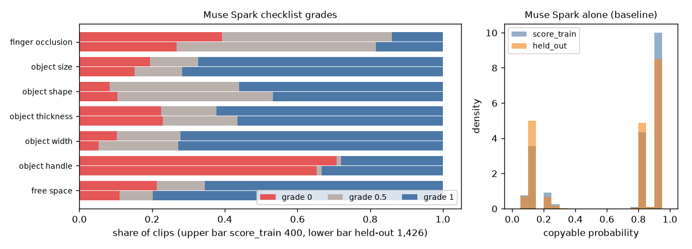

# EXP-39: Muse Spark checklist and Muse Spark alone on the 1,426 held-out clips (P7b)

Date: 2026-10-29. Scripts: `scripts/muse_hot3d.py --task checklist --role held_out --send`,
`scripts/muse_hot3d.py --task baseline --role held_out --send`.
Raw output: `out/number2/muse/checklist/`, `out/number2/muse/baseline/` (one file per clip),
`out/number2/logs/muse_*_held_out_*.log`.
Meta API cost: $28.56 (Muse Spark). Data: the 1,426 held-out clips of number 2. Nothing was scored
against the copyable label.

## Question

Number 2 needs two Muse Spark answers per held-out clip: the checklist (six
object items plus finger occlusion, prompt version 1, kept by the rule in
EXP-30) and Muse Spark alone (the baseline: a copyable probability). The gate
after P7a was "weak", and by the decision made before P7a this step goes
ahead (EXP-29).

## Setup

- One checklist call and one baseline call per clip, 2,852 calls.
- Cost limit set by the user before sending: the estimate at the P7a price
  per call, about $28.8. The checklist went first. Its real cost plus the
  baseline at the P7a price ($13.83) had to stay under $28.8 before the
  baseline was sent.
- Replies that never parse (plan section "Replies that never parse"): after
  each full run the same command was run once more, then without `--send` to
  count what is left.

## Results

| Call | Pass | Calls sent | Did not parse | API errors | Cost | Cost per call (P7a) |
| --- | --- | --- | --- | --- | --- | --- |
| Checklist | First | 1,426 | 0 | 0 | $14.66 | $0.01028 ($0.01051) |
| Checklist | Second (resend) | 0 | 0 | 0 | $0 | |
| Baseline | First | 1,426 | 0 | 0 | $13.90 | $0.00975 ($0.00970) |
| Baseline | Second (resend) | 0 | 0 | 0 | $0 | |

- Total $28.56, under the $28.8 limit. After the checklist the projection
  was $28.49, so the baseline was sent.
- Every one of the 1,826 number 2 clips (400 score_train, 1,426 held-out) has
  a parsed checklist and a parsed baseline answer. No clip is dropped by the
  plan rule, so the 5% limit is far away.

Answers, without the copyable label:

| Item | Grade 0 / 0.5 / 1, score_train | Grade 0 / 0.5 / 1, held-out |
| --- | --- | --- |
| Finger occlusion | 39% / 47% / 14% | 27% / 55% / 18% |
| Object size | 20% / 13% / 67% | 15% / 13% / 72% |
| Object shape | 8% / 36% / 56% | 10% / 43% / 47% |
| Object thickness | 23% / 15% / 62% | 23% / 21% / 57% |
| Object width | 10% / 18% / 72% | 5% / 22% / 73% |
| Object handle | 71% / 1% / 28% | 65% / 1% / 33% |
| Free space | 21% / 13% / 66% | 11% / 9% / 80% |

- Muse Spark alone gives a copyable probability with a median of 0.85 on
  held-out (score_train 0.89), mean 0.640 (0.685). The answers fall into two
  groups: 0.05 to 0.2 and 0.85 to 0.95. On held-out, 542 clips get 0.90 and
  336 get 0.85.

## Conclusion

All number 2 Muse Spark answers are in, at the P7a price, with no reply that
failed to parse. The held-out grades are close to the score_train grades,
with more free space and less finger occlusion marked as grade 0. Muse Spark
alone mostly answers one of two values, so it ranks clips coarsely. Number 2
can now be scored once on held-out with `number2_score.py --final` (P8, no
API call). The soft object check (P7c) still waits for the labels.
