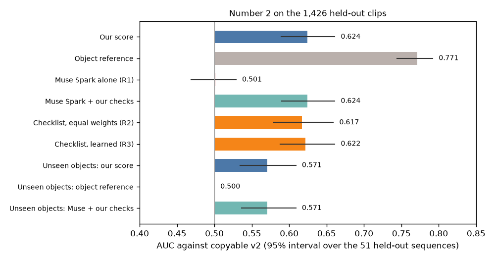

# EXP-40: Number 2 final result on the 1,426 held-out clips (P8)

Date: 2026-10-29. Script: `scripts/number2_score.py --final` (run once).
Raw output: `out/number2/final/number2_final.json`, `number2_final_scores.csv`,
`number2_final_stdout.txt`.
Meta API cost: $0 (cached answers from EXP-29, EXP-38, EXP-39). Data: 400 score_train clips to learn
the weights, 1,426 held-out clips (3 persons, 51 sequences, 46.4% copyable) to score, copyable v2
label (EXP-16, EXP-20).

## Question

Does our score pick clips that a robot hand can copy? The score is a logistic
regression on twelve grades: three local checks (camera stability,
completeness, hand shape fit), two SAM checks (visibility, contact clarity)
and seven Muse Spark checklist grades. Weights are learned on the 400
score_train clips. Every comparison and rule was written in the plan before
this run.

## Setup

- No clip was dropped for a missing Muse Spark answer (train 0, test 0).
- AUC with a 95% interval from a bootstrap over the 51 held-out sequences.
  Paired differences use the same sequences for both rows.

## Results

Main rows (comparisons 1 to 3):

| Row | AUC | 95% interval | P0001 | P0010 | P0012 | Copyable in top 20% (base 46.4%) | One-hand clips |
| --- | --- | --- | --- | --- | --- | --- | --- |
| Our score | 0.624 | 0.589 to 0.661 | 0.638 | 0.625 | 0.603 | 59.4% | 0.588 |
| 1. Muse Spark alone | 0.501 | 0.469 to 0.529 | 0.469 | 0.510 | 0.525 | 46.9% | 0.477 |
| 2. Object reference (object names, tuning rates) | 0.771 | 0.744 to 0.792 | 0.787 | 0.786 | 0.747 | 79.4% | 0.742 |
| 3. Muse Spark alone + our checks | 0.624 | 0.590 to 0.661 | 0.632 | 0.631 | 0.606 | 62.6% | 0.583 |

Comparison 4, unseen objects (every learned part refit without the object
being scored):

| Row | AUC | 95% interval |
| --- | --- | --- |
| Our score | 0.571 | 0.534 to 0.609 |
| Object reference | 0.500 | by construction |
| Muse Spark alone | 0.501 | 0.469 to 0.529 |
| Muse Spark alone + our checks | 0.571 | 0.536 to 0.609 |

Comparison 5, checklist against learning (Muse Spark grades only):

| Row or difference | AUC or difference | 95% interval | Gain by the plan rule |
| --- | --- | --- | --- |
| R1 Muse Spark alone | 0.501 | 0.469 to 0.529 | |
| R2 checklist, equal weights | 0.617 | 0.579 to 0.659 | |
| R3 checklist, learned weights | 0.622 | 0.588 to 0.661 | |
| R2 minus R1 (the checklist) | +0.117 | 0.073 to 0.166 | Yes |
| R3 minus R1 | +0.122 | 0.081 to 0.166 | Yes |
| R3 minus R2 (learning) | +0.005 | -0.019 to 0.032 | No |
| Our score minus R3 (local and SAM checks) | +0.001 | -0.011 to 0.013 | No |

Comparison 6, object rate as an add-on (labeled tuning clips of the object,
pool of 2,385 tuning clips, 20 draws):

| Labeled clips per object | Object rate alone | Combined with our score | Combined minus object rate | Combined minus our score |
| --- | --- | --- | --- | --- |
| 0 (our score) | | 0.624 | | |
| 5 | 0.718 | 0.722 | +0.004 (-0.004 to 0.013), no gain | +0.099 (0.063 to 0.130) |
| 20 | 0.762 | 0.760 | -0.001 (-0.005 to 0.001), no gain | +0.137 (0.100 to 0.167) |
| All | 0.774 | 0.771 | -0.003 (-0.006 to 0.000), no gain | +0.147 (0.112 to 0.176) |

Extra rows:

- AUC inside each object (only pairs of clips of the same object, 13,524
  pairs, 2.7% of all pairs): our score 0.506 (0.461 to 0.544), checklist
  learned 0.457 (0.412 to 0.500), Muse Spark alone 0.532 (0.483 to 0.575),
  object reference 0.5 by construction.
- AUC for each failure reason (copyable clips against clips that fail for
  that reason; held-out: 662 copyable, 538 collision, 146 reach, 80 grip):

| Failure reason | Our score | Object reference | Checklist learned | Muse Spark alone |
| --- | --- | --- | --- | --- |
| Collision (1,200 clips) | 0.611 (0.575 to 0.647) | 0.790 | 0.618 | 0.477 |
| Reach (808 clips) | 0.636 (0.568 to 0.718) | 0.688 | 0.601 | 0.581 |
| Grip (742 clips) | 0.682 (0.584 to 0.770) | 0.797 | 0.694 | 0.516 |

Learned weights (score_train), largest first: object shape 1.252, object width
0.922, finger occlusion 0.481, hand shape fit 0.434, object size 0.391,
object thickness -0.342, completeness -0.331, object handle 0.258, contact
clarity 0.237, free space -0.171, visibility 0.043, camera stability -0.030.
In the plug-in model, Muse Spark alone gets weight 0.358.

## Conclusion

Muse Spark alone cannot tell copyable from non-copyable clips (AUC 0.501).
Our score reaches 0.624, and the gain comes from asking Muse Spark the
checklist, not from learning weights (R2 minus R1 +0.117, R3 minus R2 +0.005)
and not from the local and SAM checks (+0.001). The object name alone beats
our score (0.771), because held-out persons grasp the same objects. On
objects the score has never seen, our score keeps 0.571 where the object
reference has nothing to say. Inside one object the score is at chance
(0.506), so it ranks objects, not grasps. Once 5 or more labeled clips of an
object exist, the object rate alone is as good as the combination.
