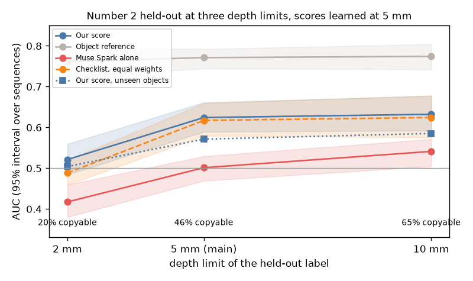

# EXP-41: Number 2 held-out result at the depth limits 2 mm and 10 mm

Date: 2026-10-29. Script: `scripts/number2_depth.py` (new). `scripts/number2_score.py` now has
`unseen_scores` (the comparison 4 scores per clip), used by both scripts.
Raw output: `out/number2/final/number2_depth.json`.
Meta API cost: $0. Data: the 1,426 held-out clips of EXP-40.

## Question

The copyable v2 label allows an Allegro mesh point at most 5 mm inside the
object. The share of copyable clips depends strongly on that limit, and the
plan says the result is reported at 2 mm and 10 mm as well. EXP-40 used 5 mm
only. Does the EXP-40 picture hold when the label is stricter or looser?

## Setup

Written in the plan (section "Depth limit on held-out") before computing:

- Nothing is learned again. All weights, the hand shape fit and the Muse
  Spark rows are learned on the 5 mm label of the 400 score_train clips, as in
  EXP-40. Only the held-out label they are judged against changes
  (`copyable_depth_2mm`, `copyable_depth_10mm` in `benchmark/number2/clips.csv`).
- The object reference takes the share of each object on the 2,385 tuning
  clips at the same depth.
- Rows: comparisons 1 to 5 and the AUC inside each object. Comparison 6 and
  the rows per failure reason stay at 5 mm.
- The 5 mm rows equal EXP-40. The script checks this and stops if not.
- One paired difference was added to the four of comparison 5: our score
  minus Muse Spark alone (comparison 1).

## Results

AUC with the 95% interval over the 51 held-out sequences:

| Row | 2 mm | 5 mm (main, EXP-40) | 10 mm |
| --- | --- | --- | --- |
| Held-out copyable share | 19.9% | 46.4% | 64.7% |
| Our score | 0.521 (0.484 to 0.559) | 0.624 (0.589 to 0.661) | 0.632 (0.592 to 0.677) |
| Muse Spark alone (R1) | 0.417 (0.380 to 0.459) | 0.501 (0.469 to 0.529) | 0.541 (0.504 to 0.571) |
| Object reference | 0.761 (0.724 to 0.793) | 0.771 (0.744 to 0.792) | 0.774 (0.742 to 0.804) |
| Muse Spark alone + our checks | 0.508 (0.473 to 0.545) | 0.624 (0.590 to 0.661) | 0.640 (0.600 to 0.685) |
| Checklist, equal weights (R2) | 0.488 (0.459 to 0.520) | 0.617 (0.579 to 0.659) | 0.624 (0.575 to 0.678) |
| Checklist, learned (R3) | 0.506 (0.469 to 0.547) | 0.622 (0.588 to 0.661) | 0.629 (0.586 to 0.680) |
| Unseen objects: our score | 0.504 (0.466 to 0.545) | 0.571 (0.534 to 0.609) | 0.585 (0.546 to 0.630) |
| Our score inside each object | 0.505 | 0.506 | 0.504 |

Paired differences (95% interval, gain if above 0):

| Difference | 2 mm | 5 mm | 10 mm |
| --- | --- | --- | --- |
| Our score minus Muse Spark alone | +0.104 (0.041 to 0.163) | +0.123 (0.081 to 0.168) | +0.091 (0.037 to 0.152) |
| R2 minus R1 (the checklist) | +0.071 (0.010 to 0.124) | +0.117 (0.073 to 0.166) | +0.082 (0.019 to 0.148) |
| R3 minus R1 | +0.089 (0.029 to 0.148) | +0.122 (0.081 to 0.166) | +0.088 (0.032 to 0.150) |
| R3 minus R2 (learning) | +0.018 (-0.009 to 0.047) | +0.005 (-0.019 to 0.032) | +0.005 (-0.021 to 0.034) |
| Our score minus R3 (local and SAM checks) | +0.015 (-0.001 to 0.029) | +0.001 (-0.011 to 0.013) | +0.003 (-0.011 to 0.018) |

- Our score per person at 2 mm: P0001 0.547, P0010 0.534, P0012 0.483. At
  10 mm: 0.655, 0.630, 0.612.
- Copyable share in the top 20% of our score: 23.1% at 2 mm (base 19.9%),
  76.9% at 10 mm (base 64.7%).

## Conclusion

At 10 mm the EXP-40 picture holds: our score 0.632, Muse Spark alone 0.541,
the checklist adds to Muse Spark alone and learning adds nothing. At 2 mm,
where only 20% of clips are copyable, our score falls to chance (0.521, the
interval covers 0.5) and Muse Spark alone ranks clips the wrong way (0.417).
Our score still beats Muse Spark alone there, but only because Muse Spark
alone is below chance. The object reference stays at 0.76 to 0.77 at every
depth. So the number 2 result depends on the depth limit: it holds for the
5 mm limit fixed in advance and for a looser one, not for a stricter one.
