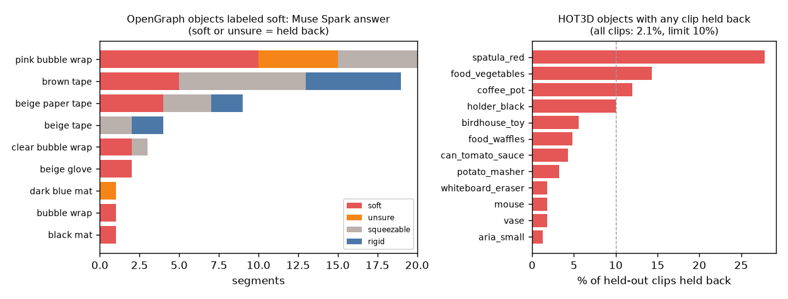

# EXP-42: Soft object check (P7c)

Date: 2026-10-29. Scripts: `scripts/muse_soft.py send --set pilot|hot3d|opengraph --send`,
`scripts/muse_soft.py score`. Prompt: `scripts/prompts/soft_object.txt` (fixed in the plan).
Labels: `splits/softness_labels.csv` (commit 0ced28f).
Raw output: `out/soft/muse/` (one file per item), `out/soft/soft_check.json`, `out/soft/logs/`.
Meta API cost: $9.11 (Muse Spark): pilot $0.11, HOT3D $6.64, OpenGraph $2.36.

## Question

The October 28 proposal limits the score to rigid objects. One more Muse
Spark question per clip (rigid, squeezable, soft or unsure) is meant to take
soft objects out of the score: soft or unsure means no score. Does Muse Spark
catch the soft objects, and does it leave the rigid HOT3D clips alone?

## Setup

Fixed in the plan (section "Soft object check") before any call:

- Ground truth: every object name labeled rigid, squeezable or soft by two
  team members on their own, then an agreed label. Agreement before
  settling: 81.7% of 104 names, Cohen's kappa 0.613 (HOT3D 0.891, OpenGraph
  0.533, as reported by the labelers). Agreed labels: HOT3D 28 rigid, 5
  squeezable. OpenGraph 52 rigid, 10 squeezable, 9 soft.
- Four OpenGraph names marked "excluded from the experiment" in the sheet
  (the object was not found in the video) are not sent or scored: white glove,
  beige gloves, white bubble wrap, green plant. "yellow sponge" is a
  whiteboard eraser (rigid plastic with a thin pad) and is labeled rigid.
- Data: all 1,426 HOT3D held-out clips (3 frames each), all 280 remaining
  OpenGraph held-out contact segments, plus the 56 tuning segments of soft
  objects (3 frames each). 60 segments of 9 objects are labeled soft.
- Held back = the answer is soft or unsure. A reply that does not parse is
  sent once more, and counts as unsure after two failures.
- Pass: at least 70% of soft segments held back and at most 10% of HOT3D
  clips held back. No verdict with fewer than 20 soft segments or 4 soft
  objects.
- The pilot (10 score_train HOT3D clips and 10 rigid OpenGraph tuning
  segments, not part of the scored sets) went first. Its cost per item was
  below the estimate (HOT3D $0.0044 against $0.0073, OpenGraph $0.0068
  against $0.0091), so the full sets were sent.

## Results

| Set | Items | Did not parse | API errors | Cost |
| --- | --- | --- | --- | --- |
| Pilot | 20 | 0 | 0 | $0.11 |
| HOT3D held-out | 1,426 | 0 | 0 | $6.64 |
| OpenGraph | 336 | 0 | 0 | $2.36 |

Every item has a parsed answer. No item was forced to unsure.

| Metric | Value | Pass rule | Met |
| --- | --- | --- | --- |
| Soft segments held back | 51.7% (31 of 60, 9 objects), 95% interval by object 30.8% to 74.4% | at least 70% | No |
| HOT3D clips held back | 2.1% (30 of 1,426) | at most 10% | Yes |
| **Verdict** | **fail** | | |

- Held-out segments only: 1 of 4 soft segments held back (25%).
- OpenGraph held-out segments labeled rigid are held back in 18.1% (35 of
  193), squeezable in 1.2%.
- HOT3D: rigid clips held back 2.4%, squeezable 0%. The most held back
  objects are spatula_red (27.8%), food_vegetables (14.3%), coffee_pot
  (12.0%) and holder_black (10.0%).
- Muse Spark answers on the 60 soft segments: soft 25, unsure 6, squeezable
  19, rigid 10.

| Soft object | Segments | Soft | Unsure | Squeezable | Rigid | Held back |
| --- | --- | --- | --- | --- | --- | --- |
| pink bubble wrap | 20 | 10 | 5 | 5 | 0 | 75% |
| brown tape | 19 | 5 | 0 | 8 | 6 | 26% |
| beige paper tape | 9 | 4 | 0 | 3 | 2 | 44% |
| beige tape | 4 | 0 | 0 | 2 | 2 | 0% |
| clear bubble wrap | 3 | 2 | 0 | 1 | 0 | 67% |
| beige glove | 2 | 2 | 0 | 0 | 0 | 100% |
| black mat | 1 | 1 | 0 | 0 | 0 | 100% |
| bubble wrap | 1 | 1 | 0 | 0 | 0 | 100% |
| dark blue mat | 1 | 0 | 1 | 0 | 0 | 100% |

- Added after the verdict, descriptive only: the three tape names hold 32 of
  the 60 soft segments and Muse Spark holds back 9 of them (28%). The other
  six soft objects are held back in 22 of 28 segments (79%). For two of the
  tape names the labelers disagreed before settling (squeezable and soft).
- Our number 2 score on HOT3D held-out: AUC 0.624 on all 1,426 clips, 0.625
  (0.590 to 0.663) on the 1,396 clips that are kept.

## Conclusion

The soft object check fails the rule fixed in advance. Muse Spark leaves
rigid HOT3D clips alone (2.1% held back) but catches only half of the
segments labeled soft (51.7%, rule 70%). Most misses are tape, which Muse
Spark calls squeezable or rigid. Bubble wrap, gloves and mats are mostly
caught. It also holds back 18% of rigid OpenGraph segments. So the soft
object step of the proposal is not supported as it stands: a "soft or unsure"
answer from Muse Spark is not enough to keep soft objects out of the score.
Dropping the held-back HOT3D clips leaves the number 2 AUC unchanged.

As the measurement plan asks for a failed check, the viewer has a Touch check
tab (added 2026-10-29, `scripts/viewer_data.py`, no call). It lists the 30
held-back HOT3D held-out clips, marked as not validated: 28 answered soft and
2 unsure, from 12 objects, led by coffee_pot (6), food_vegetables (5),
holder_black (5) and spatula_red (5). All 12 objects are labeled rigid.
